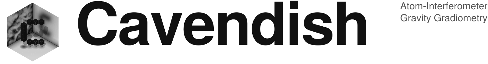
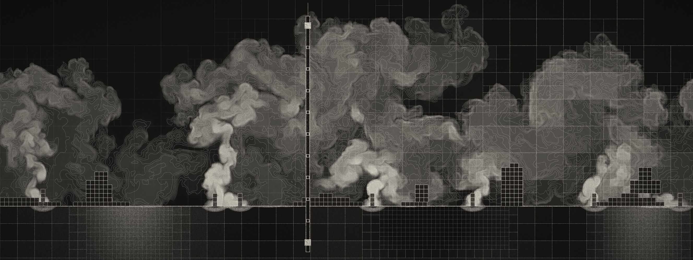
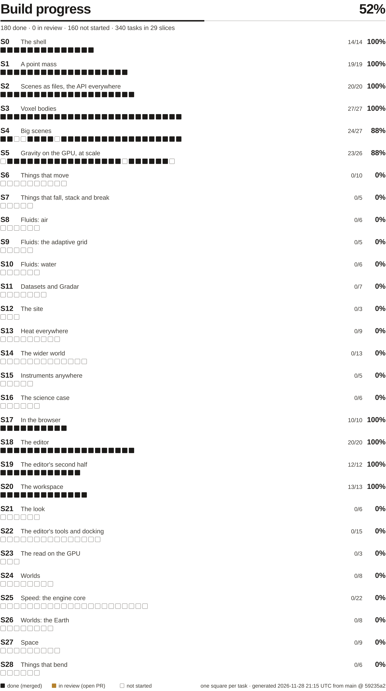
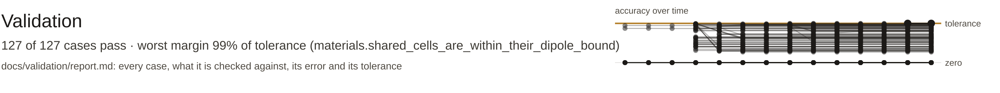
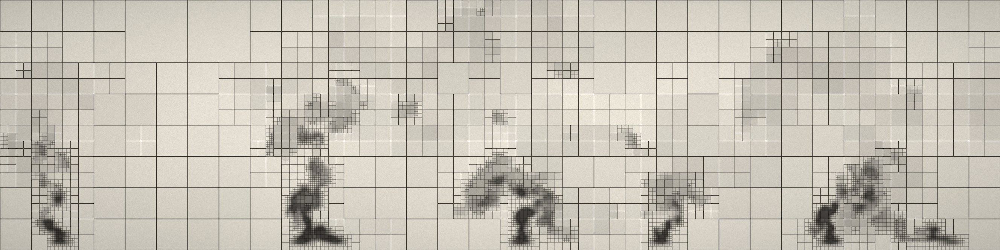
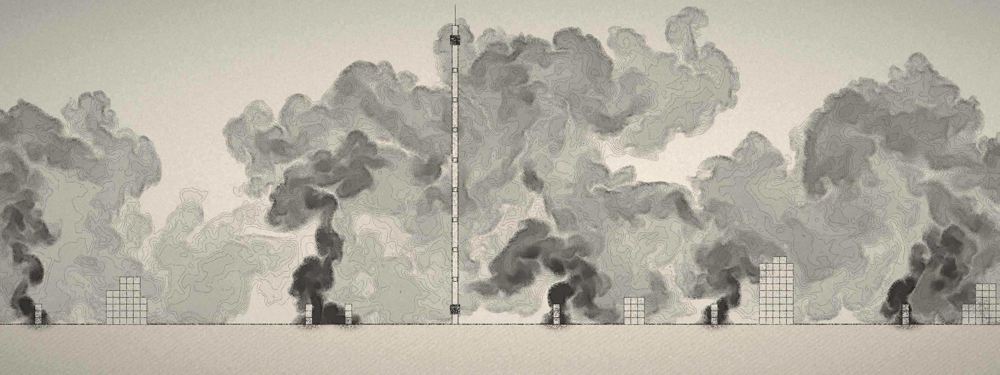

<picture>
  <source media="(prefers-color-scheme: dark)" srcset="docs/readme/title-anim-dark.gif">
  
</picture>

---

A voxel world engine around an array of atom-interferometer gravity gradiometers, rebuilt from a blank
slate. Start with `plan/REBUILD.md`; how the build runs is `plan/KICKOFF.md`; where it stands is
`plan/PROGRESS.md`. The browser mock-up of the viewer is in `docs/viewer-mockup/`.
What has been checked against what, and by how much, is `docs/validation/report.md` (`cargo xtask validate --report`).

**Try it in the browser: [ma1achy.github.io/Cavendish](https://ma1achy.github.io/Cavendish/)** (Chrome or
Edge, Safari 26, Firefox on Windows: it needs WebGPU). Built from `main` on every push
(`.github/workflows/pages.yml`); `#exec=load comb; panes 4` at the end of the address runs console commands.

<a href="plan/tasks.yaml">
<picture>
  <source media="(prefers-color-scheme: dark)" srcset="https://raw.githubusercontent.com/Ma1achy/Cavendish/progress/progress-dark.png">
  
</picture>
</a>

<a href="docs/validation/report.md">
<picture>
  <source media="(prefers-color-scheme: dark)" srcset="https://raw.githubusercontent.com/Ma1achy/Cavendish/progress/validation-dark.png">
  
</picture>
</a>

## History

The previous code is kept in history: tag `v1-final` (the validated v1 forward model, used as the
oracle) and tag `v2-prototype` (the world-physics prototype; branch `v2-world-physics`, commit `71ec48a`). Their design documents are in `reference/`.

<picture>
  <source media="(prefers-color-scheme: dark)" srcset="docs/readme/signature-dark.svg">
  
</picture>

