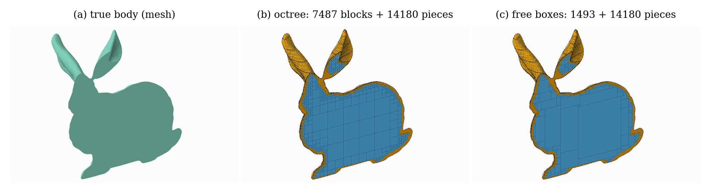
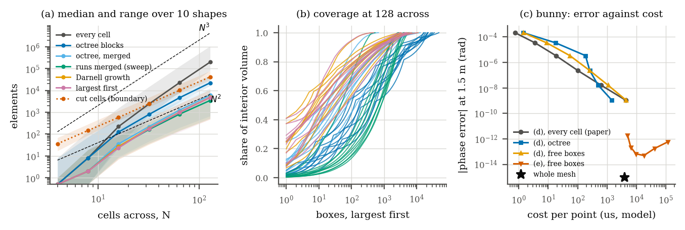
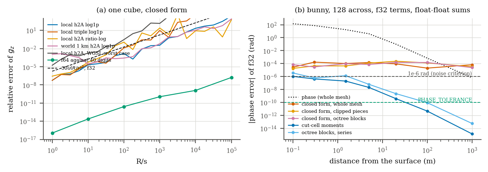

# Interior boxes and single precision, for the polyhedral-gravity paper

Research note, 27 Nov 2026, for `docs/papers/polyhedral-gravity/` (draft 3) and its referee report
(`REVIEW-draft-3.md`, S6). Scripts, data and figures:
[`paper-boxes-and-precision/`](paper-boxes-and-precision/). Pass criteria were committed before any
measurement ([`criteria.md`](paper-boxes-and-precision/criteria.md), commit 7ec1f12; A5 was added at the
owner's request before its run). Every number below is in
[`data/tables.md`](paper-boxes-and-precision/data/tables.md), written by `analyse.py` from the JSON
in `data/`. The meshes, lattice placement (`GENERIC`), tower and phase are the shapes study's own
(`shapes_lib`, imported unchanged); its meshes are downloaded into its git-ignored cache.

*Updated 27 Nov 2026:* the AACB and Darnell paragraphs in §A, item 4 of "What the paper should say
(A)" and "Not verified" now rest on the full AACB preprint (Fenney, Allen & Aman, June 2025, 12 pp.),
not the HPG 2025 poster. No measured number in this note changed.

*Updated 28 Nov 2026:* Darnell's 2011 article, Dielissen & Kaldewaij 1991, Thall 2006 and Joldes, Muller &
Popescu 2017 read from the owner's copies (§A sources, §B3, "Not verified"). Two corrections: Darnell names no
distance metric and no coverage figure (the Manhattan metric and the 90% are this note's choices), and the
preprint's "p. 3" is the magazine's contents page (the article is pp. 35–37, 39). No measured number or
recommendation changed.

The tolerance throughout is Cavendish's `PHASE_TOLERANCE` = 1e-10 rad
(`crates/cav-core/src/forward.rs`); "safe against noise" means ≤ 1e-6 rad, a hundredth of the
1e-4 rad Hz^-1/2 floor for one second.

## Answer in brief

- **A. The octree body is the right representation.** Merge the interior up the octree; keep only
  the surface at leaf size. On the ten shapes at 128 cells across:
  - interior elements fall from 0.08–1.06 million cells to 16–47 thousand blocks, 0.5–0.6 of the
    cut cells;
  - the error is unchanged (interior exact to rounding);
  - the modelled cost per point at 1.5 m falls to 0.7–3.3 ms, set mostly by the cut cells.

  Free-size boxes on top cut the interior elements 5–36 times further (0.5–5.7 thousand). They gain
  nothing near the body unless a box gets a far-field series as good as the cube's.

  Correcting the paper's cost model (referee S6) lowers the voxel costs at 10⁻⁸ rad by 1.1–1.7 times.
  It flips **no** verdict of the paper's Table 5 against the whole-mesh sum. The ranking
  (d) < (c) ≪ (b) < (a) stands, except (c) on the sphere (the known anomaly).

- **B. In f32 the closed form is not safe anywhere**, not even against the noise: its error is about
  10⁻⁴ rad at every distance. Cut-cell moments and series are safe to 10⁻¹⁰ rad only beyond about
  50–100 m, where their own phase is below ~10⁻³ rad. The closed form needs f64 (CPU) or float-float
  throughout. Moments and series can stay f32 with local offsets and compensated sums.

## A. Interior boxes and the octree body

### Sources and methods

- **The octree body** (the owner's representation; paper §6) merges eight equal interior children
  into their parent. A body's interior is then the largest aligned 2^k blocks wholly inside, and only
  cut cells stay at the finest pitch. Each block is a box, so its field is the closed form (12
  triangles, the paper's face-and-edge form, eq. `eq:result`), or its l ≤ 4 cube series far away.
- **AACBs.** Fenney, Allen & Aman put small groups of axis-aligned "contained" and "containing"
  boxes into a ray-tracing BVH (preprint, "June 2025", Imagination Technologies, 12 pp., Eurographics
  template; no DOI or arXiv id printed; also an
  [HPG 2025 poster](https://highperformancegraphics.org/2025/publications/posters/AACBs_%20BVH%20Occlusion%20muHierarchies%20-%20HPG2025.pdf)).
  What the preprint says about the inner (contained) boxes of a closed mesh:
  - *Voxels* (§4, §4.2). A conservative voxelisation, 32³ in their timings and "diminishing" gains
    beyond 64³ (§5). Boundary voxels are those a triangle touches; inner voxels are found by
    scan/fill passes (solid voxelisation, Schwarz & Seidel 2010). Contained boxes use inner voxels
    only, so they sit at least one voxel inside the surface.
  - *Seed* (§4.2, eq. 1). Voxel density ρ_v = min over boundary voxels v_b of ‖v − v_b‖₁, the
    Manhattan distance to the nearest boundary voxel, "similar to that suggested by Darnell"; the
    densest voxel not yet in any candidate seeds the next box. All densities cost O(m log n)
    (m inner, n boundary voxels) through a spatial index of the boundary.
  - *Growth* (§4.2). The seed grows uniformly into the largest cube of inner voxels, then "along any
    remaining free axes" to the largest volume. This is close to this note's largest-first growth;
    the seed rule differs (densest voxel, not largest cube).
  - *Overlap* (§4.2). "Unlike Darnell's method, the candidates are permitted to overlap." For
    occlusion, overlap is harmless. **For gravity it is not**: the boxes must partition the interior
    exactly, or carry signed overlaps.
  - *Selection* (§4.3, Figs 6–7). Candidates are kept or dropped by the extra *occlusion* they add,
    estimated from 13 orthographic bitmaps of the voxel grid (3 axis, 6 face-diagonal, 4 body-diagonal
    directions); a candidate may also replace a similar earlier box. The criterion is projected
    occlusion, not volume, and it is greedy as candidates are made, not a prune of a large set.
  - *How many* (§3, §5, Fig. 1). About as many as a wide BVH node holds ("four, eight, or more"):
    3 containing + 8 contained on the bunny, 8 boxes per bunny and 4 per bowl in the tests. Build
    time 0.5–1.5 ms per model, 16 threads on an AMD 9800X3D (Table 2).
  - *Not in the preprint*: any coverage fraction against box count, any volume captured, any
    optimality or NP-hardness statement. The quality numbers are traversal savings only (5–30% fewer
    node visits and box and triangle tests, abstract; Table 1).

  So AACBs give a handful of large, overlapping, conservative inner boxes chosen for occlusion. They
  answer "a few big boxes", not "partition the interior", and carry no gravity-usable coverage data.
  The preprint (§6) also suggests spheres as contained volumes; for gravity a sphere's outside field
  is exactly a point mass, but what remains is then no longer boxes.
- **Darnell 2011.** Fenney et al. (§2) summarise Darnell's method: "1) locating all voxels that are
  entirely within the mesh, 2) finding the 'densest' (i.e innermost), as yet unprocessed voxel,
  3) expanding a box outwards from that voxel until it meets the surface of the model or a
  previously expanded box", repeated "until a sufficient volume of the model has been accumulated";
  the boxes are then unioned and meshed. The stopping rule is "a percentage of the total volume or
  that the rate of volume increase falls below some threshold" (§4.3), the basis of this note's 90%
  coverage figure. Darnell's 2012 reprint adds that boxes "are just expanded in all directions
  equally"
  ([Game Developer](https://gamedeveloper.com/programming/in-depth-oxel---a-tool-for-occluder-generation)).
  The original, read 28 Nov 2026: N. Darnell, "Automated occluders for GPU culling", *Game Developer*,
  Sep. 2011 ("The Inner Product" column), **pp. 35–37 and 39** (p. 38 is an advertisement; the
  preprint's "p. 3" is the contents page, which lists it at p. 35)
  ([archive.org](https://archive.org/download/GDM_September_2011/GDM_September_2011.pdf)). Most of it
  is on hierarchical-z culling (pp. 35–37); the box method is pp. 37–39. What it says:
  - *Voxels* (p. 37). Voxels "completely inside" are the solid voxelisation minus the surface
    voxelisation (Schwarz's GPU method, §§3.1, 4.1), so boxes are conservative; the mesh must be
    watertight (p. 39).
  - *Seed* (p. 39, step 2). "The voxel that is the furthest away from any empty voxel, excluding any
    voxel already enclosed in an occlusion volume", distances tested against a list of surface
    voxels. **No metric is named**: Manhattan is this note's (and the AACB preprint's) choice.
  - *Growth* (p. 39, step 3). Start from a 1³-voxel box and "iteratively expand each side of the box
    ... until you can't expand any side of the box without entering an empty voxel, or another box
    that has already been placed". "The only approach I've tried is using a uniform expansion
    strategy"; he suggests prediction toward the roomier axis as an improvement. Boxes therefore do
    **not overlap**, which agrees with the AACB preprint's "unlike Darnell's method". `boxes.py`'s
    `darnell` (static taxicab seed order, six faces in turn) follows this.
  - *Stop* (p. 39, step 4). Examples only: "an absolute percentage in volume is consumed", boxes
    below "a point of diminishing returns or ... too small", or "a maximum number of boxes". **No
    percentage is given** ("X%" in the summary, p. 37): the 90% below is this note's threshold.
  - *Then* the boxes are merged by CSG (p. 39). Results are pictures only (Fig. 4); it "can still take
    several seconds" even on the GPU, and suits "axis-aligned objects, like buildings", not organic
    shapes (p. 39). No counts, coverage or error figures.
- **Why greedy.** A minimum partition into boxes is NP-complete in 3-D
  ([Dielissen & Kaldewaij 1991](https://doi.org/10.1016/0020-0190(91)90207-X), *Inf. Process. Lett.* 38,
  1–6; read 28 Nov 2026). What is proved: MNRP3, "given an orthogonal polyhedron P and a natural number
  K, is there a partition of P in at most K blocks?", is NP-complete (§2, p. 2; NP-hard by reduction from
  3SAT with each literal at most three times, Theorems 1–3, §3, pp. 2–5; in NP by guessing a block label
  per unit cube of a boolean matrix, §4, p. 5). An orthogonal polyhedron is a *simple* polyhedron with
  axis-parallel faces, and the gadgets are built of unit cubes, so this covers voxel sets. "Disallowing
  holes in the polyhedrons does not effect the NP-completeness" (§5, p. 6). It is a **partition**
  (non-overlapping blocks) with a **minimum number** objective, not a cover; the 2-D version (orthogonal
  polygon into rectangles) is polynomial (§1, p. 1), and convex orthogonal polyhedra are left open (§5).
  It says nothing about covering a given fraction of the volume with fewest boxes (the 90% rule below), so
  greedy rules are compared on that without a hardness claim.

`boxes.py` takes each shape at 4–128 cells across on the shapes study's own lattice. It decomposes
the interior six ways:

- every cell;
- octree blocks;
- octree blocks merged face to face;
- x-runs merged along y, then along z ("sweep");
- Darnell's growth;
- largest-first (largest centred cube of free cells, re-evaluated lazily, grown on the face that adds
  most).

It then sums each decomposition's field at towers 0.1 m to 1 km from the surface. The boundary is
added as (c) fill + centroid, (d) cut-cell moments or (e) clipped pieces.

The costs use the paper's model (8.5 ns per cube series or point, 17 ns per point + quadrupole,
55 ns per triangle) plus a box at 12.6 triangles (690 ns). That ratio comes from a Rust timing of the
box's face form against one triangle (`kbench/`; `data/kbench-*.json`: 721–780 ns against 57–58 ns
on this PC). A cubic element takes its l ≤ 4 series when (side/2)/d is below a switch:
- 0.01, "strict", the shapes study's rule;
- 0.05;
- 1/6, which is S3's "closed form within 3 sides".

A free box takes point + quadrupole, its exact second moment, under the same switch on its half
diagonal.

### Results

**Partition and rounding.**
- **A1 passes.** All 49 decompositions partition the interior, and every control (largest box
  dropped) fails.
- **A3 passes.** With boxes inside and (d) on the boundary, the shapes study's 1.5 m error is
  reproduced to 2.2×10⁻¹² rad.
- **A2 is missed narrowly at the largest near interiors**, and the criterion is not moved:
  - the box sums differ from the cell-by-cell sum by up to 3.3×10⁻¹¹ rad (torus, 128 across, 0.1 m,
    interior phase 1250 rad), against a pre-written 1.25×10⁻¹¹ (10⁻¹⁴ of the phase);
  - all five box decompositions carry the same offset and agree with one another to 1.6×10⁻¹¹ rad;
  - so the outlier is the sum of 276,000 cell fields, rounding at 2.5×10⁻¹⁴ of the phase, not the
    boxes.
- **A4 fails for elongated boxes.** The box kernel in f64 against 40 digits is 2×10⁻¹⁴ at R/s = 10
  for a cube, but 3×10⁻¹³ for a 1:1:16 box and 9×10⁻¹² for 1:1:256. Rounding grows with the aspect
  ratio (§B1 table in `tables.md`). It is still far below the tolerance at these distances.

**Counts against pitch** (`tables.md`, first table; Figure A(a)).
- At 128 cells across:
  - interior cells number 8.0×10⁴–1.06×10⁶;
  - cut cells number 2.9–7.7×10⁴;
  - octree blocks number 1.6–4.7×10⁴, which is 0.5–0.6 of the cut cells.
- Fitted exponents over 16–128 across:
  - cut cells 2.00–2.10;
  - cells 3.1–3.9;
  - octree blocks 2.1–2.5 on the six compact shapes, but 2.8–3.3 on the dragon, Armadillo, Buddha
    and CAD part.
- **Criterion A5(i), exponent 2.0–2.4, fails for those four** (Suzanne at 2.48 also fails). Their
  thin parts gain interior cells faster than N² until they are resolved. The blocks are not yet in
  the N² regime at 128 across, although their count is already below the cut cells'.
- About 80% of the octree's blocks are single finest cells (bunny: 27,028 of 34,378). These form the
  staircase just inside the surface.

**Free-size boxes on top.** At 128 cells across:
- octree blocks merged face to face: 670–12,773;
- sweep: 527–5,663 (the fewest on nine shapes);
- Darnell: 475–11,011;
- largest-first: 475–10,733.

Compared with the octree's blocks, the sweep has 5–36 times fewer elements, and 36 times fewer on the
CAD part, whose interior is a few big slabs. Darnell's rule covers 90% of the interior volume with
the fewest boxes, 61–1,340, against 2,700–12,300 octree blocks. All the rules take seconds in Python.

**Error and cost near, mid and far** (128 across; `tables.md`).
- **Error.** The interior is exact, so the error is the boundary's: (d) at 1.5 m is 7×10⁻¹¹–2.4×10⁻⁷
  rad, (e) is at rounding.
- **The series switch matters most.** The octree's extra error at 1.5 m is:

  | switch | extra error at 1.5 m (rad) |
  |---|---|
  | strict | ≤ 3.4×10⁻¹² |
  | 0.05 | ≤ 7.7×10⁻⁸ (sphere, torus, with big blocks); ≤ 5.4×10⁻⁹ elsewhere |
  | S3's 3-side rule | up to 3.5×10⁻⁵ |

  At 0.1 m the S3 rule gives 3×10⁻⁶–7×10⁻⁴ rad. So **S3's rule is not good enough for the octree's
  large blocks**. The read needs the error-controlled opening the paper already describes (§6).
- **Cost of the octree read with (d)** (strict switch):

  | distance from the surface | cost per point |
  |---|---|
  | 0.1 m | 5.5–10 ms (near blocks take the closed form) |
  | 1.5 m | 0.7–3.3 ms |
  | 100 m | 0.65–1.7 ms |

  For comparison, the paper's model, which sums every cell as a series, gives 1.2–10 ms. The whole
  mesh is 0.06–3.8 ms. Of the 1.5 m octree cost, the cut cells' 17 ns each come to 0.5–1.3 ms, so
  **the surface, not the interior, sets the cost**.
- **Free boxes do not cut the near cost.** Their counts are smaller, but a large box near a tower
  needs its 690 ns closed form. Its point + quadrupole series is worse than a cube's l ≤ 4 series:
  the sweep's boxes under S3's switch err by up to 7.6×10⁻³ rad. Free boxes + (d) cost 1.0–5.3 ms at
  1.5 m under the strict switch, more than the octree on all ten shapes. A box series to l = 4 would
  change this, but it was not built.

**The corrected cost table** (the paper's Table 5; `tables.md`, "Corrected cost"). The interior is
the octree or free boxes, with the cheapest switch that still reaches the tolerance once the
interior's own truncation error is added. Cost to reach 10⁻⁸ rad at 1.5 m, μs per point:

| shape | whole mesh | (d), every cell (paper) | (d), octree | (d), free boxes |
|---|---|---|---|---|
| teapot | 366 | 286 | 168 | 497 |
| Suzanne | 62.5 | 407 | 260 | 633 |
| bunny | 3830 | 893 | 608 | 1420 |
| Spot | 322 | 582 | 357 | 811 |
| dragon | 2700 | 175 | 147 | 514 |
| Armadillo | 3300 | 208 | 161 | 568 |
| Buddha | 2640 | 116 | 95 | 272 |
| CAD part | 290 | 48 | 43 | 37 |

The sphere and torus do not reach 10⁻⁸ within 128 across. At 10⁻⁴ and 10⁻⁶ the octree changes the
cost by 1.0–3.2 times. The voxel route against the whole mesh comes out the same way as in the
paper's model in all 30 (shape, tolerance) cases.

Referee S6 expected a large factor. The measured factor is small because, at the pitch where each
tolerance is first met, the cut cells (17 ns each) already cost about as much as all the interior
cells (8.5 ns each). The paper's sentence "summing the whole mesh directly … is cheaper than every
voxel technique except (d) on the teapot and the CAD part" was already scoped by S6. With the octree
it now reads: (d) beats the whole mesh at 10⁻⁸ rad on the teapot, bunny, dragon, Armadillo, Buddha
and CAD part, and loses on Suzanne and Spot.

**Does coalescing change the error-against-cost ranking near the body?** No.
- The interior is exact in every variant, so no error changes.
- Costs shift by an interior term common to every boundary technique.
- On the octree, (d) is cheapest per accuracy on nine shapes. On the sphere, (c) is cheaper at 10⁻⁴
  and 10⁻⁶ (the paper's open question).
- At 0.1 m only the clipped pieces reach 10⁻¹⁰ rad; (d) is at 1.3×10⁻⁶–2.5×10⁻⁴. So the layered
  scheme's "pieces near" is still required.





### What the paper should say (A)

1. **§6, the octree body, measured.** Add `figures/octree-cutaway.png` (style of Figure 8, bunny at
   64 across: 7,487 octree blocks and 14,180 clipped pieces against 1,493 free boxes). Add a short
   table, from `tables.md`'s first table, of interior cells, cut cells, octree blocks and free boxes
   at 128 across. Change "the tree's leaves therefore grow as the surface" to the measured version:
   blocks grow with fitted exponent 2.1–2.5 on compact shapes, and 2.8–3.3 on thin ones until
   resolved; 80% of blocks are finest cells; at 128 across blocks are 0.5–0.6 of the cut cells.
2. **§5 "Error against cost" and Table 5.** Replace the model "every interior cell at 8.5 ns" with
   the octree body read with an error-controlled series switch. Use the corrected table above. Say
   that the correction is 1.0–3.2 times (1.1–1.7 at 10⁻⁸ rad) and changes no verdict, and that the cost of the voxel route
   is the cut cells'. This answers referee S6.
3. **§6/§7, the read.** State that a fixed geometric switch (closed form within 3 sides) is not
   enough for large octree blocks: up to 3.5×10⁻⁵ rad at 1.5 m and 7×10⁻⁴ rad at 0.1 m on these
   bodies. The phase-error-bounded opening of §6 is required, not optional.
4. **One paragraph on free-size boxes**, citing Darnell (2011, *Game Developer*, Sep., pp. 35–39:
   furthest-from-empty seed, uniform growth to the surface or an earlier box, no overlap, stop at a
   chosen volume fraction) and the AACB preprint (§4.2: densest-voxel seed, cube then free-axis growth, overlap
   allowed), and Dielissen & Kaldewaij for NP-completeness (minimum-number partition of an orthogonal
   polyhedron into blocks, with or without holes; not the fixed-coverage problem). Greedy boxes give 5–36 times fewer interior elements
   than the octree, and 61–1,340 boxes cover 90% of the volume. Unlike AACBs they must not overlap.
   They are exact to rounding, but elongated boxes round worse. They save storage and element count,
   not near-field cost, unless boxes get an l ≤ 4 series.
5. **Proposed Figure A** (`figures/boxes.pdf`, Okabe–Ito): (a) elements against N for the six
   decompositions and the cut cells, median and range over ten shapes, with N² and N³ guides; (b)
   share of the interior volume against the number of boxes; (c) the bunny's error against cost for
   (d) on every cell, the octree and free boxes, with the whole mesh.

## B. Single precision

### Method

`precision.py` evaluates the paper's closed form (eq. `eq:result`, with the h·2A numerator and the log1p edge),
the cut-cell moments (point + quadrupole) and the cube series in numpy float32, every operation in
f32, and compares with the same expression in f64. The f64 reference is checked against a 40-digit
evaluation (mpmath) on single boxes. Variants:

- **frame**: offsets element − point formed in f64 and then rounded (the plan's tower frame, REBUILD
  §3.4), or vertices and point rounded separately in the body frame, or in a world frame 1 km away;
- **numerator** h·2A against the triple product; **edge** log1p against the log of the ratio;
- **WGSL worst case**: the spec permits atan2 to be off by 4096 ULP and log by 2⁻²¹ absolute on
  [0.5, 2]. WGSL has no log1p and no f64; fma may be unfused, and implementations may reassociate
  ([WGSL §15.7.4, §15.7.5, §17.5](https://www.w3.org/TR/WGSL/#floating-point-accuracy)). These
  errors are injected as random perturbations of the permitted size;
- **sums** as a GPU reduces them, over 1024 lanes and then a tree: plain f32, Kahan
  ([Kahan 1965](https://doi.org/10.1145/363707.363723)), float-float with two-sum
  ([Dekker 1971](https://doi.org/10.1007/BF01397083)), and f32 terms with f64 accumulators. A single
  sequential f32 sum is the worst case ([Higham 1993](https://doi.org/10.1137/0914050)).

The body is the Stanford bunny at 32, 64 and 128 cells across, read at 0.1 m to 1 km from its surface.
It is read four ways: the whole mesh (69,664 triangles), the octree's interior blocks (closed form and
l ≤ 4 series), the cut cells' moments (recomputed in f32 from the pieces, about each cell centre), and
the clipped pieces (up to 2.0 million triangles).

### Results

**One element (B1).** For a cube the f32 relative error of g_z follows ε(R/s)². With offsets formed
locally it is 2×10⁻⁵ at R/s = 10, 10⁻³ at 100 and 3×10⁻² at 10³. That is inside the pre-written
30u(R/s)² bound (u = 6×10⁻⁸), so **the paper's scaling argument carries over to f32**. The other
variants are worse:

- the triple product grows as (R/s)³, reaching 10 at 10³;
- the log of the ratio is ~10⁻¹ at R/s = 100;
- a world frame 1 km away has a floor of 10⁻³ even at R/s = 1;
- WGSL's permitted worst case is 3×10⁻¹ at R/s = 100.

f64 against 40 digits is 2×10⁻¹⁴, 3×10⁻¹², 10⁻¹⁰ and 10⁻⁹ at R/s = 10, 10², 10³ and 10⁴.

Elongated boxes round worse, in both precisions. A 1:1:256 box in f64 is 9×10⁻¹² at R/s = 10 and
7×10⁻¹⁰ at 100 (R measured against the long side). Criterion A4 (10⁻¹³ at R/s ≤ 10) therefore fails
for aspect ratios of 16 and above; it holds for the cube.

**A body (B2).** The closed form in f32 is wrong by about 10⁻⁴ rad at every distance, from 0.1 m to
1 km. This holds for the whole mesh, the octree blocks and the clipped pieces, at every pitch, and
whatever the summation (`tables.md`, "B2-B4"). At 1 km the error is a hundred times the signal
(6.6×10⁻⁷ rad).

The error does not fall with distance because each triangle's edge terms are of size ℓ and cancel
to a field of order A/R. Each triangle therefore carries an absolute rounding of about uℓ. Summed
over F triangles this gives a phase error of about

> 0.5 · k_eff T² G ρ · u · ℓ · √F ≈ 865 rad/m × 0.5 × 6×10⁻⁸ × ℓ√F,

that is 10⁻⁴ rad for ℓ ≈ 5 mm and F ≈ 7×10⁴. This is an estimate that matches the measurement, not
a bound. For clipped pieces √F·ℓ hardly changes with the pitch, because F grows as N² and ℓ falls as
1/N. That is why 32, 64 and 128 across all give ~10⁻⁴ rad.

There is no one culprit to fix. Rounding only the offsets, only atan2 and log1p, only the stored
geometry or only the edge products to f32 (the rest in f64) gives 10⁻⁵ to 10⁻⁴ rad each
(`precision-diagnose-bunny.json`).

**Moments and series are fine in f32 when the sum is.** They lose about 10⁻⁷ of their own phase. At
128 across, with float-float or f64 accumulation:

| distance from the surface | 0.1 m | 1.5 m | 20 m | 100 m | 1 km |
|---|---|---|---|---|---|
| cut-cell moments, error (rad) | 1.1×10⁻⁶ | 2.0×10⁻⁷ | 4×10⁻¹⁰ | 5×10⁻¹² | 2×10⁻¹⁵ |
| octree blocks as series, error (rad) | 3.7×10⁻⁶ | 1.4×10⁻⁶ | 2×10⁻⁹ | 9×10⁻¹¹ | 6×10⁻¹⁴ |

One sequential f32 sum over all elements is up to 10³ times worse: 7×10⁻⁴ rad for the blocks at
0.1 m. Lanes plus a tree is close to float-float, and Kahan lanes help little here, because the
kernel's own rounding dominates. The f32 moments' total mass is off by 8×10⁻⁸ relative, and their
centroids by at most 6×10⁻⁴ h.

**Where f32 is safe** (criterion B2):

| part | ≤ 1e-10 rad (oracle) | ≤ 1e-6 rad (noise) |
|---|---|---|
| closed form (mesh, pieces, blocks), any frame or sum | never | never (~1e-4 rad everywhere) |
| cut-cell moments, local offsets, float-float sum | ≥ ~50 m (5e-12 at 100 m) | ≥ 0.3 m (4.4e-7; 1.1e-6 at 0.1 m) |
| octree blocks as series, the same | ≥ 100 m (9e-11) | ≥ 5 m (1.4e-6 at 1.5 m, 6e-8 at 5 m) |
| anything in a world frame 1 km off, or with WGSL's worst-case functions | never | never |

In one line: an f32 contribution is within the oracle's tolerance only if its own phase is below
about 10⁻³ rad and it is a moment or series term. That happens beyond ~50–100 m for a tonne-scale
body.

### The cheapest fix (B3)

- **The closed form must not be f32.** It needs f64 or float-float in every part (offsets,
  geometry, products and the two functions), not just in the sum. The layered scheme makes this
  affordable: the closed form is used only for the clipped pieces within a few cells of an arm point,
  and for the few hundred to few thousand interior boxes (part A). Both are cheap enough for the f64
  CPU oracle. On the GPU the closed form needs float-float throughout, including float-float log1p
  and atan2. The sources give the arithmetic, not the functions:
  - **Joldes, Muller & Popescu 2017** (*ACM TOMS* 44(2), art. 15res,
    [doi:10.1145/3121432](https://doi.org/10.1145/3121432); read 28 Nov 2026) prove relative error
    bounds for double-word ("float-float" when the words are f32) arithmetic in precision p, with
    u = 2⁻ᵖ (f32: u = 2⁻²⁴, u² ≈ 3.6×10⁻¹⁵). Table 1 (p. 25), with FP-operation counts that assume an
    FMA-based exact product (Alg. 3):

    | operation | algorithm | bound | ops |
    |---|---|---|---|
    | DW + FP | Alg. 4 (QD) | 2u² (Thm 2.2) | 10 |
    | DW + DW | Alg. 5, "sloppy" (Dekker's add2) | none: relative error up to 1 when signs differ | 11 |
    | DW + DW | Alg. 6, accurate | 3u² + 13u³ (Thm 3.1; the earlier 2u² claim is wrong, p. 7) | 20 |
    | DW × FP | Alg. 7 / 8 / 9 (FMA) | 1.5u² + 4u³ / 3u² / 2u² (Thms 4.1–4.3) | 10 / 7 / 6 |
    | DW × DW | Alg. 10 / 11 (FMA) / 12 (FMA) | 7u² / 6u² / 5u² (Thms 5.1, 5.3, 5.4) | 9 / 8 / 9 |
    | DW ÷ FP | Alg. 15 | 3u² (Thm 6.2) | 10 |
    | DW ÷ DW | Alg. 17 / 18 (FMA) | 15u² + 56u³ / 9.8u² (Thms 7.1, 7.2) | 18 / 31 |

    So one f32 float-float operation is good to 2–15 u² ≈ 7×10⁻¹⁵–5×10⁻¹⁴ relative, at 6–31 f32
    operations. Their advice (§8, pp. 25–26): never use Alg. 5 unless both operands have the same sign;
    with an FMA prefer Alg. 9 and Alg. 12. Two WGSL cautions follow: the counts assume a fused FMA,
    which WGSL does not guarantee (§17.5), and every bound assumes the compiler keeps the error-free
    transforms unreassociated (§15.7.5). Nothing here covers log1p or atan2.
  - **Thall 2006** is a one-page poster abstract ("Category: Poster"; no venue printed on the copy),
    not a paper. It describes "doublefloats" in Cg: pairs of f32 with 48 significant bits, add, subtract,
    multiply and divide "as in Hida [2000]" with no loops; square and nth roots and logarithms by one or
    two Newton steps from an f32 start; exponentials and trigonometric functions by Taylor series after
    argument reduction, "work ... underway". A 512² Mandelbrot ran at 5–8 frames/s against 20–25 in
    f32 (GeForce 6800 GTX), 95 against 15 operations in the inner loop. It gives **no error bounds**:
    "much work remains to determine error-bounds on doublefloat operations".

  So the float-float closed form needs its own log1p and atan2 with a measured or proven error; the
  basic operations cost about 6–20 f32 operations each and are bounded at ~10⁻¹⁴ relative.
- **Moments and series can be f32** with tower-local offsets formed in f64 and float-float (or f64)
  accumulation, for nodes whose phase is below ~10⁻³ rad. Larger contributions need the plan's
  float-float. This is the plan's §3.4 rule, now with a measured threshold.
- **On WGSL**, the paper's two rules are not enough. Also needed:
  - a log1p of one's own (for example 2·atanh(ℓ/(a+b)) as an odd polynomial when ℓ/(a+b) is small,
    since L_e = 2 atanh(ℓ/(a+b)) exactly);
  - an atan2 of one's own, accurate to a few ULP;
  - a check that the compiler does not reassociate the two-sum, which §15.7.5 permits.

  The real hardware's atan2 and log errors were not measured. They are likely far better than the
  spec's bound, but that needs a measurement on the device.

### What the paper should say (B)

Replace the Limitations bullet "the f32 behaviour of the closed form on the GPU is derived from the
scaling, not measured" with the measurement. The scaling ε(R/s)² holds in f32 per element, but in a
sum over a body the closed form in f32 carries an absolute phase error of about
0.5 k_eff T² Gρ u ℓ √F. That is 10⁻⁴ rad for the bunny, at every distance and pitch. So the closed
form is an f64 (or float-float) kernel. Cut-cell moments and series are f32-safe for contributions
below ~10⁻³ rad, given local offsets and compensated sums. Add Figure B (`figures/precision.pdf`):
(a) per-cube relative error against R/s by variant, with f64 against 40 digits; (b) the bunny's f32
phase error by part against distance, with `PHASE_TOLERANCE` and the noise line. Add one sentence on
WGSL (no log1p, atan2 permitted 4096 ULP).



## Not verified

- **Sources.** Read first-hand by 28 Nov 2026: the AACB preprint, Darnell 2011 (the magazine issue),
  Dielissen & Kaldewaij 1991, Joldes et al. 2017 and Thall 2006 (a one-page poster abstract, so there
  is no fuller Thall text to fetch). Still second-hand: Hida, Li & Bailey's QD algorithms (cited by
  Thall and Joldes et al.), and which double-word addition (Joldes et al.'s Alg. 5 or 6) Thall's
  "as in Hida" means.
- **The cost model.** Costs are a model (measured kernel times × counts), with no tree walk, cache
  or GPU. The box's 690 ns is a CPU f64 timing of an unoptimised kernel. One atan2 per face (6 per
  box) did not halve it, so transcendentals are not the whole cost; a tuned kernel may be 2–3 times
  faster (not measured).
- **The free boxes' far field** is only point + quadrupole. A box series to l = 4 was not built, and
  it would decide whether free boxes cut near cost.
- **One lattice placement per pitch** (the study's `GENERIC`, near-symmetric; referee S1). The
  counts and costs will not move much with placement; the errors may, as S1 says.
- **f32 was emulated in numpy, not run on a GPU.** numpy's f32 functions are better than WGSL
  permits, and the worst case was injected, not measured. Real hardware sits between the two.
  Float-float kernels were not built or timed.
- **The f32 body study is on one shape** (the bunny). The closed-form error law
  0.5 k_eff T² Gρ u ℓ √F is an estimate fitted by eye to that one shape.

## Further questions

1. Does a box series to l = 4 (a box's fourth moments are separable) make free boxes cheaper than
   the octree near the body? Measure it with the same switch rules.
2. What is the cheapest float-float closed form, and what does it cost on the build PC's GPU? Measure
   it in the slice, with an f32-only control that fails at 10⁻⁴ rad.
3. What are the real atan2 and log errors on the target GPUs (Vulkan via wgpu, and Metal)? A
   one-shader measurement.
4. Do the thin shapes' octree exponents come down to ~2 beyond 128 across? Needs the compiled
   voxeliser at 256–512 across.

## Reproduce

```
python prep_meshes.py                 # download, check, repair (git-ignored cache)
cd kbench && cargo run --release      # kernel timings (data/kbench-*.json)
python boxes.py run <shape>           # each of the ten (data/boxes-<shape>.json); ~10-40 min each at 128
python precision.py kernel            # B1, A4
python precision.py body bunny 32,64,128
python precision.py diagnose bunny
python octree_figure.py bunny 64      # figures/octree-cutaway.png
python analyse.py                     # data/tables.md, figures/boxes.*, figures/precision.*
```
