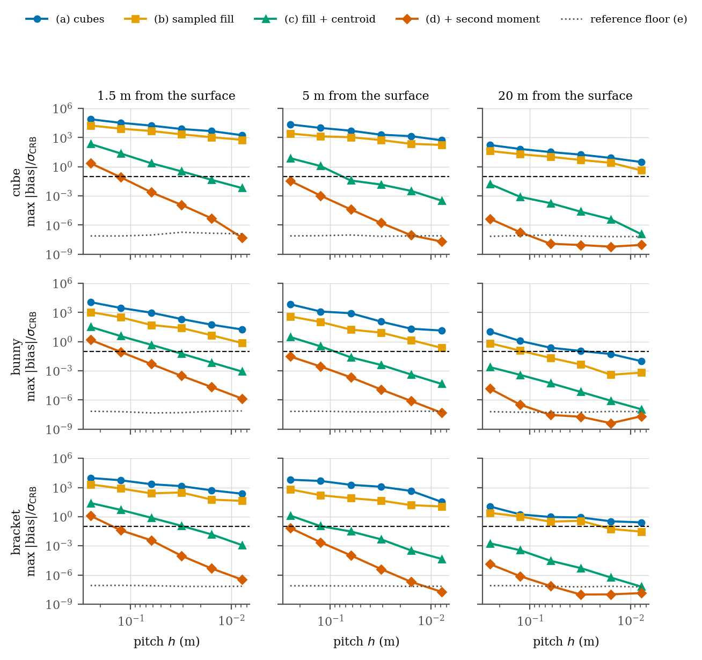
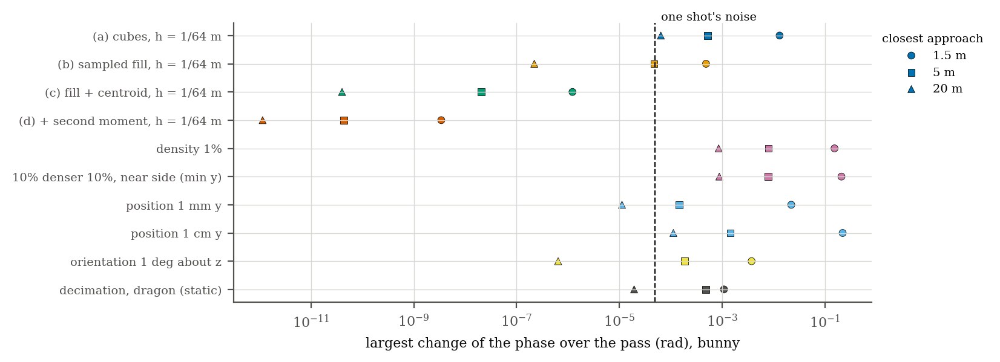

# How accurate must the boundary representation be? An error budget judged by inference

For the polyhedral-gravity paper (`docs/papers/polyhedral-gravity/`). The question: how fine must a
voxel or mesh representation be, judged by what it does to the estimate of a passing body's mass,
position and speed? And how does that error compare with what we do not know about a real body
(its density, its position, its orientation, its mesh)? Scripts, data and figures are in
`paper-error-budget/`. Everything is reproducible with `budget.py` (commands in its docstring).
Every number below is in `budget.json` or `checks.json` there, and in readable form in `tables.md`.

## Summary

1. **Criterion.** Data `d = φ(θ) + n`. A forward model that errs by Δφ biases the
   maximum-likelihood estimate by `δθ = F⁻¹ JᵀΣ⁻¹ Δφ` ([Cutler & Vallisneri 2007, eq. 13]
   (https://arxiv.org/abs/0707.2982)). By Cauchy–Schwarz, `|δθᵢ|/σᵢ ≤ ‖Δφ‖_Σ` for *every* parameter
   and *every* parametrisation. So the whitened residual norm `‖Δφ‖_Σ` is a model-independent
   accuracy measure. [Lindblom, Owen & Brown 2008, eq. 5](https://arxiv.org/abs/0809.3844) call two
   models indistinguishable when `‖Δφ‖_Σ < 1`. We ask for 0.1.
2. **Noise.** AION-10 goal: 10⁻⁴ rad/√Hz ([Badurina et al. 2020, Table 1]
   (https://arxiv.org/abs/1911.11755)). With the 2 s cycle (`plan/VALIDATION-AND-RESEARCH.md` §1) that
   is σ = 5×10⁻⁵ rad per shot.
3. **Pitch for bias < 0.1 σ_CRB at 1.5 m** (worst of three bodies and three lattice placements):

   | Technique | Pitch needed |
   |---|---|
   | (d) cut-cell moments with second moment | 13–15 cm |
   | (c) fill + centroid | 2–4 cm |
   | (b) sampled fill (Cavendish today) | sub-millimetre (extrapolated; order 1–2) |
   | (a) plain cubes | never in practice |

   At 5 m: (d) is fine at 25 cm (the coarsest pitch run), (c) needs 8–12 cm, and (b) needs 0.001–6 mm.
   At 20 m, (c) and (d) are fine at 25 cm.
4. **Physical uncertainties dwarf the representation error of (c) and (d).** At 1.5 m:
   - 1 mm of position error: 20–600 σ.
   - 1° of orientation error: 5–100 σ.
   - 1 % density error: 150–2200 σ. All of it goes into the mass.
   - A 10 % denser tenth of the body: 150–2700 σ.
   - The 5120-triangle icosphere against the sphere: 2000 σ.

   Against these, (d) at 1/64 m is at ≤ 5×10⁻⁶ σ and (c) at ≤ 0.04 σ. The sampled fill at 1/64 m is
   at 4.5–1100 σ: as large as a millimetre of position error.
5. **The paper's figure of "a few parts in 10⁷ of its own signal" is about right** for the closest
   pass. Now it follows from the instrument's noise and the number of shots, not from assertion.

## 1. The question as posed, and what is computed

**Scene** (`budget.py`):
- **Bodies.** Three bodies, each 1 m across with ρ = 2700 kg m⁻³:
  - the cube with its faces on the lattice, the worst case for (a) and (b) (paper §4; 2.7 t);
  - the Stanford bunny (540 kg);
  - the CAD part, mk7 drive (184 kg).

  The meshes and their repair are the shapes study's (`exact-skin-and-partial-fill/shapes/`).
- **Track.** Each body moves along a straight line at 1 m/s. Its bounding-box centre is 1 m below
  the lower cloud. At closest approach the lower cloud is d = 1.5, 5 or 20 m from the surface.
- **Instrument and sampling.** One AION-10 tower (two clouds 5 m apart), 61 shots 2 s apart, one of
  them at closest approach.
- **Voxels** are fixed in the body's frame and move rigidly with it, as Cavendish stores bodies
  (paper §5, "Orientation and motion").
- **Truth** is the exact polyhedron: the whole mesh summed with Werner & Scheeres' closed form.

**Phase.** The phase is the single-instant k_eff T² Δg_z of the paper and the shapes study. This
study does not integrate the flight. That is a parallel study's question, and its limitation is in §6.

**Inference.** Parameters θ = (ln M, x₀, y₀, v). The direction of travel and the height are known,
as the Gradar note does for people and vehicles (`gradar-inference.md` §3.2).
- **Fisher matrix.** F = JᵀJ/σ², white noise (Kay 1993, eqs. 3.31 and 3.33, as read in
  `gradar-inference.md` §3.1). J is taken by 1 mm central differences of the exact mesh.
- **Bias.** The bias of each representation is the linearised model-error formula above, with Δφ
  its residual against the mesh. The residual is a sum over boundary cells against their exact
  clipped pieces, as in `sweep.py`.
- **Noise levels.** Bias/σ scales as 1/σ_noise:
  - at the stretch level of 10⁻⁵ rad/√Hz, multiply every ratio by 10;
  - at AION-10-initial (10⁻³ rad/√Hz, same table), divide every ratio by 10.

**Why the body is not level with the cloud.** In the first run the body was level with the lower
cloud, and the Fisher matrix was singular. A point mass level with one cloud gives that cloud no
g_z. The upper cloud then reads M a⁻³ g(vt/a), which fixes only M/a³ and v/a. Mass, range and speed
are then degenerate for one tower. Moving the body 1 m down breaks this at 1.5 and 5 m. At 20 m the
height offset is small against the range, so the degeneracy returns:

| Body | σ(M)/M at 20 m | σ(y₀) at 20 m |
|---|---|---|
| cube | 0.16 | 1.2 m |
| bunny | 0.58 | 4.4 m |
| bracket | 2.0 | 15 m |

One tower cannot weigh a body 20 m away. Several towers would; see question 1 at the end.

## 2. Cramér–Rao bounds (σ = 5×10⁻⁵ rad per shot, 61 shots)

| Body | d | Peak phase | σ(M)/M | σ(x₀) | σ(y₀) | σ(v) |
|---|---|---|---|---|---|---|
| cube | 1.5 m | 65 rad | 4.6×10⁻⁶ | 1.7 µm | 3.0 µm | 0.9 µm/s |
| cube | 5 m | 4.7 rad | 5.9×10⁻⁶ | 43 µm | 78 µm | 7.5 µm/s |
| cube | 20 m | 0.43 rad | 0.16 | 0.72 mm | 1.2 m | 5 cm/s |
| bunny | 1.5 m | 15 rad | 2.6×10⁻⁵ | 7.1 µm | 18 µm | 4.4 µm/s |
| bunny | 5 m | 0.80 rad | 2.9×10⁻⁵ | 0.25 mm | 0.27 mm | 42 µm/s |
| bunny | 20 m | 0.086 rad | 0.58 | 7.0 mm | 4.4 m | 19 cm/s |
| bracket | 1.5 m | 6.3 rad | 6.9×10⁻⁵ | 18 µm | 45 µm | 12 µm/s |
| bracket | 5 m | 0.31 rad | 8.0×10⁻⁵ | 0.64 mm | 1.0 mm | 0.11 mm/s |
| bracket | 20 m | 0.029 rad | 2.0 | 16 mm | 16 m | 0.7 m/s |

These are bounds for a perfectly known body. They are why the representation has to be so good at
close range. With the height z₀ also free, σ(M)/M grows about 6 times at 1.5 m and 200–300 times at 5 m
(`tables.md`).

The SNRs run from 10⁴ to 10⁶. At these SNRs the maximum-likelihood estimate attains the bound, by
the |log r| test of [Vallisneri 2008](https://arxiv.org/abs/gr-qc/0703086) as measured in
`gradar-inference.md` §8.

## 3. Bias of each representation

*Figure: the largest |bias|/σ_CRB over the four parameters, worst of three random lattice placements,
against pitch. Dotted: the reference floor (pieces + interior against the mesh), 10⁻⁷ σ.*

**Pitch at which max |bias|/σ < 0.1.** Interpolated between measured pitches (1/4 to 1/128 m).
\* marks an extrapolation beyond 1/128 m with the fitted order.

| Technique | Body | 1.5 m | 5 m | 20 m |
|---|---|---|---|---|
| (a) cubes | cube | 0.7 µm\* | 0.8 µm\* | 0.5 mm\* |
| (a) cubes | bunny | 0.4 mm\* | 0.3 mm\* | 28 mm |
| (a) cubes | bracket | 20 µm\* | 0.7 mm\* | 3 mm\* |
| (b) sampled fill | cube | 0.7 µm\* | 1 µm\* | 3 mm\* |
| (b) sampled fill | bunny | 3.6 mm\* | 5.6 mm\* | 116 mm |
| (b) sampled fill | bracket | 0.13 mm\* | 0.08 mm\* | 19 mm |
| (c) fill + centroid | cube | 21 mm | 76 mm | ≥ 250 mm |
| (c) fill + centroid | bunny | 37 mm | 91 mm | ≥ 250 mm |
| (c) fill + centroid | bracket | 30 mm | 121 mm | ≥ 250 mm |
| (d) + second moment | cube | 131 mm | ≥ 250 mm | ≥ 250 mm |
| (d) + second moment | bunny | 129 mm | ≥ 250 mm | ≥ 250 mm |
| (d) + second moment | bracket | 151 mm | ≥ 250 mm | ≥ 250 mm |
| (e) clipped pieces | all | any pitch: 10⁻⁷ σ | any | any |

**The model-independent bound ‖Δφ‖_Σ < 0.1** asks for pitches 1.3–1.9 times finer for (c) and
(d): 11–24 mm and 92–100 mm at 1.5 m (`tables.md`, in brackets).

**Fitted orders.** The orders of bias/σ, over the last four pitches, are:

| Technique | Order of bias/σ |
|---|---|
| (b) sampled fill | 1.0 on the cube and bracket, 2.0 on the bunny |
| (c) fill + centroid | 2.3–3.1 |
| (d) + second moment | 3.7–4.8 |

**Which parameter takes the bias.** At 1/64 m:
- at 1.5 m, mostly the speed or the along-track position;
- at 5 m, the mass;
- at 20 m, nothing measurable.

**Changing the noise level.** At 10⁻⁵ rad/√Hz the bias/σ ratios grow tenfold, and the pitches shrink:

| Technique | Pitch × | Pitch at 1.5 m |
|---|---|---|
| (c) fill + centroid | 0.46 | 10–17 mm |
| (d) + second moment | 0.56 | 7–9 cm |

**What a lattice placement changes.** For (a) and (b), the worst of three placements is 9–23 times
the best (median 2–5 times), so their thresholds jump. For (c) and (d) the placement matters little.

**Validation** (criteria written before measuring; all pass, `checks.json`):

| Case | Result |
|---|---|
| V1, known answers | A 1 % density residual returns δ ln M = 0.0100, with the others < 2×10⁻¹² σ (cube and bunny, three distances). A 1 cm along-track shift returns 1 cm: linear, the other parameters move by < 2×10⁻¹² σ; exact (non-linear), within 2.4×10⁻⁴. |
| V2, against a closed form | Fisher σ for the analytic sphere matches the point-mass derivatives to 4.6×10⁻⁶. The control, a 30 cm step, is off by 3–69 %. |
| V3, the bound | Holds in every case (an assertion in `analyse.py`). |
| V4, against a non-linear fit | A Gauss–Newton fit of the voxel model itself agrees with the linear bias to 3×10⁻⁵ relative. Tested with bias/σ up to 6 (bunny, 1/32 m, (b) and (c)). |
| V5, the reference | Clipped pieces + interior reproduce the mesh to ‖Δφ‖/σ ≤ 2×10⁻⁷ at every pitch and distance. |

**V1's written control did not fail as it should have.** It was the exact 30 cm *along-track* shift
at 1.5 m. It missed 30 cm by only 0.3–0.5 %, because a shift along the track is nearly a shift in
time. We recorded that and added a control across the track: the exact 1 cm shift returns
δy₀ = 0.992 cm (within 1 %), and 30 cm misses by 19–20 %, as a control must. So the linear bias
formula is trustworthy for range errors up to about 1 cm at 1.5 m. Every voxel bias of (c) and (d)
is far below that.

## 4. The physical uncertainties, in the same units

Peak |Δφ| over the pass (rad), with the largest |bias|/σ in brackets. Positions are from
`truth-*.json` → `budget.json["physical"]`. Shown for the bunny; the cube and bracket are in
`tables.md`.

| Change (bunny) | 1.5 m | 5 m | 20 m |
|---|---|---|---|
| (b) sampled fill, h = 1/64 m | 4.9×10⁻⁴ (4.5 σ) | 4.8×10⁻⁵ (1.4 σ) | 2.2×10⁻⁷ (4×10⁻⁴ σ) |
| (c) fill + centroid, h = 1/64 m | 1.2×10⁻⁶ (0.007 σ) | 2.0×10⁻⁸ (4×10⁻⁴ σ) | 4×10⁻¹¹ (8×10⁻⁷ σ) |
| (d) + second moment, h = 1/64 m | 3.4×10⁻⁹ (2×10⁻⁵ σ) | 4.4×10⁻¹¹ (8×10⁻⁷ σ) | 1×10⁻¹² (4×10⁻⁹ σ) |
| density 1 % | 0.15 (390 σ, all in M) | 8×10⁻³ (340 σ) | 8.6×10⁻⁴ (0.017 σ) |
| 10 % denser over 10 % of the volume, near side | 0.21 (390 σ) | 8×10⁻³ (340 σ) | 8.9×10⁻⁴ (0.03 σ) |
| the same, leading end | 0.13 (480 σ) | 1.0×10⁻² (410 σ) | 8.7×10⁻⁴ (0.53 σ) |
| position 1 mm, across the track (y) | 2.2×10⁻² (56 σ) | 1.5×10⁻⁴ (3.7 σ) | 1.1×10⁻⁵ (2×10⁻⁴ σ) |
| position 1 mm, vertical (z, not fitted) | 4.7×10⁻³ (110 σ) | 1.1×10⁻³ (34 σ) | 6.6×10⁻⁶ (0.002 σ) |
| position 1 cm, y | 0.22 (560 σ) | 1.5×10⁻³ (37 σ) | 1.1×10⁻⁴ (0.002 σ) |
| orientation 1° about the vertical | 3.8×10⁻³ (96 σ) | 1.9×10⁻⁴ (4.7 σ) | 6.5×10⁻⁷ (0.014 σ) |
| orientation 1° about the track | 3.7×10⁻³ (49 σ) | 2.1×10⁻⁴ (5.5 σ) | 7.1×10⁻⁷ (0.008 σ) |
| facet: 5120-triangle icosphere vs sphere (1 m radius, 11 t) | 0.32 (2000 σ) | 4.2×10⁻² (680 σ) | 3.7×10⁻³ (0.05 σ) |
| decimation: dragon 871k → 49k triangles (static\*) | 1.1×10⁻³ | 4.8×10⁻⁴ | 1.9×10⁻⁵ |
| decimation: Buddha 1.09M → 48k triangles (static\*) | 6.2×10⁻⁴ | 2.2×10⁻⁴ | 8.8×10⁻⁶ |

How the rows were made:
- **Inhomogeneity.** The denser region is the 10 % of the volume nearest the tower's side, or
  nearest the leading end. It is summed from cut-cell moments at 1/64 m, which are good to about
  10⁻⁷ of the row.
- **Decimation (\*).** These rows are the shapes study's static numbers (`exact-distance.json`), with
  the centre of mass at that distance from the tower's axis. They are a 4–7×10⁻⁴ relative change at
  every distance, the mass the decimation lost (paper Table 4). In an inference that change would go
  almost entirely into M. I did not recompute them as passes, because the full scans need the
  study's repair pipeline (question 3).
- **Physical rows of the other bodies.** They are in `tables.md`; the ranges in the Summary are
  across all three bodies.

**What the table says:**
- Every physical uncertainty studied is 10²–10⁸ times larger than the (c) and (d) representation
  errors at 1/64 m.
- Even the sampled fill is smaller than 1 mm of position error at 1.5 m on the bunny. It is not on
  the cube: 1100 σ against 340–600 σ for 1 mm.
- A density error is not a model error at all for an inference that fits M. It goes wholly into the
  mass (V1).
- Shape and pose errors need not go into the fitted parameters. How much of each physical row is
  left as misfit after the fit was not computed (question 4).

## 5. What the paper should say (and a proposed table and figure)

1. **State the criterion in inference terms (§1 and §7).**
   - Replace "the source must be represented to a few parts in 10⁷ of its own signal" with: a
     representation is adequate when its whitened residual over a pass is below 0.1. Then no
     parameter's bias exceeds 0.1 σ_CRB (Cutler & Vallisneri eq. 13 with Cauchy–Schwarz; Lindblom
     et al. eq. 5).
   - Give the noise per shot: 5×10⁻⁵ rad at 10⁻⁴ rad/√Hz and a 2 s cycle. That also answers the
     referee's S13 (a noise density compared with a phase).
   - Keep "a few parts in 10⁷" as the consequence it is. At 1.5 m the cube's threshold residual is
     ≈ 0.1 σ/√N_eff relative to a 65 rad peak, i.e. about 10⁻⁷.
2. **Add the threshold table** (§3 above, the (b)–(d) rows, bunny and cube) to §4 or §5, or as a
   new short section. Suggested caption: "Pitch at which a representation's bias in mass, position
   or speed stays below 0.1 σ_CRB, one AION-10 tower, 10⁻⁴ rad/√Hz, single-instant phase."
3. **Add the error-budget figure** (`fig-budget.pdf`, Okabe–Ito, the paper's rc style). Or extend
   Table 8 with the physical rows of §4: density 1 %, a 1 mm and 1 cm position error, a 1°
   orientation error, and the decimation and facet rows. Then the reader sees that the voxel row is
   no longer the one that matters once (c) or (d) is used.
4. **Change the conclusion's emphasis.**
   - With cut-cell moments, voxel pitch is not the limiting accuracy at any distance studied.
     Pitches of 2–4 cm with (c), or 13–15 cm with (d), already keep the bias below 0.1 σ at 1.5 m.
   - The limit is what is known about the body: its mesh (facet and decimation errors), its density
     distribution, and its pose to better than a millimetre and a degree.
   - The sampled fill does not converge fast enough (order 1–2). It biases inference by 4–1100 σ at
     1/64 m, close to a tower.
5. **Caveats to carry:**
   - single-instant phase (this study and the paper alike);
   - one tower, with direction and height known;
   - white noise;
   - three bodies;
   - the 20 m rows are trivially safe because one tower barely constrains M there, not because the
     representation is good. With several towers σ(M) shrinks and the 20 m thresholds tighten.

## 6. What I could not verify, and the limits of this study

- **Kay 1993** was not re-read for this note. Its equations are cited as read in
  `gradar-inference.md` §3.1. Cutler & Vallisneri, Lindblom et al. and Badurina et al. were read
  here (the pages cited).
- **Cycle time and conventions.**
  - The 2 s cycle is the plan's, not AION's: Badurina et al.'s Table 1 gives no cycle time.
  - That table's T column is captioned as "2T" while the text says T = 1.4 s. The repo uses
    2T = 1.46 s throughout.
  - The per-shot conversion σ = ASD/√(2Δt) assumes a one-sided ASD, as `gradiometer-environment.md`
    §0 does.
- **Single-instant phase.** A body at 1 m/s moves 1.46 m during one 2T. The instrument's response to
  rapid changes is smaller than the instantaneous Δg_z (referee S2). So the 1.5 m numbers are an
  upper bound on bias/σ only if residual and signal are attenuated alike, which is not shown. The
  parallel flight-integral study should rerun `budget.py run` with its phase.
- **Bodies and placements.** Three bodies and three placements per pitch. The (a)/(b) thresholds
  depend strongly on placement, and their extrapolations to micrometres are only statements that
  they do not converge.
- **Decimation rows** are static and not passes.
- **The 20 m rows** are degenerate for one tower (§1).

## 7. Further questions (not chased)

1. Rerun with the default five-tower array. It breaks the 20 m mass–range degeneracy and will
   tighten the 20 m thresholds.
2. Rerun with the flight-integral phase (the parallel study).
3. Passes of the full against the decimated dragon and Buddha, for the decimation's bias/σ. This
   needs the shapes study's repair cache.
4. A fifth parameter (height) and a population of bodies. Overlapping bodies couple through F's
   off-diagonal blocks. Also the post-fit misfit of each physical row: how much of it no parameter
   absorbs.

## Sources

- Cutler & Vallisneri 2007, *LISA detections of massive black hole inspirals: parameter extraction
  errors due to inaccurate template waveforms*, PRD 76, 104018, [arXiv:0707.2982]
  (https://arxiv.org/abs/0707.2982). Read §II A–B: eqs. 6–7 (Fisher matrix and covariance) and
  12–13 (theoretical error).
- Lindblom, Owen & Brown 2008, *Model waveform accuracy standards for gravitational wave data
  analysis*, PRD 78, 124020, [arXiv:0809.3844](https://arxiv.org/abs/0809.3844). Read §II A,
  eqs. 2–5 and 9.
- Badurina et al. 2020, *AION: an atom interferometer observatory and network*, JCAP 05 (2020) 011,
  [arXiv:1911.11755](https://arxiv.org/abs/1911.11755). Read Table 1 and §2.
- Kay 1993, *Fundamentals of Statistical Signal Processing, Vol. I*. As read in
  `gradar-inference.md` §3.1.
- Vallisneri 2008, [arXiv:gr-qc/0703086](https://arxiv.org/abs/gr-qc/0703086). As read in
  `gradar-inference.md` §3.1.
- The shapes study `exact-skin-and-partial-fill.md` §3 and its scripts: meshes, voxeliser, kernels,
  and the decimation numbers.

## Pass criteria, written before measuring

Scene and method are in `paper-error-budget/budget.py`'s docstring.

- **V1, known-answer bias.**
  - A residual that is exactly a parameter change must come back as that change.
  - A 1 % density error gives δ(ln M) = 0.0100, with |bias|/σ < 10⁻⁶ on x₀, y₀ and v.
  - A 1 cm shift along x, taken linearly, gives δx₀ = 1.000 cm with the others < 10⁻⁶ σ.
  - Applied as the exact (non-linear) 1 cm shift, it must give δx₀ = 1 cm within 1 % at every
    distance (the linearisation holds at the scale of the errors studied).
  - **Control arm:** the exact 30 cm shift at 1.5 m must miss 30 cm by more than 1 % (the linear
    formula is not trusted beyond its range).
- **V2, the Fisher matrix against a closed form.** For the analytic sphere (a point mass outside), σ
  from finite-difference Jacobians (1 mm step) must agree with σ from the analytic derivative of the
  point mass's k_eff T² Δg_z to 10⁻⁵ relative, for every parameter and distance. **Control arm:** a
  30 cm step must disagree by more than 10⁻³ somewhere.
- **V3, the bound.** Every |bias_i|/σ_i ≤ ‖Δφ‖/σ (Cauchy–Schwarz). An identity; a failure is a bug.
- **V4, linear bias against a non-linear fit.** For the bunny at 1/32 m and 1.5 m, techniques (b)
  and (c): Gauss–Newton fitting the technique's own model (its voxels, moved with the body) to the
  noiseless exact signal must give a bias within 10 % (or 0.02 σ, whichever is larger) of the
  linear formula.
- **V5, the reference is good enough.** The clipped pieces plus interior cubes must reproduce the
  mesh with ‖Δφ‖/σ < 10⁻² at every pitch and distance. Otherwise a technique's residual below that
  level is not resolved, and is reported as "at the reference floor".

**Amendment, same day, before any voxel result was read.** The first run put the body level with
the lower cloud. V2 then failed, with a normalised condition number of 6×10⁸. That was not a bug.
A point mass level with the lower cloud gives that cloud no g_z, and the upper cloud's signal
M a⁻³ g(vt/a) fixes only M/a³ and v/a. So for one tower M, range and speed are exactly degenerate.
- The body now passes 1 m below the lower cloud. The criteria are unchanged.
- Numerics: σ and the bias now come from the SVD of J with unit-norm columns, not from inverting F.
- The V1 control was found too weak afterwards (§3). It is kept as written and reported as failing
  to fail, and an across-track control was added.

**Criterion for the answer** ("the pitch at which bias/σ < 0.1"):
- the largest of the four |bias_i|/σ_i, worst of three random lattice placements, below 0.1 at that
  pitch and at every finer one measured;
- interpolated log–log between measured pitches;
- beyond 1/128 m, extrapolated with the order fitted over the last three pitches, and marked as
  extrapolated.
