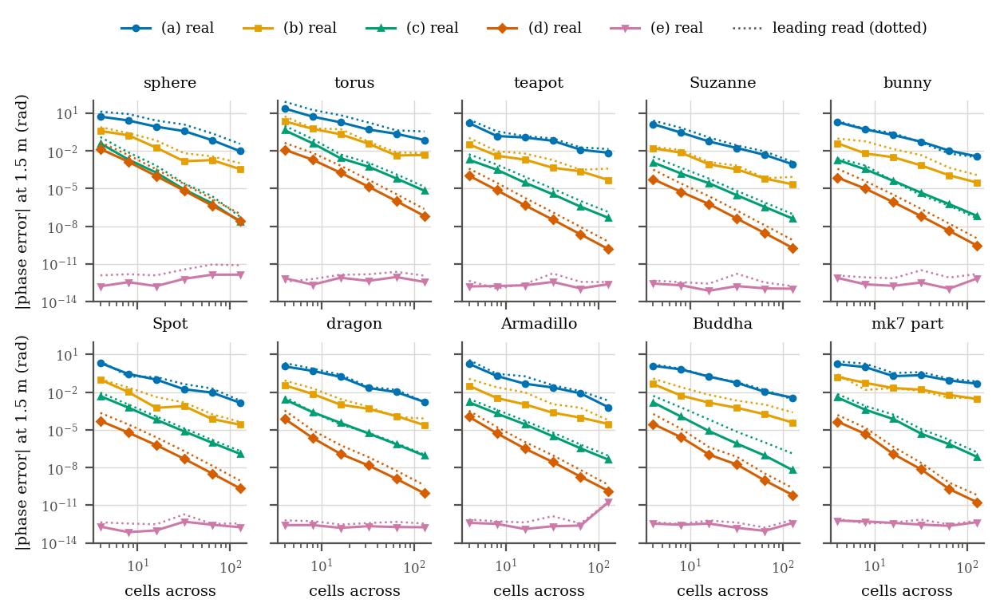
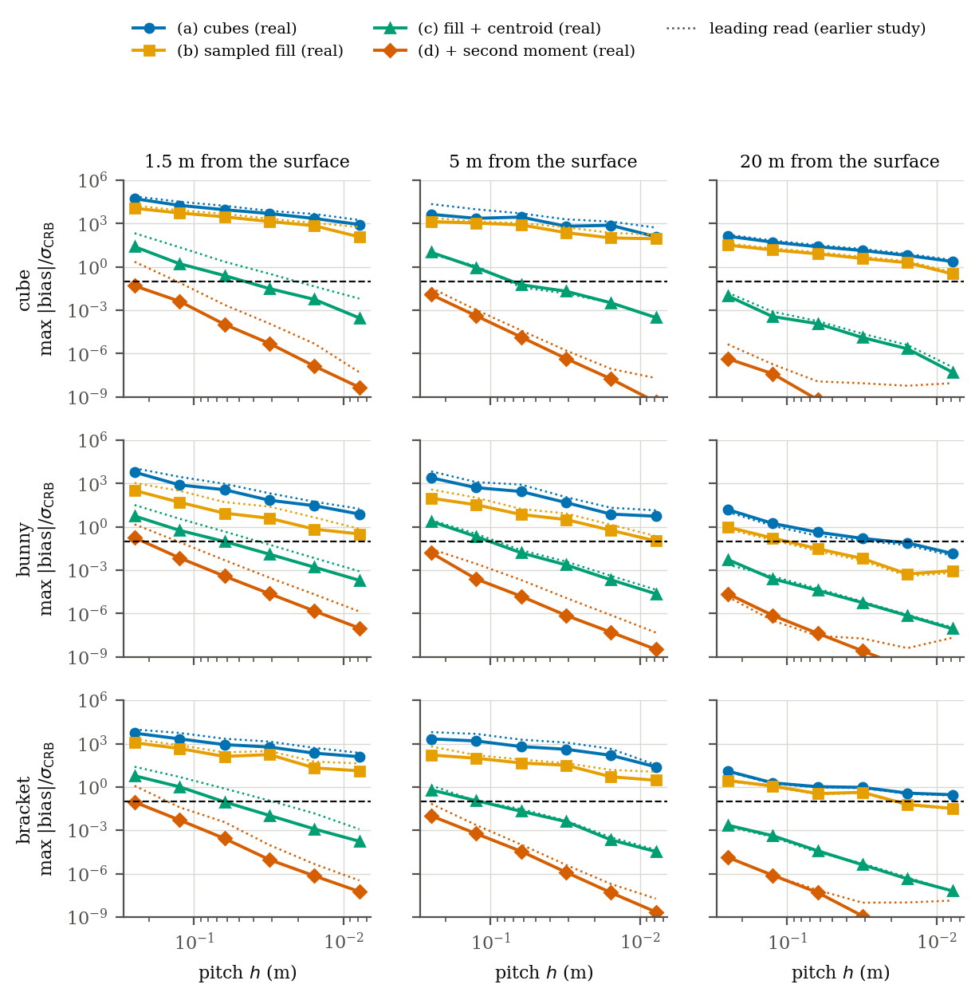

# The polyhedral-gravity paper's numbers with the real interferometer read

Research note for the polyhedral-gravity paper (draft 3) and its referee report
(`docs/papers/polyhedral-gravity/REVIEW-draft-3.md`, S1, S2, S13). Question: what does every
measured phase number in the paper become when the single-instant k_eff T² Δg_z at the two launch
points is replaced by the phase AION-10 reads, the flight integral along the arms? Scripts, data
and figures are in [`paper-real-read/`](paper-real-read/). The pass criteria were committed before
anything was measured ([`CRITERIA.md`](paper-real-read/CRITERIA.md), commit `4688409`, with one
amendment in `d7038a5` before any sweep or budget number). Every number below is in one of the
generated tables ([`tables-sweep.md`](paper-real-read/tables-sweep.md),
[`tables-budget.md`](paper-real-read/tables-budget.md), [`tables-conv.md`](paper-real-read/tables-conv.md),
[`tables-regimes.md`](paper-real-read/tables-regimes.md)) and traceable to a script and its JSON in
[`data/`](paper-real-read/data/).

## Summary

- **The signals change; the paper's conclusions about representations do not.** With the real read,
  a static 1 m body 1.5 m from the lower launch gives a phase of the **opposite sign and 1.5–3.3 times
  smaller** than k_eff T² Δg_z (bunny +10.4 rad against −17.4; the 2 m sphere +90 against −294). At
  5 m it is 2–3 times smaller with the same sign; at 20 m 5–10 % larger. Moving past at 2 m (walking),
  it is the opposite: 1.6–1.9 times larger and positive (the flight-phase study's result, extended
  here to all six bodies).
- **The voxel errors fall with the signals, mostly by 2–4 times, and keep their ranking and orders.**
  At 128 cells across and 1.5 m (RMS over four lattice placements):
  - cut-cell moments (d): **1.7×10⁻¹¹–2.9×10⁻¹⁰ rad on the eight meshes** (paper: 7.3×10⁻¹¹–1.1×10⁻⁹),
    6.6×10⁻⁸ on the torus and 2.8×10⁻⁸ on the sphere (paper 2.4×10⁻⁷, 9.6×10⁻⁸): 0.23–0.32 of the
    leading read on every shape;
  - fill + centroid (c): 6×10⁻⁹–1.2×10⁻⁷ on the eight meshes (paper 4×10⁻⁸–2×10⁻⁷);
  - sampled fill (b): 2.2×10⁻⁵–4.7×10⁻³; plain cubes (a): 6×10⁻⁴–7×10⁻².
  - (d) < (c) < (b) < (a) on every placement of the nine non-spherical shapes (Q1). The orders of
    (c) and (d) move by at most 0.43 (Q2): (d) 3.6–3.9 on nine shapes and 4.5 on the CAD part.
- **The sphere "open question" was mostly the lattice placement (referee S1).** On the paper's
  near-symmetric placement, (c) was anomalously good, e.g. 4×10⁻⁷ against 2–3×10⁻³ on random
  placements at 8 across. Over three random placements (d) beats (c) by 1.4–3.5 times at 4–64 cells
  across in the real read, and (d★) beats (c★) at every pitch. At 128 across the two meet: (c)
  2.1×10⁻⁸, (d) 2.8×10⁻⁸ (RMS). (d) is the same to two digits on every placement there, (c) varies
  fourfold.
- **The error budget loosens.** With the real read in signal, Jacobian and residuals, the pitch
  for max |bias| < 0.1 σ_CRB at 1.5 m is:
  - **(c): 46–64 mm** (leading read: 21–37 mm);
  - **(d): ≥ 220 mm, i.e. the coarsest pitch run already passes** (leading: 129–151 mm).

  The bounds widen (σ(M)/M 2.5–3 times larger at 1.5 m) faster than the residuals grow. At 20 m one
  tower now weighs the body to 1.4–20 % (leading read: 16–200 %). The arms sample several heights,
  which breaks the mass–range degeneracy of a two-point read. The conclusion stands: physical
  uncertainties (1 % density 57–800 σ, 1 mm of position 4–390 σ, 1° of orientation 0.3–30 σ) dwarf
  (c) and (d).
- **Every other measured phase changes in value, not in kind** (Tables 2, 3, 6, 7, 8 and the text):
  - Table 8's rows become 4.8×10⁻² / 2.6×10⁻⁵ / 2.4×10⁻⁷ rad (was 1.2×10⁻¹ / 4.2×10⁻⁵ / 4.0×10⁻⁷);
  - "about 214 rad" becomes 49 rad;
  - the facet errors 0.19 and 0.43 rad (was 0.64, 1.8);
  - decimation 1.5–3.4×10⁻³ rad (was 0.6–1.3×10⁻³);
  - pose differences 1.2–4.4 % (was 4–18 %).

  The full list is §6.
- **Where the paper's read holds.** For a static body the real and leading reads agree to 10 %
  beyond 44–68 m and to 1 % beyond about 640 m along the paper's tower ray (lower launch point 17°
  below the body). The difference decays as 1/d: 5.5 % at 100 m, 1.5 % at 400 m. That is further
  than the flight-phase study's point mass level with the launch (1 % beyond 94 m). So "beyond 50–100 m
  within 1 %" holds only for a source near the launch height. Along the paper's own ray it is 10 %
  at 50 m.
- **Recommendation.** Quote every phase in the paper from the real read, with the generated tables
  here, and keep the conclusions:
  - the error ranking;
  - the orders;
  - "pitch is not the limit, knowing the body is";
  - the layering distances, which move by one or two steps of the distance grid (factor ≤ 2.4),
    mostly closer (Table 6).

  Change the sphere paragraph from an open question to a placement effect plus a convergence at
  128 across. Drop "one tower cannot weigh a body 20 m away".

## 1. The read, and the checks that it is Cavendish's

**The real read** is Cavendish's flight integral (`crates/cav-core/src/forward.rs`), ported in
[`../paper-flight-phase/flight.py`](paper-flight-phase/flight.py), which matches `cav run` to
1.8×10⁻¹⁵ rad ([paper-flight-phase.md](paper-flight-phase.md) §1, C1). Per interferometer it is
(m_A/ħ)∫₀^{2T}[V(upper arm) − V(lower arm)]dt, lower minus upper; it is first order in the source,
as Hogan, Johnson & Kasevich use for gravity inhomogeneities
([arXiv:0806.3261](https://arxiv.org/abs/0806.3261) §5.2.1) and Carlton & McCabe for moving masses
at this site ([arXiv:2308.10731](https://arxiv.org/abs/2308.10731) eq. 11). The model's sequence:
n = 1000 ħk at 698 nm (v_kick = 6.58 m/s), T = 0.73 s, u₀ = 3.86 m/s, Δr = 5 m, instantaneous kicks.
The arms rise 0–5.01 m above each launch point and separate by up to v_kick·T = 4.8 m.

**Static bodies** ([`realread.py`](paper-real-read/realread.py) `AxisRead`). With V = −GρU,
V(p + z_u) − V(p + z_l) = −Gρ∫g_z dz along the vertical. g_z is interpolated on 48 Legendre heights
of [0, 5.01 m] above each launch point, and the interpolant is integrated exactly between the arms at
every flight node. That gives fixed weights A_j with

ΔΦ = (m_A/ħ) G ρ Σ_j A_j [g_z(p + Δr ẑ + z_j ẑ) − g_z(p + z_j ẑ)],  Σ_j A_j = ∫Δz dt = v_kick T²,

so a uniform gradient gives the paper's k_eff T² Δg_z exactly. The shapes study's kernels then run
unchanged at 98 points per launch point instead of 2. The leading read comes from the same
evaluation, so every table here has both.

**Moving bodies** (`PassRead`): U summed at the flight nodes, each at its own time, the body's frame
moving with it. The error budget uses Gauss order 8 on panels ≤ 0.2 s (R4); the walk past uses the
engine's own rule (order 6, panels ≤ 0.1 s). The Jacobian comes from g = ∇U at the same nodes; the
speed column weights every node by its own time.

**Kernels.** [`kern/`](paper-real-read/kern/src/main.rs) is the shapes study's formulas in Rust on
four threads (86 ns per triangle and point per thread, about five times the numpy).

**The budget's residuals** (criteria amendment): (d)'s residual is the pieces' l = 3, 4, 5 multipole
terms from their exact raw moments to order 5 ([`moments.py`](paper-real-read/moments.py), a
collapsed Gauss rule exact to degree 5 on each tetrahedron from the centroid). The other techniques
add closed-form point, quadrupole and cube terms. The exact pieces' closed form would have cost
about an hour per body and placement at 128 across.

**The criteria, against what was measured:**

| criterion | result | where |
|---|---|---|
| R1, the static read is the flight integral (≤ 1e-10 rel.) | **pass**: 3.9×10⁻¹¹ (point masses, 1.2–1.5 m, z = −1…11 m), 1.2×10⁻¹⁴ (bunny). Control: the leading read misses by 66–267 % | [`checks.json`](paper-real-read/checks.json) |
| R2, compiled kernels = numpy (≤ 1e-12) | **pass**: triangles 9.6×10⁻¹⁵, points + quadrupole 1.4×10⁻¹⁵, series 2.4×10⁻¹⁵. Control: 1 µm moves it 1.3×10⁻⁶ | `checks.json` |
| R3, only the read changed (leading reproduces the study: 1e-6 rel. or 1e-13 rad) | **fail as written**: differences ≤ 4.6×10⁻¹² rad (sphere), ≤ 2×10⁻⁵ rel. where the error is above 1e-7 rad. That is the order of summation, inside the study's own (e) floor (≤ 9×10⁻¹² rad). The benchmark's Table 2 and the budget's leading signals reproduce to the printed digits and to 7×10⁻¹⁴ rel. | `tables-sweep.md` Checks, `truth-*.json` |
| R4, moving read converged | **pass at 1.5 and 5 m** (signal 1×10⁻¹³, (c) 8×10⁻⁷, (d) 5×10⁻⁴); **fails as written at 20 m** (d 0.29): there the closed-form residual is at its rounding floor. The moments' residual itself changes by 2×10⁻¹⁵ at 20 m (`r4b`, added after) | [`budget-r4.json`](paper-real-read/data/budget-r4.json) |
| R5, the reference (≤ 1e-10 rad at 1.5 m) | **pass**: ≤ 3.5×10⁻¹¹ (Armadillo), ≤ 2.2×10⁻¹² on the rest | `tables-sweep.md` |
| R6, Jacobian vs 1 mm differences (1e-5) | **pass**: 8.3×10⁻⁷ (cube), 7.9×10⁻⁷ (CAD part). Control (30 cm): 7.7 % | [`budget-r6.json`](paper-real-read/data/budget-r6.json) |
| R7, moments = the pieces (1e-12) | **pass**: 1.6×10⁻¹⁴ | test in the log; `r7_volume` in `run-*.json` |
| R8, l ≤ 5 truncation (≤ 5 % at 4 across, ≤ 1 % from 16) | **pass on the budget's bodies and eight shapes; fails on the torus at 4 across (15 %)**, where h = 0.7 m at 1.3 m. From 16 across: ≤ 0.8 % (CAD part), ≤ 3×10⁻⁴ elsewhere | `tables-sweep.md` |

None was moved.

## 2. The representation sweep (paper Table 4, Figs. 9–10, Table 5)

[`sweep_real.py`](paper-real-read/sweep_real.py) is the shapes study's `sweep.py run`, unchanged
in substance: the same meshes, voxeliser, clipped pieces, moments and techniques. It differs in
three ways:
- the read, (real, leading) at 1.5, 5 and 20 m from the same lower launch point;
- four lattice placements per pitch (seed 0 the study's near-symmetric one, seeds 1–3 random);
- the compiled kernels.

Data: `data/sweep-<shape>-s<seed>.json`. Tables: [`tables-sweep.md`](paper-real-read/tables-sweep.md).
Figure: [`fig-sweep.pdf`](paper-real-read/fig-sweep.pdf).

*Phase error 1.5 m from the surface against cells across, RMS over four placements; solid the real
read, dotted the paper's. Okabe–Ito, the paper's rc style.*

**At 128 across, 1.5 m: real read (paper's number, one placement).** RMS over four placements;
the fitted order of the RMS over 8–128 across in brackets.

| shape | signal (rad) | (a) | (b) | (c) | (d) | (e) |
|---|---|---|---|---|---|---|
| sphere | +89.7 (−294) | 9.5e-3 (5.2e-2) | 3.5e-4 (4.8e-4) | 2.3e-8 [4.1] (8.9e-8) | 2.8e-8 [3.9] (9.6e-8) | ≤ 2e-12 |
| torus | +49.7 (−212) | 7.3e-2 (1.6e-1) | 4.7e-3 (5.4e-4) | 6.8e-6 [3.0] (1.1e-5) | 6.6e-8 [3.7] (2.4e-7) | ≤ 1e-12 |
| teapot | +5.0 (−9.1) | 7.1e-3 (1.8e-2) | 4.8e-5 (3.4e-4) | 4.7e-8 [3.2] (1.2e-7) | 1.5e-10 [3.9] (5.9e-10) | ≤ 5e-13 |
| Suzanne | +5.4 (−12.0) | 8.5e-4 (2.0e-3) | 2.2e-5 (1.6e-4) | 4.1e-8 [3.0] (9.0e-8) | 1.9e-10 [3.7] (7.8e-10) | ≤ 4e-13 |
| bunny | +10.4 (−17.4) | 3.6e-3 (3.1e-4) | 3.0e-5 (2.5e-6) | 6.6e-8 [3.1] (4.0e-8) | 2.9e-10 [3.8] (1.1e-9) | ≤ 1e-12 |
| Spot | +8.3 (−13.8) | 1.4e-3 (3.1e-3) | 2.5e-5 (3.4e-5) | 1.2e-7 [3.1] (2.1e-7) | 2.2e-10 [3.7] (9.1e-10) | ≤ 6e-13 |
| dragon | +3.0 (−5.1) | 1.7e-3 (8.7e-4) | 2.4e-5 (6.8e-5) | 8.8e-8 [2.9] (1.1e-7) | 8.9e-11 [3.6] (3.9e-10) | ≤ 4e-13 |
| Armadillo | +3.5 (−7.9) | 6.2e-4 (1.7e-3) | 2.9e-5 (5.0e-5) | 4.1e-8 [3.1] (8.4e-8) | 1.3e-10 [3.8] (4.2e-10) | ≤ 4e-11 |
| Buddha | +2.7 (−4.2) | 3.6e-3 (2.9e-4) | 3.7e-5 (1.0e-4) | 6.0e-9 [3.5] (1.3e-7) | 6.4e-11 [3.7] (2.3e-10) | ≤ 6e-13 |
| mk7 part | +3.5 (−7.0) | 4.7e-2 (8.6e-3) | 2.8e-3 (2.7e-3) | 7.0e-8 [3.2] (1.5e-7) | 1.7e-11 [4.5] (7.3e-11) | ≤ 1e-12 |

(The (a) and (b) entries that grew, such as the bunny's, are the placement spread, not the read.
Those techniques vary by 10–100 times between placements, and the paper's single placement was a
favourable one for them; the leading read's RMS over the same four placements is in
`tables-sweep.md`.)

**What holds and what moves:**
- **Q1 (ranking): holds** on every placement of the nine non-spherical shapes. The sphere breaks
  it at 128 across on two placements ((c) < (d)), see below.
- **Q2 (orders): holds.** The real read's orders are within 0.43 of the leading read's on the same
  placements (largest: the Buddha's (c), 3.48 against 3.05). The spread over placements is the
  honest error bar the referee asked for in S5: (d) ±0.1–0.3, except the Buddha (2.2–3.9: its dip
  at 16 across is one placement's); (c) about ±0.3.
- **(c)/(d) at 128 across** (the referee's M3): 95–4040 in the real read, 38–2510 in the leading
  read over the same placements.
- **At 5 and 20 m** the errors in the two reads are within a factor 3 of each other. At 20 m (d)
  reaches the rounding floor of the pieces' closed form (≤ 10⁻¹³) on every mesh.
- **Table 5** (the cheapest modelled cost to reach 10⁻⁴ / 10⁻⁶ / 10⁻⁸ rad, on the RMS error) keeps its
  order: (d) < (c) ≪ (b) < (a). (d) now reaches 10⁻⁸ rad within 128 across on all eight meshes, at
  40–355 µs (paper: 48–893 µs). (d) is again cheaper than (c) on every shape, now including the
  sphere at 10⁻⁴ (33 against 35 µs).

**The sphere (Q3, referee S1).**

| cells across | 4 | 8 | 16 | 32 | 64 | 128 |
|---|---|---|---|---|---|---|
| (c), paper's placement | 1.1e-2 | **4.3e-7** | 3.4e-5 | 2.4e-6 | 3.6e-8 | 2.9e-8 |
| (c), RMS of 3 random | 4.5e-2 | 2.4e-3 | 2.1e-4 | 9.8e-6 | 7.8e-7 | 2.1e-8 |
| (d), RMS of 3 random | 1.3e-2 | 1.4e-3 | 1.0e-4 | 6.8e-6 | 4.4e-7 | 2.8e-8 |
| (c★) / (d★), RMS of 3 random | 4.5e-2 / 1.3e-2 | 2.4e-3 / 1.4e-3 | 2.1e-4 / 1.0e-4 | 9.4e-6 / 6.9e-6 | 8.1e-7 / 4.4e-7 | 3.2e-8 / 2.8e-8 |

(real read, rad, 1.5 m)

- **The criterion was:** (d) beats (c) at 64 and 128, and (d★) beats (c★). It is met at 64. At 128 it
  is met for (d★) against (c★) but not for (d) against (c).
- **The paper's "(d) worse than (c) at every pitch, by up to 30 times" was the near-symmetric
  placement.** There (c) is between 3.6 and 5600 times better than on random placements.
- **On random placements (d) wins at 4 to 64 across, by 1.4–3.5 times, and the two meet at 128.**
  (d) on the sphere is deterministic: the same to two digits on every placement, at order 3.9. (c)
  scatters fourfold between placements.
- **What is left is not an anomaly of (d).** It is (c)'s faster-than-third-order fall on a closed
  convex surface at fine pitch (order 4.1 on the sphere). The isotropy argument of §4 of the paper
  would give that.

**Facet error** ([`data/facets.json`](paper-real-read/data/facets.json)): the 5120-triangle icosphere
is off from the sphere by −0.194 rad at 1.5 m (paper 0.64), the 4096-triangle torus by −0.431 (1.8).
At 81 920 and 262 144 triangles: −0.012 and −0.0068 rad (0.040, 0.028). The slope is still −1.00 per
triangle count, so the paper's "about 10⁵ times the voxel error of (d)" stays about 10⁵–10⁶ (0.012 rad
against 2.8×10⁻⁸ on the sphere).

**The launch axis** passes 1.31–1.50 m from the mesh at "1.5 m" (`clearance`), because the paper's
ray points 17° down and the arms rise 10 m.

## 3. The error budget (paper-error-budget, the proposed threshold table and figure)

[`budget_real.py`](paper-real-read/budget_real.py) keeps the earlier study's scene:
- three bodies, 1 m/s, the body 1 m below the lower cloud;
- 61 shots 2 s apart;
- σ = 5×10⁻⁵ rad per shot;
- θ = (ln M, x₀, y₀, v);
- the same three placements.

Every phase is the flight read of a body moving during the shot: the signal, the Jacobian from g
at the nodes, and the residuals. Data: `data/truth-*.json`, `data/run-*-s*.json`,
`data/budget.json`. Tables: [`tables-budget.md`](paper-real-read/tables-budget.md).

*Largest |bias|/σ_CRB over (ln M, x₀, y₀, v), worst of three placements, against pitch; solid the
real read, dotted the earlier study's leading read; dashed 0.1.*

**Pitch for max |bias|/σ < 0.1 (Q4):** real (leading). \* means extrapolated beyond 1/128 m.

| technique | body | 1.5 m | 5 m | 20 m |
|---|---|---|---|---|
| (c) fill + centroid | cube | **46 mm** (21) | 72 mm (76) | ≥ 250 mm (≥ 250) |
| | bunny | **63 mm** (37) | 102 mm (91) | ≥ 250 mm |
| | CAD part | **64 mm** (30) | 118 mm (121) | ≥ 250 mm |
| (d) + second moment | cube | **≥ 250 mm** (131) | ≥ 250 mm | ≥ 250 mm |
| | bunny | **220 mm** (129) | ≥ 250 mm | ≥ 250 mm |
| | CAD part | **≥ 250 mm** (151) | ≥ 250 mm | ≥ 250 mm |
| (b) sampled fill | all | 0.13–4.4 mm\* (0.001–3.6\*) | 0.0006–7.6 mm\* | 3.6–101 mm |
| (a) cubes | all | 6 µm–0.5 mm\* | 17 µm–0.7 mm\* | 0.6–20 mm |

- **At 1.5 m the thresholds loosen by 1.7–2.2 times for (c), and (d) passes at the coarsest pitch.**
  At 5 m they are unchanged within 12 %.
- **(b) still does not converge.** Its orders are 1–2, and the extrapolated pitches mean only
  that.
- **Why the budget loosens although the walker signals grow.** These passes are 1 m below the
  cloud. At 1.5 m the static and slow-moving real signal there is smaller than the leading one
  (44 against 65 rad for the cube), and its shape differs. So σ_CRB grows 2.5–3 times. The (c) and
  (d) residuals shrink about as much as in §2.
- **One tower at 20 m.** It is no longer degenerate:

  | | real read | leading read (earlier study) |
  |---|---|---|
  | σ(M)/M at 20 m | cube 0.014, bunny 0.058, CAD part 0.19 | 0.16, 0.58, 2.0 |

  The arms sample the field at many heights, where the two launch points sampled two.

**Physical rows at 1.5 m, bunny** (max |bias|/σ; earlier study in brackets):
- 1 % density: 150 (390);
- 1 mm across the track: 9.7 (56);
- 1 mm vertical: 17 (110);
- 1° about the vertical: 30 (96);
- the denser near-side tenth: 150 (390);
- the 5120-triangle icosphere against the sphere: 640 σ (2000).

(c) and (d) at 1/64 m are at 1.6×10⁻³ σ and 1.5×10⁻⁶ σ (0.007, 2×10⁻⁵). Every physical row of all
three bodies is in `tables-budget.md`. The earlier conclusion holds unchanged in kind: knowing the
body, not the pitch, limits the accuracy.

**Validation in the real read** (`tables-budget.md`, V1; `budget-r6.json`, R6):
- a 1 % density residual returns δ ln M = 0.010000;
- the exact 1 cm along-track shift returns 1.0000 cm;
- across the track it returns 0.994–0.997 cm at 1.5–5 m;
- the 30 cm control misses by 10–16 %, as a control must;
- the Jacobian matches differences to 8×10⁻⁷.

## 4. The other measured numbers

**Table 2 and Table 8's measured rows** ([`conv_real.py`](paper-real-read/conv_real.py),
[`tables-conv.md`](paper-real-read/tables-conv.md)). The benchmark's five convex bodies, the same
placements, the lower launch point where the benchmark put its lower point. The leading read
reproduces the paper's Table 2 to every printed digit. With the real read, at h = 1/64 m and 1.5 m
from the centre:

| row (worst of three directions, RMS of four placements) | cube_aligned | cube | icosahedron | plate | sphere |
|---|---|---|---|---|---|
| signal | 45.5 (201) | 45.6 (200) | 48.8 (214) | 4.47 (18.3) | 46.2 (203) |
| 0/1 | 1.0 (3.5) | 3.5e-3 (5.6e-3) | 5.4e-3 (1.7e-2) | 3.3e-3 (1.1e-2) | 1.5e-2 (5.1e-2) |
| sampled fill 4³ | 4.8e-2 (1.2e-1) | 7.1e-5 (1.2e-4) | 1.6e-4 (2.7e-4) | 5.3e-5 (1.8e-4) | 3.5e-4 (6.8e-4) |
| fill fraction | 1.9e-3 (4.9e-3) | 1.4e-6 (2.5e-6) | 6.7e-6 (1.3e-5) | 2.1e-7 (2.0e-6) | 2.8e-5 (7.6e-5) |
| fill + centroid | 1.8e-5 (1.0e-5) | 1.7e-6 (1.7e-5) | 1.4e-6 (2.9e-6) | 2.6e-5 (4.2e-5) | 2.0e-7 (6.8e-7) |
| + second moment | 6.5e-9 (3.9e-9) | 2.4e-7 (4.0e-7) | 1.4e-7 (3.0e-7) | 6.7e-9 (2.6e-8) | 1.2e-7 (2.5e-7) |

(Orders and the 10 m block: `tables-conv.md`; the orders move by ≤ 0.7, the aligned cube stays at
order 1.0 for 0/1.)

- **The "214 rad" was the worst direction of the leading read.** There the lower point sits 1.34 m
  below the centre. The real read gives 43–49 rad in all three directions.
- **In that direction the arms pass 0.19–0.26 m from the body.** The paper's tower geometry puts
  the arms almost against the body, so the "1.5 m from the lower arm" of Table 8's caption is
  1.5 m from the launch point only.
- **Table 8's measured rows** (worst body): sampled fill **4.8×10⁻²** (1.2×10⁻¹); fill + centroid
  **2.6×10⁻⁵** (4.2×10⁻⁵); + second moment **2.4×10⁻⁷** (4.0×10⁻⁷); closed-form rounding
  3.8×10⁻¹⁴ × 48.8 = **1.9×10⁻¹²** (8.2×10⁻¹²).
- **The abstract's "10⁴ and 10⁷ times better" on the aligned cube** becomes **2.7×10³ and 7×10⁶**
  (4.8×10⁻² / 1.8×10⁻⁵, / 6.5×10⁻⁹).

**Table 6, the crossovers** ([`regimes_real.py distance`](paper-real-read/regimes_real.py),
[`tables-regimes.md`](paper-real-read/tables-regimes.md)). This uses the same 18-point log grid
from 0.5 m (ratio 1.56; the referee's S7). The study's points within five cells of the surface were
not run: from there the arms would pass through the body. On the 1 m bodies at 1/32 m, real
(leading):

| technique | below 10⁻⁶ rad beyond | below 10⁻¹⁰ rad beyond |
|---|---|---|
| (d) cut-cell moments | 0.5–0.78 m (0.78–1.2) | 4.7–7.3 m (3–7.3) |
| (c) fill + centroid | 1.2–3.0 m (3–4.7) | 18–44 m (18–44) |
| (f) body multipole l ≤ 3 | 7.3–11 m (7.3–11) | 44 m (28–44) |
| (g) point mass | 28–44 m (28–44) | 167–261 m (167–261) |
| (a) cubes | 107–261 m | never |

- The sphere's (d) and (c) both reach 10⁻⁶ at 3.0 m. The torus's (d) reaches 10⁻⁶ at 1.9 m and
  10⁻¹⁰ at 18 m.
- The layering (pieces within a metre, moments to a few metres, series beyond) is unchanged.

**Q5: where the leading read holds.** The real/leading ratio of the shapes' signals along the
paper's ray:
- 0.33–0.49 at 5 m;
- 1.08–1.10 at 20 m;
- 1.055 at 100 m;
- 1.015 at 400 m;
- 1.006 at 1000 m.

So 10 % is reached beyond 44 m (Armadillo 68 m) and 1 % beyond 640 m (the grid). For a point mass
level with the lower launch the flight-phase study found 1 % beyond 94 m. A body 17° above the
launch point's horizon, as here, needs several times further. The coordinator's "beyond about
50–100 m within 1 %" is true for a source near launch height. For the paper's geometry, quote
"within 10 % beyond ~50 m, within 1 % beyond ~600 m". The difference falls as 1/d.

**Orientation (paper §5, "Orientation and motion")**, h = 0.1 m, 1.5 m ([`data/orientation.json`](paper-real-read/data/orientation.json)):
- **The torus.** Turned about its axis, (c) and (d) do not change to two digits: **5.8×10⁻⁴** and
  **2.4×10⁻⁵** rad (paper 1.2×10⁻³, 8.6×10⁻⁵). The sampled fill wanders between **4.6×10⁻⁴ and
  1.1×10⁻²** (5×10⁻⁴–3×10⁻²).
- **The box.** Fill + centroid goes from **4.2×10⁻⁶** aligned to **3.2×10⁻⁴** at 10° (1.9×10⁻⁵ →
  10⁻³).
- **The teapot.** (d) stays at **2.4–3.2×10⁻⁶** at every angle (1.0–1.3×10⁻⁵).
- **The conclusion holds.**

**Table 7** ([`data/walkpast.json`](paper-real-read/data/walkpast.json),
[`data/exact-distance.json`](paper-real-read/data/exact-distance.json)). Walking past is the
flight read with the engine's rule. Spot, the CAD part and the bunny reproduce the flight-phase
study's peaks to the printed digits (6.48/6.75/6.47, 3.28/3.20/3.30, 9.41/9.19/9.47), which is a
cross-check of `PassRead` against its C1-validated code.

| mesh | upright / turned / on side / point mass (rad) | poses differ by |
|---|---|---|
| bunny | +9.41 / +9.19 / +9.47 / +9.33 (−5.00 / −5.52 / −5.53 / −5.54) | 0.29, 3.1 % (0.55, 10 %) |
| Spot | +6.48 / +6.75 / +6.47 / +6.61 (−3.98 / −4.68 / −4.00 / −3.92) | 0.28, 4.2 % (0.84, 18 %) |
| dragon | +2.64 / +2.54 / +2.65 / +2.59 (−1.49 / −1.50 / −1.54 / −1.54) | 0.10, 3.9 % (0.06, 4 %) |
| Armadillo | +3.18 / +3.16 / +3.20 / +3.20 (−1.92 / −2.03 / −1.93 / −1.90) | 0.04, 1.2 % (0.13, 6 %) |
| Buddha | +2.09 / +2.08 / +2.10 / +2.13 (−1.29 / −1.24 / −1.26 / −1.26) | 0.03, 1.6 % (0.05, 4 %) |
| mk7 part | +3.28 / +3.20 / +3.30 / +3.18 (−1.94 / −1.90 / −2.31 / −1.89) | 0.14, 4.4 % (0.41, 18 %) |

The point mass's relative departure from the mesh, with the centre of mass 1.5 / 5 / 20 m from the
axis and level with the lower launch:

| | 1.5 m | 5 m | 20 m |
|---|---|---|---|
| real read | 0.5–4 % | 3–9 % | 2–6×10⁻⁴ |
| paper | 3–40 % | 0.05–0.6 % | 3×10⁻⁵–8×10⁻⁴ |

- The 5 m figure is inflated: in this geometry the real signal passes through zero just beyond
  5 m, before 5.8 m (0.03–0.17 rad there, against 4–17 rad at 1.5 m).
- With second moments: 8×10⁻⁷–7×10⁻⁶ at 20 m (2–8×10⁻⁶). With third: 6×10⁻⁹–1×10⁻⁷
  (0.5–2×10⁻⁷).
- The leading read's sign change near 1 m becomes a single sign change just beyond 5 m.

**Decimation (Table 3's last column, Table 7's text).** The full scans were rebuilt with the shapes
study's `fullres.py dump` (Armadillo 345 944, dragon 871 306, Buddha 1 087 422 triangles, closed).
Decimated against full at 1.5 m, real (leading):

| | real | leading (paper) |
|---|---|---|
| dragon | −3.4×10⁻³ rad | 1.1×10⁻³ |
| Armadillo | −3.3×10⁻³ | 1.3×10⁻³ |
| Buddha | −1.5×10⁻³ | 6.2×10⁻⁴ |

The relative change is unchanged at 4–7×10⁻⁴ (the mass lost), at every distance.

## 5. Where the instantaneous approximation still holds

| regime | what holds |
|---|---|
| error ranking, orders in h, layering distances | unchanged by the read (§2, §4) |
| relative errors of a representation | within a factor 0.05–2 of the leading read's at 1.5 m; within 3× at 5–20 m |
| absolute phases of static bodies | not at 1.5–5 m (sign, factor 1.5–3); 10 % beyond ~50 m, 1 % beyond ~600 m along the paper's ray (≈ 94 m level with the launch) |
| moving bodies | the flight-phase study's vT/d ≲ 0.2 for 1 %, on top of the above |
| inference thresholds | loosen at 1.5 m by ~2 (the read is smaller and less degenerate) |

## 6. Every number the paper quotes, and its replacement

Real read (paper's value). Static numbers are RMS over four placements where the paper had one.
"—" means not recomputed (reason in §8).

**Abstract and §1**
- "10⁻¹ rad, three orders above the shot noise" (sampled fill, aligned cube, 1.5 m, 1/64 m): **4.8×10⁻²
  rad**; per-shot noise is 5×10⁻⁵ rad (S13), so about 10³ times one shot.
- "our form loses 10⁻¹² of g": not a phase number; unchanged.
- "holds the representation error near 10⁻⁷ rad at 1.5 m with 1/64 m": **2.4×10⁻⁷ rad** (Table 8, worst body).
- "(d) reach 10⁻¹⁰–10⁻⁹ rad at 1.5 m with 128 across": **1.7×10⁻¹¹–2.9×10⁻¹⁰** on the eight meshes;
  6.6×10⁻⁸ torus, 2.8×10⁻⁸ sphere.
- "a mesh standing in for a curved shape is off by 0.03–2 rad": **0.007–0.43 rad** (262 144-triangle
  torus to 4096-triangle torus; the 80-face icosphere 11 rad).
- "a decimated scan by 10⁻³ rad": **1.5–3.4×10⁻³ rad**.
- "On the sphere alone adding the second moment makes the result worse, which we cannot yet
  explain": **placement effect; on random placements (d) is 1.4–3.5× better than (c) up to 64 across
  and equal within 1.4× at 128** (§2).
- "A 1.4 t block of rock 1.5 m from the lower arm gives about 214 rad" (\SignalMax): **49 rad**
  (icosahedron; 43–49 rad in the three directions).
- "represented to a few parts in 10⁷ of its own signal": with the real signal (~45 rad) and the
  budget's criterion, **(d) at 1/64 m is at 2.4×10⁻⁷ rad, 5×10⁻⁹ of the signal**; the criterion that
  matters is bias < 0.1 σ (§3).

**§4, Table 2** (real, at 1/64 m; the full table in `tables-conv.md`): signals 45.5 / 45.6 / 48.8 /
4.47 / 46.2 (201 / 200 / 214 / 18.3 / 203); every row in §4 above. "10⁴ / 10⁷ better" → **2.7×10³ /
7×10⁶**. "Order 3.5–4.4 for the exact fill on turned faces" → **3.4–4.4** (real, 1.5 m). "≥ 3.4
with the second moment" → **≥ 3.7** (real, 1.5 m: 3.7–4.7). 10 m row "8×10⁻¹³–3×10⁻¹¹ at orders
3.8–4.3" → **1.7×10⁻¹²–3.1×10⁻¹¹ at 3.7–4.2**.

**§5, text and Table 4** (Table 4 above): (e) "≤ 10⁻¹¹ rad" → **≤ 3.5×10⁻¹¹** (Armadillo 128,
one placement; ≤ 2×10⁻¹² elsewhere); (d) "order 3.6–4.5 on nine shapes" → **3.6–3.9, and 4.5 (CAD)**;
"7×10⁻¹¹ to 10⁻⁹ at 128" → **1.7×10⁻¹¹–2.9×10⁻¹⁰**; (c) "4×10⁻⁸ to 2×10⁻⁷" → **6×10⁻⁹–1.2×10⁻⁷**;
(b) "orders 0.6–3.4, 2.5×10⁻⁶–3×10⁻³" → **orders 1.0–2.1, 2.2×10⁻⁵–2.8×10⁻³** (meshes); CAD (b)
"order 0.6, 2.7×10⁻³" → **1.0, 2.8×10⁻³**; CAD (d) "7.3×10⁻¹¹ at order 4.5" → **1.7×10⁻¹¹ at 4.5**;
Buddha's (d) order 2.9 → **3.7** (RMS; 2.2–3.9 by placement).

**§5, facet paragraph**: 0.64 / 1.8 rad → **0.19 / 0.43 rad**; 0.04 / 0.03 rad at 81 920 / 262 144
→ **0.012 / 0.0068 rad**; slope −0.99 → **−1.00**; "about 10⁵ times (d)" → **~4×10⁵**; "(d★)
total 10⁻⁷ and 2×10⁻⁷ rad" → **2.8×10⁻⁸ and 6.7×10⁻⁸**.

**§5, sphere paragraph**: the 26-direction RMS numbers (1.7×10⁻³ … 2.1×10⁻⁵) — **not recomputed**;
replaced by the placement test of §2. "(d) beats (c) by 1.4 to 2000, 23 to 2100 at 128" →
**14–4040 at every pitch, 95–4040 at 128** (RMS, nine shapes).

**§5, Table 5** (µs to 10⁻⁴ / 10⁻⁶ / 10⁻⁸ rad, (d) row): sphere 33 / 796 / — (77 / 1886 / —); torus
22 / 480 / — (49 / 1164 / —); teapot 0.46 / 6.0 / 114 (0.81 / 14 / 286); Suzanne 0.70 / 7.6 / 154
(1.3 / 19 / 407); bunny 0.74 / 16 / 355 (1.4 / 40 / 893); Spot 0.54 / 9.7 / 221 (1.4 / 25 / 582);
dragon 0.51 / 3.4 / 63 (0.51 / 7 / 175); Armadillo 0.76 / 6.0 / 98 (1.2 / 11 / 208); Buddha
0.29 / 2.4 / 50 (0.36 / 1.9 / 116); CAD 0.44 / 4.2 / 40 (0.59 / 7 / 48). (c) and (b) rows in
`tables-sweep.md`. The text's ratios: (d) cheaper than (c) by **2.8–11 times at 10⁻⁴ and 7–37 at 10⁻⁶**
on the meshes (1.1–13, 4–70); "only (d) reaches 10⁻⁸" → (c) also reaches it on the Buddha (664 µs).
Whole-mesh costs unchanged (a model, no read).

**§5, Table 6**: §4 above.

**§5, orientation and motion**: torus (c), (d) 1.2×10⁻³, 8.6×10⁻⁵ → **5.8×10⁻⁴, 2.4×10⁻⁵**; sampled
fill 5×10⁻⁴–3×10⁻² → **4.6×10⁻⁴–1.1×10⁻²**; box 1.9×10⁻⁵ → 10⁻³ → **4.2×10⁻⁶ → 3.2×10⁻⁴**; teapot
1.0–1.3×10⁻⁵ → **2.4–3.2×10⁻⁶**. Lines at 1/h (0.22 / 2.3×10⁻⁴ / 3.6×10⁻⁷ / 1.0×10⁻⁸ rad) and "(d)
2.8×10⁻⁷ in either frame": the flight-phase study's §3.3–3.4 (only (c) at 1 m/s: 1.9×10⁻⁹ rad; (d)
body frame 1.3×10⁻⁵ rad); the (a), (b) and (d) lines — **not recomputed**. Spin numbers (2×10⁻²,
7×10⁻⁸, 6×10⁻⁶, 3×10⁻⁷) — **not recomputed**.

**§5, primitives paragraph** (9×10⁻³ at 10 cells, 10⁻⁵ at 100; 7–100 times): **not recomputed**.

**§5, Table 3** (decimation signal change at 1.5 m): dragon 1.1×10⁻³ → **3.4×10⁻³**, Armadillo
1.3×10⁻³ → **3.3×10⁻³**, Buddha 6.2×10⁻⁴ → **1.5×10⁻³** rad (sign reversed with the signal).

**§5, Table 7 and its text**: §4 above. "a point mass is off by 3–40 % at 1.5 m, 0.05–0.6 % at 5 m
and 3×10⁻⁵–8×10⁻⁴ at 20 m" → **0.5–4 %, 3–9 % (near a zero of the signal), 2–6×10⁻⁴**; "second
moments bring 20 m to 2–8×10⁻⁶ and the third to 0.5–2×10⁻⁷" → **8×10⁻⁷–7×10⁻⁶ and 6×10⁻⁹–1×10⁻⁷**;
"0.6–1.3×10⁻³ rad, about a million times (d)" → **1.5–3.4×10⁻³ rad, ~10⁷ times (d)**; "peaks
differing by 4–18 %" → **1.2–4.4 %**; peaks in the table above.

**§7, Table 8**: rows 1.2×10⁻¹ / 4.2×10⁻⁵ / 4.0×10⁻⁷ / 8.2×10⁻¹² → **4.8×10⁻² / 2.6×10⁻⁵ / 2.4×10⁻⁷
/ 1.9×10⁻¹²**; design rows unchanged; shot noise: add 5×10⁻⁵ rad per shot. Text "from 10⁻¹ rad today
to a few 10⁻⁷" → **from 5×10⁻² to 2×10⁻⁷**; "0.6 rad for a 5120-triangle sphere and 10⁻³ for a
decimated scan" → **0.19 rad and 1.5–3.4×10⁻³**.

**Error-budget note's numbers** (if the paper adopts them): thresholds, CRBs and physical rows in §3
and `tables-budget.md`. "(c) 2–4 cm, (d) 13–15 cm at 1.5 m" → **(c) 4.6–6.4 cm, (d) ≥ 22 cm**;
"physical 10²–10⁸ times (c), (d)" holds.

## 7. Validation cases

- **The read against the engine.** R1 ties the static read to `flight.frozen_phase`, which is
  `cav run` to 1.8×10⁻¹⁵ rad. The walk-past runner reproduces the flight-phase study's peaks.
- **Known answers for inference.** V1, from Cutler & Vallisneri's bias formula
  ([arXiv:0707.2982](https://arxiv.org/abs/0707.2982) eq. 13): a density error returns exactly
  itself in ln M, and a shift returns itself.
- **The reproduction controls.** Leading read against the committed study: Table 2 to the printed
  digit (R3), the budget's signals to 7×10⁻¹⁴.
- **The literature's validation cases** for the phase itself are the transfer function against
  sinc² (Cheinet et al. 2008) and moving point masses at AION-10 (Carlton & McCabe 2023). Both are
  in [paper-flight-phase.md](paper-flight-phase.md) §6 and not repeated.

## 8. What I could not verify

- **AION-10's real sequence.** All numbers assume Cavendish's model (n = 1000, T = 0.73 s,
  u₀ = 3.86 m/s, instantaneous kicks, 2 s cycle). The question is under "For George" in
  `plan/PROGRESS.md`. The arm separation and heights set where the real read departs from the
  gradient; finite pulses (not modelled) low-pass every signal by 0.14–7 %.
- **R3, R4 (20 m) and R8 (torus at 4 across) fail as written**, each for the reason given in §1.
- **The sweep's (d) at 20 m** is at the closed form's rounding floor on the meshes; the budget's is
  not (moments).
- **Not recomputed:** the 26-direction sphere test; the primitives paragraph; the spin numbers; the
  (a), (b) and (d) world-frame lines; Table 6's points within five cells of the surface (the arms
  would pass through the body).
- **Orders from the RMS over four placements** are not the paper's single-placement orders; the
  per-placement ranges are in `tables-sweep.md`.
- **Second-order effects** of the source on the arms are not included, as in the flight-phase study.

## 9. Further questions

1. The paper's tower ray (17° down from the body) puts the arms 0.2 m from the benchmark bodies in
   one direction (§4). A tower beside the body, level with its middle, would be the natural
   geometry for the real read. Worth deciding before regenerating figures.
2. Rerun the error budget with the default five-tower array: one tower's 20 m numbers are now finite
   and will tighten.
3. Whether the engine should expose the static axis-weight read (48 heights per launch point, exact
   for static sources) as a fast path for frozen scenes: it is 25× cheaper than the flight nodes and
   exact to 4×10⁻¹¹.
4. Why the bunny's and the CAD part's (a) are worse on random placements than on the paper's
   placement: probably the GENERIC origin favours them, as it favoured the sphere's (c).

## Sources

- Hogan, Johnson & Kasevich 2008, [arXiv:0806.3261](https://arxiv.org/abs/0806.3261) §5.2.1 (as read
  in the flight-phase study).
- Carlton & McCabe 2023, [arXiv:2308.10731](https://arxiv.org/abs/2308.10731) §II and eq. 11 (as read there).
- Cutler & Vallisneri 2007, [arXiv:0707.2982](https://arxiv.org/abs/0707.2982) eq. 13, and Lindblom,
  Owen & Brown 2008, [arXiv:0809.3844](https://arxiv.org/abs/0809.3844) eq. 5 (as read in the
  error-budget study).
- The studies reused: [paper-flight-phase.md](paper-flight-phase.md),
  [paper-error-budget.md](paper-error-budget.md), [exact-skin-and-partial-fill.md](exact-skin-and-partial-fill.md) §3.
