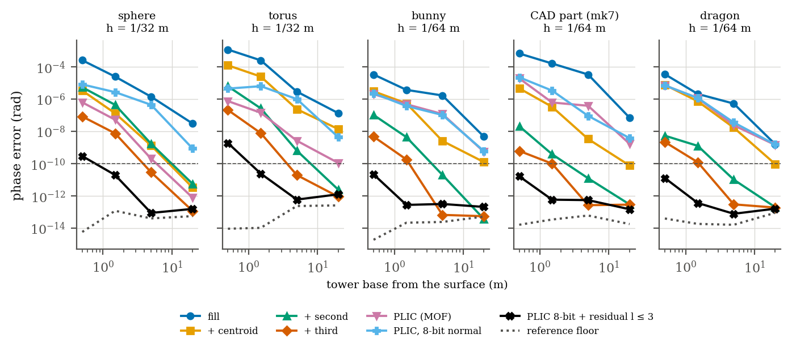
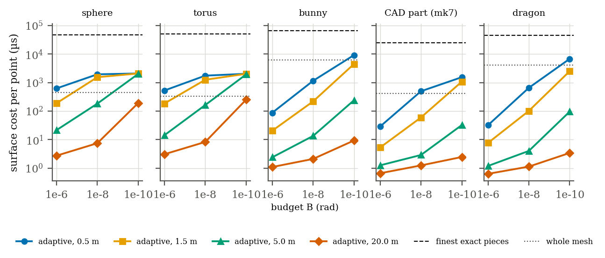

# The cheapest surface representation for the gravity read, at a given accuracy

Research note, 28 Nov 2026, for S5 (the world octree and its bounded walk) and later slices. The
owner's question: what is the cheapest way to represent a body's surface for the read at a given
accuracy, measured in accuracy, FLOPs, memory, and CPU and GPU time? Everything below is measured
unless tagged otherwise. Scripts, data, bench code and figures:
[`surface-representation/`](surface-representation/). The pass criteria were committed before any
measurement ([`CRITERIA.md`](surface-representation/CRITERIA.md), commit `2dd5f86`).

Tags: **[M]** measured here (a script and its JSON); **[Mo]** modelled (measured parts × counts, e.g.
cost per point = Σ elements × their measured ns); **[D]** derived (argument, no run).

## Answer in brief

1. **The winning boundary leaf is new to this project: the PLIC piece plus the multipole of what it
   misses.** Store the cell's exact moments (fill, centroid, second, third: 80 B in f32) and an
   8-bit-per-component plane normal (2 B); rebuild the cube ∩ half-space piece from them (its offset
   comes from the fill) and add the multipole, through l = 3, of the exact piece minus the PLIC
   piece. On all five shapes at the finest pitch this is 10⁻¹¹–2×10⁻⁹ rad at 0.5 m and
   ≤ 4×10⁻¹¹ rad at 1.5 m, 30–270 times better than the third-moment leaf at 0.5 m and at the
   reference's floor (~10⁻¹³ rad) from 5 m; its order in h is 5–6 against 4–5 for the moments
   ([`data/ladder.md`](surface-representation/data/ladder.md)) [M]. It costs one PLIC piece
   (0.5–0.9 µs per point on the CPU; at most 10 vertices, 15 edges, 7 faces) plus 12–21 ns.
   Neither ingredient alone is good: PLIC alone is no better than fill + centroid on the scans and
   the CAD part (its centroid is off where a cell holds an edge or a corner) and on those three
   20–1,400× worse than + second moment; moments alone are poor within a few cells.
2. **Exact clipped pieces are the expensive rung and buy nothing past the near field.** Real pieces
   have a median of 28–56 triangles (90 %: 36–80; max 44–190; 16–30 welded vertices) [M], so
   2–18 µs per piece per point on the CPU; the PLIC + residual leaf reaches the floor from 1.5–5 m
   at a tenth of that.
3. **Refine the surface adaptively by measured error, not uniformly.** With each cell's error known
   at build time (the voxeliser has the exact piece), choosing per cell between moments, PLIC +
   residual, exact, or refining, meets 10⁻⁸ rad at 1.5 m for 60–1,550 µs of surface work per point
   and at 20 m for 1–8 µs, against 25–67 ms for uniform finest exact pieces. It beats reading the
   whole mesh by 7–40× at 1.5 m for the CAD part and the 50,000–70,000-triangle scans, but not for
   the 4,000–5,000-triangle sphere and torus within 1.5 m, where the whole mesh is 3.5–5× cheaper
   (§2) [Mo].
4. **In the walk, the a-priori bounds hold but are pessimistic.** Every accepted node's measured
   error was within its bound up to the rounding floor (a few elements at 1–2×10⁻¹⁴ rad exceed it
   by ≤ 2×), and the control (one order too many) breaks it [M]. But the measured total error
   comes out 3×10²–10⁵ below the budget, so the bound-driven walk with a mass-shared budget costs
   23–140× the measured-error tree within 5 m (§3). Tight radii (b from the contents' box, not the
   node's cube) cut the walk's cost up to 2.8×; a BVH another 1.4–2.4× at 5–20 m, and nothing near
   (§5).
5. **Free boxes with an l = 6 series win far and lose near.** Extending the box series to l = 4 and
   6 is cheap (43 and 80 flops, 6–22 ns; checked against 40 digits, C9). Read flat, free boxes are
   then 4–33× cheaper than octree blocks at 20 m, but elongated boxes (median aspect 7–34) still
   need their closed form near the body, where l ≤ 6 octree blocks are 2.4–8× cheaper; in a walk
   the far advantage mostly disappears (§§4–5). The series order matters more than the box shape:
   l ≤ 6 makes octree blocks 20–110× cheaper near the body than l ≤ 2.
6. **GPU: float-float works and is cheap; f32 is wrong.** On the GTX 1660 SUPER the soup-triangle
   kernel runs at 3–17 ns per triangle per point in float-float (error 10⁻¹² rad) and 5–6 ns in
   native f64 (SHADER_F64 is available; 123–138 GFLOP/s against 4.3–5.0 TFLOP/s in f32), against
   75–95 ns on one CPU core. Plain f32 is wrong by 10⁻² rad. **The driver removes Dekker's
   error-free transforms unless they are guarded** with a runtime 1.0 (measured: error term 0
   without, exact with), so a WGSL float-float library must carry that guard (§6) [M].

**Recommendation for S5** (details in §7): boundary leaves store exact moments to third order plus
an 8-bit octahedral normal; the read uses moments far, PLIC + residual near, exact pieces only
inside a measured bubble (≲ 0.5 m at 10⁻¹⁰ rad); refinement is by measured per-cell error at build
time; node radii are tight; the walk's budget split needs work before the bound-driven walk is
competitive with the measured-error tree.

## 0. Set-up

- **Read.** The AION-10 flight integral with a static source, exactly as
  [`paper-flight-phase/flight.py`](paper-flight-phase/flight.py) (which matches `cav` to 2×10⁻¹⁵ rad,
  that note's C1), at the engine's quadrature (Gauss order 6, panels ≤ 0.1 s): 102 nodes × 4 arm
  points = 408 potential evaluations per tower, phase = Σ cᵢ V/G(pᵢ)
  ([`common.py`](surface-representation/common.py) `tower_points`). Towers stand with their base 0.5,
  1.5, 5 and 20 m from the surface along (1, 0.2, −0.3) from the bounding-box centre (the shapes
  study's direction). ρ = 2700 kg/m³.
- **Shapes** (the shapes study's meshes, downloaded and hashed there, not committed): the
  5,120-triangle icosphere (radius 1 m), the 64 × 32 torus (R = 1, r = 0.4 m), the Stanford bunny
  (69,664 triangles), the mk7 CAD part (5,280) and the decimated dragon (49,138, the thin shape),
  the last three 1 m across.
- **Lattices.** Four nested pitches per shape, every finer lattice inside the coarsest
  (1/8–1/64 m for the 1 m bodies, 1/4–1/32 m for the sphere and torus), voxelised with exact pieces
  by `shapes_lib.voxelise` ([`prep.py`](surface-representation/prep.py)); 9,187–23,086 boundary cells
  at the finest.
- **Errors** are the sum over boundary cells of (representation − exact piece), so the interior
  cancels. The reference floor is the same sum taken with two different exact kernels (triangle
  soup and welded polyhedron): 2×10⁻¹⁵–2.5×10⁻¹³ rad.
- **CPU bench** [`bench/`](surface-representation/bench/) (Rust, outside the workspace, depends on
  `cav-core`): every representation of every cell read at every tower (`srbench contrib`), kernel
  times (`srbench time`, one thread, below-normal priority, the S5 builder's tests running alongside,
  so times are upper bounds) and **FLOPs counted by running each kernel once on a counting number
  type** (`real.rs`, `Ct`), not by hand.

**Checks** (criteria written first):
- **C1, the bench's kernel is Cavendish's** (`data/c1-check.json`): against `Faceted::potential`,
  3×10⁻¹⁵ on a cube and **1.06×10⁻¹³ on the 5,120-triangle icosphere, against a pre-written 10⁻¹³:
  failed narrowly**. Two summation orders over 5,120 triangles at 20 m differ by this much; the
  control (one vertex moved 1 µm) differs by 6×10⁻⁸. Not moved.
- **C2, the pieces partition the body** (`data/c2-partition.json`, CAD part, h = 1/32 m): pieces +
  interior cubes = whole mesh to 7×10⁻¹³ rad (pass). The control, one piece dropped, misses by
  2.7×10⁻⁸ rad: it fails the 10⁻¹⁰ test as it must, but the threshold I wrote for it (> 10⁻⁶ rad)
  was too high for the smallest piece.
- **C3, the PLIC piece is right**: on cells cut by a single flat face (250–10,386 per shape) PLIC
  with the mesh normal equals the exact piece to ≤ 4×10⁻¹⁴ rad per cell (pass); the control
  (normal turned 1 mrad) moves them by 3×10⁻⁹–4×10⁻⁶ rad on 14 of the 16 levels that have such
  cells, but by only 2×10⁻¹⁴–5×10⁻¹³ on three bunny and dragon levels whose flat cells are slivers
  (`data/ladder.json`, `c3_*`).
- **C4, monotone ladder at 20 m: fails on the sphere.** There + second moment (5×10⁻¹²) is worse than
  + centroid (3×10⁻¹²), the sphere anomaly the shapes study already recorded; elsewhere at 20 m the
  last rungs sit on the floor (≤ 3×10⁻¹³) and their order there is noise.

## 1. The representation ladder for a boundary cell

### 1.1 Accuracy [M]

Phase error (rad) of the boundary at the finest pitch (h = 1/64 m for the 1 m bodies, 1/32 m for the
2 m sphere and 2.8 m torus), towers at 0.5 / 1.5 / 5 / 20 m. Full tables with orders in h:
[`data/ladder.md`](surface-representation/data/ladder.md); figure
[`figures/ladder.png`](surface-representation/figures/ladder.png).

| boundary cell carries | sphere | torus | bunny | CAD part | dragon |
|---|---|---|---|---|---|
| 1. fill only (mass at the centre) | 3e-4 / 2e-5 / 1e-6 / 3e-8 | 1e-3 / 3e-4 / 3e-6 / 1e-7 | 3e-5 / 4e-6 / 2e-6 / 5e-9 | 7e-4 / 2e-4 / 3e-5 / 7e-8 | 3e-5 / 2e-6 / 5e-7 / 2e-9 |
| 2. + centroid | 3e-6 / 1e-7 / 1e-9 / 3e-12 | 1e-4 / 3e-5 / 2e-7 / 1e-8 | 3e-6 / 5e-7 / 3e-9 / 1e-10 | 5e-6 / 3e-7 / 3e-9 / 7e-11 | 8e-6 / 7e-7 / 2e-8 / 9e-11 |
| 3. + second moment | 5e-6 / 4e-7 / 2e-9 / 5e-12 | 6e-6 / 3e-7 / 6e-10 / 2e-12 | 1e-7 / 4e-9 / 2e-11 / floor | 2e-8 / 4e-10 / 1e-11 / floor | 5e-9 / 1e-9 / 1e-11 / floor |
| 3+. + third moment | 8e-8 / 7e-9 / 3e-11 / 1e-13 | 2e-7 / 8e-9 / 2e-11 / 9e-13 | 5e-9 / 2e-10 / floor / floor | 6e-10 / 1e-10 / floor / floor | 2e-9 / 1e-10 / floor / floor |
| 4. PLIC, MOF normal (f64) | 6e-7 / 5e-8 / 2e-10 / 8e-13 | 8e-7 / 1e-7 / 3e-9 / 1e-10 | 2e-6 / 5e-7 / 1e-7 / 5e-10 | 2e-5 / 6e-7 / 4e-7 / 2e-9 | 7e-6 / 1e-6 / 2e-8 / 1e-9 |
| 4. PLIC, normal 2 × 8 bit, offset from the fill | 8e-6 / 3e-6 / 4e-7 / 9e-10 | 4e-6 / 6e-6 / 1e-6 / 4e-9 | 2e-6 / 4e-7 / 1e-7 / 6e-10 | 2e-5 / 3e-6 / 9e-8 / 4e-9 | 7e-6 / 1e-6 / 4e-8 / 1e-9 |
| 4. PLIC, normal and offset stored, 8 bit each | 5e-4 / 2e-4 / 4e-5 / 3e-6 | 3e-5 / 1e-5 / 2e-5 / 2e-6 | 3e-2 / 4e-2 / 2e-2 / 2e-4 | 2e-3 / 4e-4 / 5e-5 / 4e-6 | 1e-2 / 2e-2 / 1e-2 / 2e-4 |
| 5. two planes (where the surface has two directions) | 3e-6 / 3e-7 / 4e-9 / 7e-11 | 7e-6 / 6e-7 / 2e-7 / 6e-11 | 5e-6 / 1e-7 / 2e-7 / 2e-10 | 6e-6 / 1e-6 / 3e-8 / 9e-10 | 1e-5 / 7e-7 / 9e-8 / 7e-10 |
| **4 + residual: PLIC (8-bit normal) + l ≤ 3 multipoles of P and Q, each about its centroid** | **3e-10 / 2e-11 / 9e-14 / 2e-13** | **2e-9 / 2e-11 / 6e-13 / 1e-12** | **2e-11 / 3e-13 / 3e-13 / 2e-13** | **2e-11 / 6e-13 / 5e-13 / 1e-13** | **1e-11 / 4e-13 / 8e-14 / 2e-13** |
| 6. exact clipped piece | reference | | | | |
| *reference floor* | 6e-15 / 1e-13 / 4e-14 / 5e-14 | 9e-15 / 1e-14 / 2e-13 / 3e-13 | 2e-15 / 2e-14 / 2e-14 / 5e-14 | 2e-14 / 3e-14 / 6e-14 / 2e-14 | 4e-14 / 2e-14 / 2e-14 / 9e-14 |
| *the boundary cells' own phase* | 26 / 6.2 / 2.2 / 0.15 | 28 / 5.6 / 2.6 / 0.17 | 5.2 / 1.4 / 0.19 / 0.014 | 3.3 / 0.80 / 0.11 / 0.008 | 3.7 / 0.96 / 0.13 / 0.010 |



What the table says:
- **The moment rungs behave as the skin note's §2.1 count says**, now under the real read: fill only
  is first to second order, + centroid third, + second moment fourth, + third moment fifth (fitted
  orders 4.5–5.0 at 0.5–5 m where above the floor). The third moment is worth its 40 bytes: 20–60×
  over the second at 0.5 m on four shapes, 2.5× on the dragon.
- **A plane alone (PLIC) is not a better leaf than moments.** It has the right mass but its
  centroid is off wherever the cell holds an edge, a corner or curvature (moment-of-fluid residual,
  90th percentile, 0.1–6 % of h at the finest pitch, up to 22 % at coarse ones), so its error is a
  dipole layer like fill-only's: it beats + centroid on the smooth sphere and torus, matches it on
  the scans and loses on the CAD part's edges and corners. The normal choice matters little for that:
  centroid-offset, mesh area-weighted and moment-of-fluid normals are within 10× of each other.
  This is the interface-reconstruction literature's experience too: a volume fraction and a normal
  fix the interface to first order; the centroid (moment of fluid) to second (Dyadechko &
  Shashkov 2008, not read: `papers-to-fetch.md`).
- **The residual is what makes PLIC worth having.** PLIC carries the near-field *shape* (the part
  that moments, being an expansion, get wrong within a few cells); the multipole of P − Q carries
  the far field to l = 3. The remaining error is the l ≥ 4 part of P − Q, whose absolute mass is
  |P Δ Q| ≪ |P|. Two ways of adding the residual were measured: about each piece's own centroid
  (`mof_fill8_residual`, the bold row) and as the multipole of P − Q about the cell centre
  (`mof_fill8_residual_common`, which has the a-priori bound the walk uses); the common-centre
  form is 0.45–7× the other at 0.5 m (ladder.md).
- **Quantisation: store the normal, not the offset.** With the offset re-derived from the fill
  (which the leaf stores anyway), the mass stays exact and an 8-bit-per-component octahedral
  normal costs at most 10× over f64 for PLIC alone and *nothing measurable* once the residual is
  added (it absorbs the normal's error into its moments). Storing the offset quantised breaks the
  mass: 8 bits each puts 2–34 % mass errors on the 90th-percentile cell and is 100–10⁵× worse; 16
  bits each 0.01–0.2 %; the 32-bit word (11 + 11 + 10 bits) is worse than 2 × 8 bits with the
  offset from the fill.
- **Two planes do not pay.** A second plane where the surface has two directions (2-means on the
  normals; 0–93 % of cells qualify: none on the sphere, most at coarse pitch and on the dragon) improves PLIC by ≤ 3×
  and sometimes not at all, and its residual version is within 2× of the one-plane residual. The
  convex/concave cases, the latter as cube minus a convex piece, are both handled; the gain is
  small because the residual already carries what the second plane would.

### 1.2 Cost [M]

Per cell per evaluation point, one CPU thread (bunny, finest pitch; the other shapes within ±40 %,
`data/time-*.json`). FLOPs are counted by the `Ct` type (add, mul, div, sqrt; transcendentals
separately). Stored bytes are the format proposed, f32 unless stated; kernel bytes are what the
prepared kernel reads.

| representation | ns per cell per point | add + mul + div + sqrt | atan2 / log1p | stored bytes | kernel bytes |
|---|---|---|---|---|---|
| fill only (point) | 3.4–5.6 | 12 | 0 / 0 | 4 (+ the cell's key) | 16 |
| + centroid (point at the centroid) | 3.4–5.6 | 12 | 0 / 0 | 16 | 16 |
| + second moment | 5.8–11 | 39 | 0 / 0 | 40 | 40 |
| + third moment | 12–21 | 98 | 0 / 0 | 80 | 80 |
| PLIC piece, prebuilt polyhedron | 490–850 | 738 | 5.9 / 11.7 | 2 (8-bit normal; offset from the fill) | 1,290 |
| PLIC rebuilt from its plane at every point | 6,000–8,800 | — | — | 2 | — |
| PLIC built once (per walk, shared by the tower's 408 points) | 7,400–9,300 once | — | — | — | — |
| two-plane piece | 620–1,200 | — | — | 4 | — |
| **PLIC + residual (l ≤ 3)** | **≈ 510–870** (PLIC + 2 multipoles) | ≈ 930 | 5.9 / 11.7 | **82** | ≈ 1,450 |
| exact piece as a triangle soup | 2,200–18,000 (mean 26–232 triangles per piece at levels 1 and 3, × 75–95 ns) | 4,636 (bunny, 51 triangles) | 51 / 153 | 36 per triangle | 200 per triangle |
| exact piece, welded (shared vertices and edges) | 2,700–30,000 | 3,939 | 51 / 76 | 12 V + 6 F | ≈ 7,800 |
| one soup triangle (C5: 75–107 ns expected) | 75–95 (**pass**) | 94 | 1 / 3 | 36 | 200 |

- **The PLIC piece's closed form.** Cube ∩ half-space has at most 10 vertices, 15 edges and 7 faces
  (measured maximum over all 75,949 finest cells: 10 and 7). It is read with Werner & Scheeres'
  face form over polygonal faces with shared vertices and edges: one sqrt per vertex, one log per
  edge, and **one atan2 per face**: a face's solid angle is 2 arg Π_t (D_t + i h 2A_t) over its fan
  triangles, because the half-angles sum to half the face's solid angle, which lies in (−π, π] off
  the face's plane (`kern.rs`, `Poly::u`) [D]; checked against the soup kernel on every piece
  (`exact_welded` against `exact`: the reference floor row). That brings the per-point cost to
  ~6 atan2 + 12 log1p + 8 sqrt, against 51 / 153 / 153 for a median bunny piece as soup.
- **Building it costs 7–9 µs** in this unoptimised Rust (allocating clipper), about 12–18 PLIC
  evaluations, so the plane is a storage format and the piece is built once per walk and shared
  by the tower's points (or by the GPU shader itself, §6). A case table over the 256 corner sign
  patterns would make the build cheaper; not done, since it is amortised.
- **Symmetry.** Six of the seven faces lie in the cell's walls: their normals are ±eₐ, so h_f is one
  coordinate and the wall edges' in-plane normals are axis vectors. Exploiting that saves
  arithmetic but not transcendentals, which dominate; not implemented.
- **The exact pieces are far from the textbook 7–14 triangles.** Median 28–56 soup triangles per
  piece at the finest pitch (90 %: 36–80, max 44–190); the clipper fans every cap segment, and the
  scans put tens of mesh triangles in each cell. Welding shares vertices (median 16–30) and edges
  (42–84) but my welded kernel was not faster (product-trick divisions on single-triangle faces).

## 2. Adaptive surface refinement

**Method** ([`tree.py`](surface-representation/tree.py) `adaptive`) [Mo: measured errors, measured
kernel times × counts]. The four nested lattices give each boundary cell at level k its eight
children at level k + 1. For a design tower and a budget B, each cell gets the share
B × (its surface area)/(the body's) and, bottom up, the cheapest of: fill, + centroid, + second,
+ third, PLIC + residual (8-bit normal, common centre), the exact piece, or refining (the children's
best plus their full cells as interior blocks at the measured l ≤ 6 series cost, 11–16 ns). A representation is acceptable when
its **measured** error at the design tower, against the exact piece, is within the cell's share:
the voxeliser has the exact piece, so the build can measure this for each tower it knows of. The
shares add up to B, so |total error| ≤ B by construction. Costs are surface work per point; the
interior (octree blocks) is common to every option and is §4's.

Key numbers ([`data/keys.md`](surface-representation/data/keys.md); every design in
[`data/tables.md`](surface-representation/data/tables.md); figure
[`figures/cost.png`](surface-representation/figures/cost.png)):

| shape (triangles) | whole mesh | finest exact pieces | adaptive, B = 10⁻⁸, tower at 0.5 / 1.5 / 5 / 20 m | adaptive, 10⁻¹⁰ at 1.5 m |
|---|---|---|---|---|
| sphere (5,120) | 447 µs | 46,700 µs | 1,960 / 1,550 / 183 / 7.5 | 2,100 |
| torus (4,096) | 337 | 50,900 | 1,760 / 1,260 / 163 / 8.3 | 2,040 |
| bunny (69,664) | 6,270 | 66,600 | 1,160 / 219 / 13.5 / 2.1 | 4,490 |
| CAD part (5,280) | 421 | 24,800 | 499 / 60 / 2.9 / 1.2 | 1,080 |
| dragon (49,138) | 4,080 | 45,800 | 658 / 102 / 4.0 / 1.1 | 2,530 |



- **C7 passes.** At its design tower every design's measured |error| is at most 0.18 B (all four
  towers, all three budgets, every shape). **The control fails as it must**: the design for 20 m at
  10⁻⁸ rad, read at 0.5 m, is wrong by 4×10⁻⁵–10⁻³ rad. That is the per-tower bubble: a tree built
  for one tower is not valid for a nearer one.
- **The bubble.** Moving the tower from 0.5 m to 20 m cuts the surface cost 200–600×: at 20 m the
  coarsest cells (h = 1/8–1/4 m) with moments suffice everywhere; at 5 m moments at the middle
  levels, with up to a few hundred PLIC + residual leaves on the smooth shapes; at 0.5–1.5 m the near side needs PLIC + residual at
  the finest levels and some exact pieces.
- **Against uniform finest exact pieces**, adaptive refinement is 20–30,000× cheaper at the same or
  better error.
- **Against the whole mesh** it depends on the mesh. For the 50,000–70,000-triangle scans it wins
  at every tower (bunny: 5× at 0.5 m, 29× at 1.5 m, 3,000× at 20 m; dragon 6×, 40×, 3,600×). For the 4,000–5,000-triangle
  sphere and torus the whole mesh is 3.5–5× *cheaper* within 1.5 m: their adaptive designs use a
  couple of hundred coarse exact pieces, each with many triangles. The CAD part (5,280 triangles) is 1.2× dearer than its whole mesh at 0.5 m and 7× cheaper at
  1.5 m.
- **Memory**: 5–560 KiB of surface data for the adaptive designs at 10⁻⁸ rad, against 3.8–8.8 MiB
  for the finest exact pieces (welded, f32) and 0.14–2.4 MiB for the whole mesh (`tables.md`).
- **What this is not.** The errors used to choose are measured against the exact piece at a known
  tower. An engine knows its towers (the array is fixed) but moving bodies change the distance, so a
  build would tabulate each cell's error against distance, or use the bounds of §3; the measured
  choice is the cheapest that is still correct, a lower limit on cost.

## 3. Representation chosen per node in the tree walk

**Method** (`tree.py` `walk`) [M for errors and bounds, Mo for costs]. The finest level's leaves
(boundary cells and the interior's octree blocks) sit in an implicit octree up to a single root;
every node carries its exact moments to third order (aggregated from the leaves' exact moments) and
a radius b. One walk per tower, shared by its 408 points (the s5 note's shared cut). Each node gets
the budget B × (its mass)/(the body's), so the accepted cut's budgets add up to B, and takes the
cheapest representation whose **a-priori bound** is within it, else is opened:
- an inner node: its multipole through p = 2 or 3; bound Σᵢ |cᵢ| ρ M (b/dᵢ)^(p+1)/(dᵢ − b), the
  potential form of Salmon & Warren's absolute MAC (§8), summed with the read's weights;
- a boundary cell: + second or + third moment (b from the piece's box), then PLIC + residual (bound
  with M = |P Δ Q|, which the build computes exactly, b = the cell's half-diagonal, p = 3), then
  the exact piece;
- an interior block: its series to l = 2, 4 or 6 (p = l + 1, since its odd terms vanish), then its
  closed form.

Results at B = 10⁻⁸ rad (all budgets and variants in `tables.md`; tight radii unless said):

| shape | tower | walk, octree | walk, BVH | adaptive (§2, measured errors) | \|error\|/B, walk |
|---|---|---|---|---|---|
| sphere | 0.5 / 1.5 / 5 / 20 m | 45,000 / 39,400 / 16,700 / 461 µs | — / — / — / 276 | 1,960 / 1,550 / 183 / 7.5 | ≤ 3×10⁻³ |
| torus | | 45,000 / 36,200 / 12,900 / 427 | — / — / — / 229 | 1,760 / 1,260 / 163 / 8.3 | ≤ 3×10⁻³ |
| bunny | | 55,100 / 19,000 / 349 / 17.6 | — / — / 249 / 8.6 | 1,160 / 219 / 13.5 / 2.1 | ≤ 2×10⁻³ |
| CAD part | | 17,200 / 8,210 / 86.9 / 2.8 | — / — / 62 / 1.2 | 499 / 60 / 2.9 / 1.2 | ≤ 2×10⁻³ |
| dragon | | 36,000 / 10,200 / 105 / 2.7 | — / — / 63 / 1.8 | 658 / 102 / 4.0 / 1.1 | ≤ 2×10⁻³ |

(— : the BVH's cost equals the octree's within 2 %.)

- **The bounds hold, to the rounding floor.** Every accepted node's measured error is within its
  bound, plus a rounding allowance (3×10⁻¹⁶ (d/size)² of the element's monopole read, plus 10⁻¹⁴
  rad), except 1–43 elements in some walks (sphere, torus, and free boxes at 20 m on the bunny and
  CAD part) that exceed it by at most 2.05×; every one checked has an error of 1–4×10⁻¹⁴ rad, at
  the floor (the torus's PLIC leaves at 5 m; the bunny's elongated free boxes at 20 m, whose closed
  form rounds worse, the precision note's A4).
  **C8 therefore fails as written at the floor and holds above it.** Totals are always within B.
  The control (every bound one order too optimistic) puts 427–690 nodes over their bounds by 1.3–5×
  on the CAD part, 261–453 by 1.2–2.8× on the bunny and 116–191 by 1.2–4.9× on the dragon, as it must, but only 12 nodes by 1.2× on the sphere and torus, where the accepted
  elements are mostly floor-level: there the control discriminates weakly.
- **The bounds are tight per element and loose in total.** Worst error/bound is 0.2–0.8 (Salmon &
  Warren measured a mean of 0.22 for theirs), but the walk's total error is 10⁻⁵–3×10⁻³ of B. The
  cells' errors have random signs and cancel (the skin note's §2.3 double-layer argument), while
  worst-case bounds add. Sharing B by mass makes it worse: a boundary cell's share is its tiny mass.
- **So a bound-driven walk costs 23–140× the measured-error tree within 5 m** (8–55 ms per point
  within 1.5 m), because it must take PLIC + residual or the exact piece for nearly every boundary
  cell; at 20 m it is 1–37× (1× on the CAD part, 4× on the bunny).
- **What follows for S5**: the walk's ledger is safe; its budget split is the problem, not its
  structure. Two measured-grounded remedies, not tried here: share B by bound (greedy, worst bound
  first, the s5 note's priority queue) rather than by mass, and add the per-cell errors in
  quadrature where their signs are independent (a statistical budget, which the owner would have
  to accept as a different kind of guarantee).

## 4. Free-size boxes with the l = 4 and 6 series

**The series** ([`series.py`](surface-representation/series.py)). For an axis-aligned box of mass M
and half-sides a, U = M[1/R + Σ_{l = 2, 4, 6} E_l(R̂)/R^(l+1)], where E_l is the box average of
|y|^l P_l(R̂·ŷ). Only even monomials survive the average, so E_l(n) = Σ_f β_f n^f with 3, 6 and 10
coefficients per box for l = 2, 4, 6, folded at build time from the box's moments a_i^(2k)/(2k + 1)
and a fixed table κ (sympy, `kappa.rs`) [D]. Reading it costs 9 + 11, 15 + 26 and 25 + 53 adds and
multiplies through l = 2, 4, 6, one sqrt and one division (counted), 4–8, 6–14 and 11–22 ns per
point, against 730–1,000 ns for the 12-triangle closed form [M]. A cube is the special case
β₂ = 0.

**C9 passes** (`data/series-check.json`): against Nagy's prism at 40 digits the error falls with
slope 4.0, 5.85–6.0 and 7.98–8.01 in s/R for l ≤ 2, 4, 6, on a cube, a 1:2:3 box and a 4:4:1 slab.

**Free boxes against octree blocks, the interior alone** [Mo] (`tree.py interior_switch`). The
finest interior as octree blocks (4,092–12,621) or as sweep boxes (144–1,824, median aspect ratio
7–34), each read by the cheapest series whose bound is within its volume share of B, else its
closed form. Surface cost per point (µs), B = 10⁻⁶ rad, series allowed to l = 2 / 4 / 6:

| shape | 0.5 m, octree | 0.5 m, free | 5 m, octree | 5 m, free | 20 m, octree | 20 m, free |
|---|---|---|---|---|---|---|
| sphere | 11,500 / 2,790 / 554 | 1,410 / 1,400 / 1,350 | 2,730 / 145 / 86 | 1,410 / 1,280 / 853 | 145 / 70 / 70 | 1,330 / 248 / 18 |
| torus | 11,500 / 2,210 / 445 | 1,650 / 1,650 / 1,540 | 2,680 / 108 / 85 | 1,650 / 1,420 / 511 | 137 / 72 / 72 | 1,530 / 248 / 19 |
| bunny | 4,860 / 266 / 84 | 1,070 / 871 / 682 | 65 / 48 / 48 | 751 / 302 / 14 | 48 / 48 / 48 | 261 / 9.4 / 9.4 |
| CAD part | 3,430 / 41 / 31 | 143 / 116 / 100 | 40 / 36 / 36 | 98 / 11 / 1.1 | 36 / 36 / 36 | 1.1 / 1.1 / 1.1 |
| dragon | 1,870 / 39 / 22 | 790 / 397 / 144 | 18 / 18 / 18 | 126 / 4.3 / 4.3 | 18 / 18 / 18 | 4.0 / 4.0 / 4.0 |

- **The series order is the big lever for both.** For octree blocks, l ≤ 6 instead of l ≤ 2 cuts the
  near cost 20–110× (0.5 m, 10⁻⁶ rad; the earlier study's quadrupole-only series forced the closed form on every block
  near the body). For free boxes l ≤ 6 matters most far away: 28–80× at 20 m on three shapes (the CAD part's 144 boxes are already far enough at l ≤ 2).
- **Free boxes now win far, still lose near.** At 20 m free boxes with l ≤ 6 are 4–33× cheaper than
  octree blocks; at 5 m, 3.4–33× on the bunny, CAD part and dragon, and 6–10× *dearer* on the sphere and
  torus; at 0.5 m they cost 2.4–8× more than l ≤ 6 octree blocks (their elongated boxes, median
  aspect 7–34, have half-diagonals comparable to the distance, so most take the 0.9 µs closed
  form). At 10⁻¹⁰ rad the octree wins at every distance on the sphere and torus (`tables.md`).
- **This is the interior read flat, with no tree.** In a walk, far octree blocks merge into their
  ancestors' multipoles, which takes away most of the free boxes' far advantage (§5: the BVH over
  free boxes is no cheaper than the octree's at 20 m except on the sphere).
- Elongated boxes also round worse in their closed form (the precision note's A4: 9×10⁻¹² at
  R/s = 10 for 1:1:256 against 2×10⁻¹⁴ for a cube); with aspect ≤ 78 here, not limiting.

## 5. BVH against the implicit octree

**Method** (`tree.py` `sah_bvh`, `build_octree`, `walk`) [M for visits and errors, Mo for cost]. Over
the same leaves (finest boundary cells and interior octree blocks, or the free boxes), three
hierarchies, each node carrying exact moments to third order:
- the **implicit octree** with b from the node's cube (the textbook "geometric" radius);
- the same octree with b from the box of its contents ("tight", Salmon & Warren's b_max idea);
- a **binned SAH BVH** (16 bins on the longest centroid axis, one leaf per element) with tight b.

The same error-bounded walk runs on each (§3). At B = 10⁻⁸ rad, cost per point (µs) and node visits:

| shape | tower | octree, geometric b | octree, tight b | BVH, tight b | BVH over free boxes | visits, octree / BVH |
|---|---|---|---|---|---|---|
| sphere | 20 m | 473 | 461 | 276 | 227 | 36,188 / 29,909 |
| torus | 20 m | 489 | 427 | 229 | 286 | 34,314 / 27,507 |
| bunny | 5 m | 354 | 349 | 249 | 381 | 25,688 / 25,209 |
| | 20 m | 19.4 | 17.6 | 8.6 | 18.1 | 1,269 / 829 |
| CAD part | 5 m | 198 | 86.9 | 62 | 61.9 | 6,069 / 6,759 |
| | 20 m | 7.9 | 2.8 | 1.2 | 3.7 | 204 / 109 |
| dragon | 5 m | 158 | 105 | 63 | 62 | 7,567 / 7,523 |
| | 20 m | 6.4 | 2.7 | 1.8 | 3.7 | 244 / 185 |

Within 1.5 m (and at 5 m on the sphere and torus) all four cost the same to 2 %: the walk opens
every node down to the boundary cells there, so the hierarchy does not matter (BVH visits are
1.6–1.7× the octree's, a binary tree having more inner nodes; visiting is not the cost).

- **Tight radii first.** The cube-based b costs up to 2.8× (CAD part at 5 and 20 m), because a
  surface node's contents rarely fill its cube; the radius is a per-node number the octree can
  store at no structural cost.
- **A BVH helps far away**: another 1.4–2.4× over the tight octree at 5–20 m. Its nodes are grouped by
  proximity rather than by a fixed grid, so their multipoles are accepted earlier. **Where it helps**:
  free boxes (which an octree cannot hold without splitting), moving bodies (a body-frame BVH is
  rigid with the body; refit is a bottom-up box pass), and non-axis-aligned pieces. **Where the
  octree wins**: implicit addressing (a node is a key, no pointers; S5's pyramid, edits by key,
  streaming by key), the shared tree with drawing, cheap edits (a BVH degrades under local edits and
  needs refits or rebuilds), and the near field, where neither saves anything.
- **The SAH build took 7.5 s in Python** for 13,844 elements (a native binned build is milliseconds:
  not measured here).

## 6. GPU kernels (indicative: the 1660 SUPER is correctness-only)

Code: [`bench/src/shaders.wgsl`](surface-representation/bench/src/shaders.wgsl) (each kernel written
once in "N" arithmetic, with a prelude per precision) and
[`bench/src/bin/gpu.rs`](surface-representation/bench/src/bin/gpu.rs): wgpu 30.0.2 on Vulkan (driver
NVIDIA 581.29), one thread per field point, every thread looping over the same elements, dispatches
capped at ~8 ms and waited for one at a time; times are the wall clock of the whole run less the
pauses, best of three. Data: `data/gpu-bracket-L2.json` (748 cells, 35,196 soup triangles) and
`data/gpu-bunny-L1.json` (836 cells, 175,936 triangles); 16,320 points for timing, the four towers'
1,632 points for accuracy against the CPU f64 kernels.

**SHADER_F64 is offered** by this adapter on Vulkan. Peak rates by an unrolled FMA loop: **f32
4.3–5.0 TFLOP/s, f64 123–138 GFLOP/s** (1/36) [M]. WebGPU has no f64, so the web build needs
float-float.

| kernel | precision | ns per element per point | max error of U, relative | worst phase error per tower (rad) |
|---|---|---|---|---|
| soup triangle (exact pieces) | f32 | 0.06–0.08 | 0.3–1.8 | 6×10⁻² |
| | float-float | 2.7–17 | 1–2×10⁻¹⁰ | 6×10⁻¹² |
| | f64 | 5.2–6.1 | 0.7–2.5×10⁻¹¹ | 1×10⁻¹² |
| PLIC piece built in the shader from (lo, h, n, α) | f32 | 20–21 | 0.1–1.0 | 3×10⁻² |
| | float-float | 150–230 | 1–2×10⁻¹⁰ | 2×10⁻¹¹ |
| | f64 | 72–103 | 0.3–2×10⁻¹¹ | 5×10⁻¹³ |
| moments (point + second + third) | f32 | 0.12–0.14 | 6–9×10⁻⁷ | 5×10⁻⁷ |
| | f32 terms, float-float offsets and sum | 0.28–0.42 | 2–4×10⁻⁸ | 9×10⁻⁸ |
| | float-float | 1.0 | 4×10⁻¹⁴ | 5×10⁻¹⁴ |
| | f64 | 2.2–2.5 | 4×10⁻¹⁵ | 1×10⁻¹⁴ |

For comparison, one CPU core in f64 (`srbench time`): soup triangle 75–95 ns, PLIC prebuilt
490–850 ns, moments 12–21 ns.

- **C6 passes**: float-float is within 2.4×10⁻¹⁰ relative of the CPU f64 kernel for polyhedra and
  PLIC pieces (criterion 10⁻⁹), f32 moments within 9×10⁻⁷ (criterion 10⁻⁶). The control, the f32
  polyhedron kernel, is wrong by 30–180 % per point: with body-frame coordinates in f32 and the
  GPU's own atan2 and log, the edge terms' cancellation leaves nothing. That is 100× worse than the
  precision note's numpy-f32 estimate (10⁻⁴ rad), as that note warned for WGSL's permitted errors.
- **The driver removes the error-free transforms.** The first float-float run was no better than
  f32 (moments 1.4×10⁻⁶ relative). A probe (`gpu probe`, `data/gpu-ff-probe.json`) shows why:
  two_sum(1, 2⁻³⁰) returned an error term of 0 instead of 2⁻³⁰, and Dekker's two_prod 0 instead of
  6×10⁻⁸. Passing each intermediate through a multiplication by a runtime 1.0 (from a uniform)
  restores both exactly. WGSL permits this reassociation (§15.7.5, the precision note's caution)
  and this driver does it. Every float-float routine in Cavendish's WGSL must be guarded this way,
  and the GPU tier needs this probe as a test.
- **Speed.** Float-float soup triangles run at 2.7–17 ns per triangle per point, 5–30× one CPU core;
  native f64 at 5–6 ns, so on this card f64 is as fast as float-float for the closed form (the
  transcendentals dominate, and both emulate them). In the CPU's counted operations (94 flops + 4
  transcendentals per triangle) that is 6–35 G triangle-operations per second [Mo]. Each workgroup
  reads every element once (200 B per triangle in float-float), about 1 GB/s from cache over a run:
  the kernels are compute-bound [Mo].
- **The in-shader PLIC kernel is slow** (150–230 ns in float-float, as much as 10–60 soup triangles)
  because its corner and polygon arrays are indexed local arrays, which spill to memory, and it
  computes each edge's log on both faces. It is a correctness kernel, not a tuned one; it reads a
  cell from 32 bytes (lo, h, n, α) against 200 B × 28–56 triangles for the exact piece.
- **Moments as f32 terms with float-float offsets and sum** cost 2–3× pure f32 and are good to
  ~10⁻⁸ relative: the precision note's rule (f32 is safe for contributions below ~10⁻³ rad),
  measured on hardware.

## 7. Recommendation

**For S5 (the world octree and its walk):**
1. **Boundary leaves store exact moments to third order** (fill, centroid, second, third: 80 B in
   f32 about the cell centre) **plus an 8-bit-per-component octahedral normal** (2 B). The fill
   fixes the PLIC offset, so the plane costs 2 B and the mass stays exact. Drop the sampled `count`.
   Reasons: the moments are the cheapest rung that is right beyond a few cells (§1.1), the plane
   adds the near-field shape for 2 B, and every rung can be validated against the exact piece the
   voxeliser already makes (the C3 control and the reference floor show the check works).
2. **The leaf kernel picks by distance**: moments (12–21 ns) where their bound allows, PLIC +
   residual (0.5–0.9 µs, built once per walk and shared by the tower's points) nearer, the exact
   piece only inside a small bubble. Measured, PLIC + residual alone keeps the whole boundary within
   2×10⁻⁹ rad at 0.5 m and 4×10⁻¹¹ rad at 1.5 m on these shapes, so the exact piece is needed only
   within ~0.5 m at 10⁻¹⁰ rad, or for a body with fewer triangles than its near leaves' cost (then
   read the whole mesh: sphere, torus, CAD part within 0.5–1.5 m).
3. **Node radii are tight** (b_max of the contents, one f32 per node): 1–2.8× cheaper walks for no
   structural change. Keep the implicit octree; a BVH buys 1.4–2.4× only at 5–20 m and costs the
   pyramid's addressing, edits and streaming.
4. **Interior blocks get the l ≤ 6 box series** (19 coefficients per block at build, 11–22 ns per
   point): 20–110× cheaper than l ≤ 2 near the body. Free boxes are not worth a second structure
   in S5.
5. **The walk's error ledger is sound but its budget split needs work** before it is competitive
   near the body: a mass-proportional split with worst-case bounds is 23–140× costlier than the
   measured-error tree within 5 m. Use the s5 note's priority queue (worst bound first) and measure
   the slice's walk against the measured-error tree of §2 as its oracle.
6. **Validation cases for the slice** (each has a known answer): the PLIC piece on a flat-cut cell
   equals the exact piece to 10⁻¹³ rad (control: a turned normal); PLIC + residual against the exact
   pieces on the five shapes at 0.5 and 1.5 m (`data/ladder.md`, to 2×); the walk's per-node
   error ≤ bound + rounding, with the one-order-too-many control; the box series against Nagy at 40
   digits (C9).

**For the GPU slices:** the closed form needs float-float or f64 throughout (f32 is wrong by
10⁻² rad); every float-float routine must be guarded against the driver's reassociation, with the
probe as a GPU-tier test; f64 is available natively on Vulkan here and was as fast as float-float,
but not on WebGPU. Moments can be f32 terms with float-float offsets and sums (10⁻⁸ relative).

## 8. Sources

Read for this note (the owner's library; not stored in the repo):
- **Salmon, J. K. & Warren, M. S. (1994).** "Skeletons from the treecode closet." *J. Comput. Phys.*
  111, 136–155. [doi:10.1006/jcph.1994.1050](https://doi.org/10.1006/jcph.1994.1050). Read pp.
  139–143: the worst-case analysis (§3.1, Figs. 4–5); the "Absolute MAC", which accepts a cell when
  an analytic bound on its partial error is below a user tolerance (eqs. 9–10, p. 142); and the
  measured ratio of error to bound (mean 0.22, rms 0.28; Fig. 7, p. 143). The walk here is that MAC
  for the potential: the Taylor remainder of 1/|x − y| after order p is at most
  M b^(p+1)/(d^(p+1)(d − b)), the potential's analogue of their eq. (9) with B₍ₙ₎ ≤ M bⁿ [D; their
  Appendix B was not re-read]. Measured worst error/bound here: 0.2–0.8.
- **Weymouth, G. D. & Yue, D. K.-P. (2010).** "Conservative Volume-of-Fluid method for free-surface
  simulations on Cartesian grids." *J. Comput. Phys.* 229, 2853–2865.
  [doi:10.1016/j.jcp.2009.12.018](https://doi.org/10.1016/j.jcp.2009.12.018). The PLIC form
  m·x = α (their eq. 8); "a set of analytic equations … which relate the intercept of a linear
  interface with the volume fraction once the normal is known" (their ref. [7], Scardovelli &
  Zaleski, p. 2854); and that the normal is the hard part (LVIRA/ELVIRA, their ref. [6]). Here the
  offset is solved numerically (safeguarded Newton on the clipped volume, `geom.rs plic_offset`),
  not by Scardovelli & Zaleski's closed form, which was not read.
- **Rathinam, A. & Dempster, A. G. (2019).** "Octree-based mascon model for small body gravity
  fields." *J. Guid. Control Dyn.*, Engineering Note.
  [doi:10.2514/1.G004008](https://doi.org/10.2514/1.G004008). A variable-depth octree refined at the
  occupied (surface) nodes to a set depth, mascons at the leaves, the outer nodes' densities scaled
  to keep the total mass (Sec. II). That is geometric refinement to a fixed depth; §2 refines by
  measured error at the tower, and carries moments, not point masses.
- **Joldes, Muller & Popescu (2017)**, read for the precision note: the double-word algorithms
  (two_sum, Dekker's split, the accurate addition) in the shaders.
- The notes this builds on: [`exact-skin-and-partial-fill.md`](exact-skin-and-partial-fill.md)
  (§§1.1, 2.1, 3.1–3.3), [`paper-boxes-and-precision.md`](paper-boxes-and-precision.md),
  [`paper-benchmarks.md`](paper-benchmarks.md), [`paper-flight-phase.md`](paper-flight-phase.md),
  [`s5-world-octree.md`](s5-world-octree.md) and [`fluids.md`](fluids.md).

Not read, added to `papers-to-fetch.md`: Scardovelli & Zaleski 2000 (the analytic cube ∩ half-space
volume), Dyadechko & Shashkov 2008 (moment of fluid), Pilliod & Puckett 2004 (LVIRA/ELVIRA), Wald
2007 (binned SAH) and MacDonald & Booth 1990 (the SAH). The BVH is built from the common description
of binned SAH (16 bins on the longest centroid axis, cost Σ area × count), not from Wald's text.

## 9. What I could not verify

- **The criteria, as they came out.** C1 failed narrowly (1.06×10⁻¹³ against 10⁻¹³, summation
  order); C2 passed, its control's written threshold was too high; C3 passed, its control weak on
  three sliver-only levels; C4 failed on the sphere (the known anomaly) and is floor-limited at
  20 m elsewhere; C5, C6, C7 and C9 passed; C8 failed as written at the rounding floor (≤ 2.05×, all
  at 1–4×10⁻¹⁴ rad) and its control discriminates weakly on the sphere and torus; C10 as C8. No
  threshold was moved.
- **Costs are models.** Every cost per point is counts × kernel times measured on one CPU thread
  while the S5 builder's tests ran, so absolute times are upper bounds (the same kernel varied by up
  to 2× between runs; `data/time-*.json` for L1 and L3). No real walk was timed; Python walks give
  visits, counts and errors, not wall time.
- **The adaptive tree chooses by measured error at four fixed towers.** For a moving body or a new
  tower it would need per-cell error tables against distance, or §3's bounds; neither was built.
- **One lattice placement** per shape (the shapes study's `GENERIC`); errors may move with
  placement, costs will not much.
- **The PLIC build is unoptimised** (7–9 µs); a case-table construction was not written. The GPU
  PLIC kernel spills its arrays; the times there are a poor upper bound for a tuned kernel.
- **GPU numbers are indicative** (the owner's ruling): one card, one driver, timed by wall clock;
  the float-float soup kernel ran at 2.7 and 17 ns per triangle in two sessions. The hardware atan2
  and log errors themselves were not measured separately, only their effect (f32 wrong by 10⁻²
  rad).
- **Sources not read**: Scardovelli & Zaleski 2000, Dyadechko & Shashkov 2008, Pilliod & Puckett
  2004, Wald 2007, MacDonald & Booth 1990 (`papers-to-fetch.md`); Salmon & Warren's Appendix B was
  not re-derived, only its eq. (9) used in potential form.
- **The sphere anomaly** (+ second moment no better than + centroid on the sphere) is still
  unexplained; the residual rung does not have it.

## 10. Further questions

1. Budget split for the bounded walk: worst-bound-first sharing (and, if the owner accepts it, a
   statistical sum) against the measured-error tree of §2 as the oracle. This decides S5's near-field
   cost.
2. Per-cell error against distance tables for the adaptive tree, so it serves moving bodies and any
   tower.
3. A case-table PLIC builder and a GPU PLIC kernel without local arrays; then whether the GPU should
   build pieces from 2-byte planes or read prebuilt pieces.
4. The PLIC + residual rung's order in h (5–6 here) on finer pitches with the compiled voxeliser
   (256–512 across).
5. Why the second moment does not help on the sphere (skin note §8), now that the residual rung
   does not show it.

## Reproduce

In [`surface-representation/`](surface-representation/), every process at below-normal priority
with at most four threads (`low.ps1`):

```
python prep.py                        # voxelise five shapes at four pitches (.work/, ~10 min)
python series.py gen                  # the box series' κ tables (bench/src/kappa.rs)
python series.py check                # C9
cd bench; cargo build --release       # stand-alone crate; builds srbench and gpu
powershell -File run_cpu.ps1 all      # C1, C2, contrib (every rep, cell, tower), time, boxes
python ladder.py                      # data/ladder.{json,md}
python tree.py run                    # parts 2-5: data/tree-<shape>.json (~15 min per shape)
python summary.py                     # data/tables.md
bench/target/release/gpu .work/bracket 2 data/gpu-bracket-L2.json   # ~2 min of GPU
bench/target/release/gpu probe        # the float-float probe
python figures.py                     # figures/*.{pdf,png}
```
