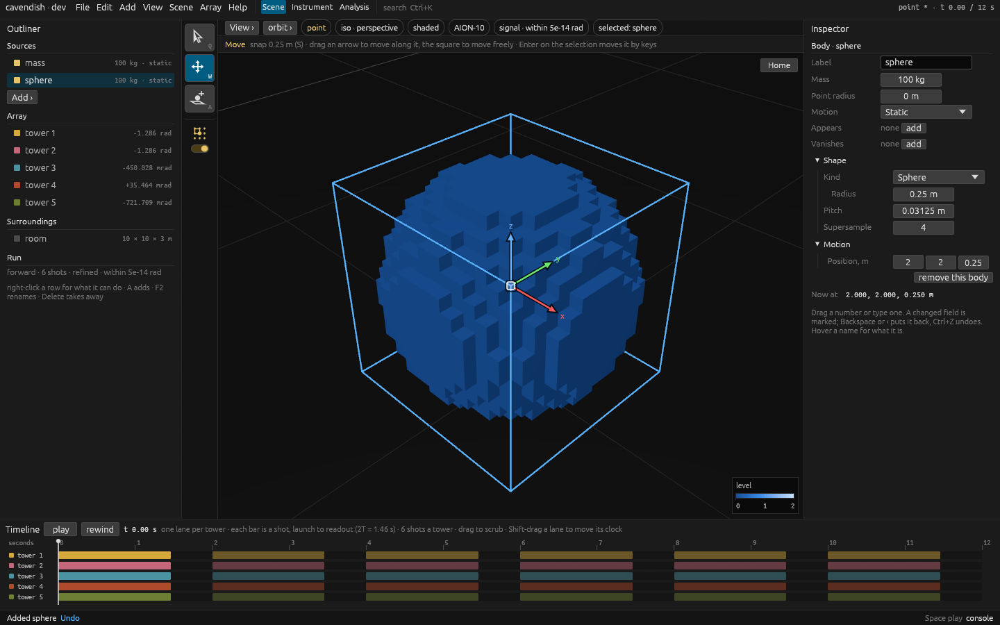
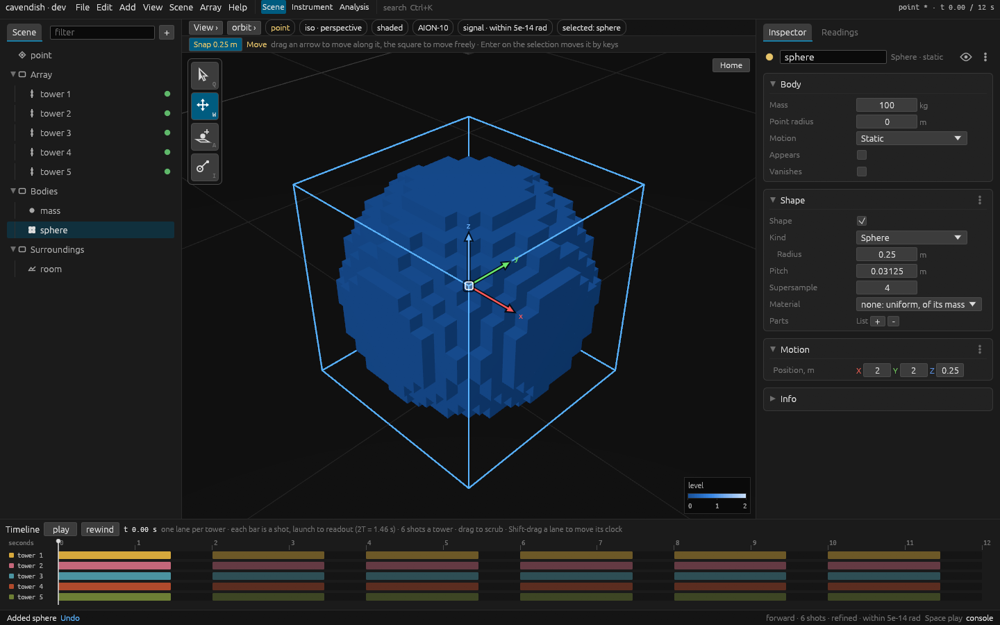
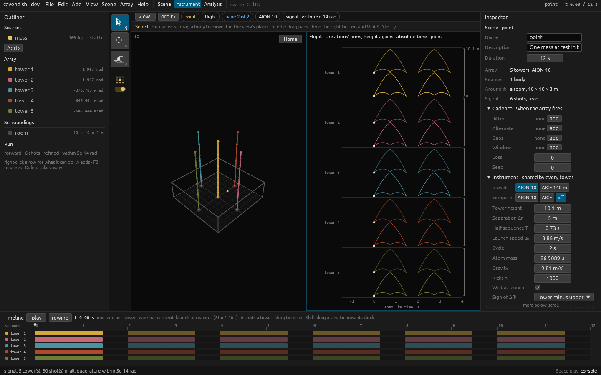
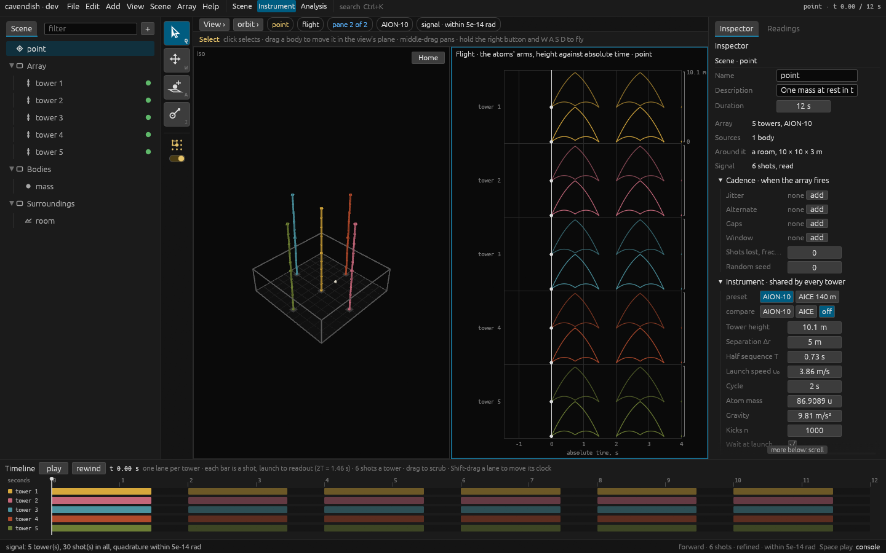

# S19 — The editor's second half: matter, meshes, the voxel tools and the numbers

Slice brief. Plan: `plan/REBUILD.md` §9 (row S19), §2 (principle 11, "everything is data"). Research:
`docs/research/editor-ux.md` ("the note": §3.5 the tools, §3.11 windows, §3.12 data and detail
tiers, §3.13 the camera), `docs/research/exact-skin-and-partial-fill.md` ("the skin note": §5, what
a cell crossed by two materials must carry). Requirement: `docs/design/keyboard.md` ("the spec").
Carried in: the third review of S18 (`docs/slices/S18-review-3.md`, nine minors). Tasks:
`plan/tasks.yaml`, TASK-S18-05 (materials), TASK-S18-06 (mesh import), TASK-S19-01 … 12, and the
new slice S20 for what moves on (§3).

No new research note: the notes answer the method questions. Where this brief settles something
they left open it says so in §2.

## 1. What the owner can newly do

- **Make bodies of real materials.** A material library as data (`scenes/materials.ron`: tungsten,
  lead, steel, copper, aluminium, granite, concrete, glass, oak, water, ice and others, each with
  density, colour, elastic and thermal properties and where the numbers come from). A voxel body
  is given a material in the inspector; its mass is then its density times its volume as
  voxelised, and the inspector says so. A scene can define its own materials beside the library's.
- **Build bodies of several materials.** A body's *parts*: further solids of other materials,
  added, painted or cut into it, in order. A cell two materials share keeps both masses (the skin
  note's rule: moments add), so nothing is lost at an interface.
- **Paint with a brush** (Paint tool, `B`): on a voxel body, click or drag to paint a material
  into it, add matter of a material, or erase; the brush's radius and material in the tool's
  options. A whole stroke is one undo.
- **Import a mesh.** Drop an OBJ or STL file on the window, or File › Import mesh…: say how big
  (a scale, or "fit to" a size typed with its unit), which material, how finely to voxelise, and
  where; one Enter adds the body, one undo takes it out. On the web a dropped file is kept by the
  page for the session.
- **Ask the scene questions in the view.** Probe (`I`): click a point and read the gravity there,
  the cell under the pointer (its body, material, mass) and that cell's share of each tower's
  phase, and the distance to each tower. Measure (`M`): click two points and read the distance
  between them and from each to each tower. Slice (`C`): a handle in the view moves the section
  plane through voxel bodies (replacing the slider rows).
- **Resize bodies** (Scale tool, `R`): handles on the selection scale its shape along an axis or
  uniformly, snapped; a typed factor in the keyboard's session (`R`, `2`, Enter).
- **Type numbers with units** everywhere a number is typed: `2 km`, `45 deg`, `3 g/cm^3`, `20 ms`,
  in the inspector's fields, the transform session and the console. A unit of the wrong kind is
  refused in words.
- **Choose how hard the simulation works.** Detail tiers as data (`scenes/tiers.ron`: preview,
  standard, reference) and the scene's own; the footer's `detail` switch and `detail <tier>` in
  the console; every bundle's manifest says the tier it was made at, with the tier's values.
  Each tier's error against the reference tier is measured and written in the tier file.
- **Keep good views.** Camera bookmarks saved in the scene (`view save <name>`, `view goto`,
  `,` and `.` to step through them, a list in the view's header).
- **Use the keys in a browser.** Every action whose key the browser keeps for itself (Ctrl+N,
  Ctrl+W, Ctrl+T, Ctrl+1–3 and others) has a second key on the web, shown on the `?` sheet and
  in the palette there.
- **Dock and float panels** (last; see §3): the scene tree, inspector and timeline as tabs in dock
  areas, dragged to dock elsewhere or to float as a window over the canvas (in the page as
  natively).

Every edit above is one `Command` through `Engine::apply`, so the console, `cav exec` and an agent
over MCP can do it too, and one undo takes it back.

## 2. Design in one page

**Materials are data, mass is moments.** The world of S4 already has materials (label, density,
colour). That `MaterialSpec` gains optional elastic and thermal properties (Young's modulus,
Poisson's ratio, thermal conductivity, specific heat, expansion) and is shared: the library
(`cav-sim/scenes/materials.ron`, embedded) and a scene's own `materials` list use it, the scene's
taking precedence by label. A voxel body's `shape` gains `material` (a label) and `parts` (solids
with an offset, a material and a mode: `Add`, `Paint`, `Erase`), applied in order. With no material
a body is exactly what it was (uniform, its `mass` spread over its samples; every existing scene and
reading unchanged to the bit). With a material, each sample point of the body has one material,
and a leaf's mass is `Σ_m n_m × ρ_m × v` (`n_m` its samples of material `m`, `v` the volume of a
sample point): the tree keeps one unit per material and, for a cell more than one material shares,
that sum in a side table (the skin note's §5: "store each boundary leaf's mass moments, not a fill
times one density … because moments add"; the palette index is for colour). The body's `mass`
field is then not used and the inspector shows the mass the materials give. This does not build
the skin note's exact piece moments (S5's TASK-S5-09): it lays the table that revision fills.
*Bound (after the review, minor 2):* a shared cell is read as one uniform cube of its summed
mass at the cell's centre, so its mass is right and its centre is not. Its dipole error about
the centre is at most |Δρ|·v·h/8 (the excess density over the lighter material filling half the
cell, its centroid h/4 off; v = h³), the same order as a partly filled cell's; to first order it
moves a phase by that times ∂ΔΦ/∂x of a kilogram at the cell. The validation case
`materials.shared_cells_are_within_their_dipole_bound` measures it on a body that attains it.
What any body weighs is one rule, `BodySpec::mass_in` (after the review, I1): its materials'
for a body of materials, else its `mass`; the bundle's `source_mass`, the inspector and the
console all use it.

**Paint is parts.** A brush stroke is one part: `Stroke { points, radius }`, the union of balls
along the pointer's path in the body's frame. The tool inserts the part as the drag begins and
sets its points as it goes (a run of `Set`s: one undo for the stroke, the engine's existing
coalescing). The tree is made again from the spec on every edit, so no edit can drift a mass:
undo gives back the same bits.

**Meshes are imported by a command.** `import <file> [fit <size> | scale <factor>] [material <m>]
[pitch 
] [at x y z]` adds a body with a `Mesh` shape. A dropped file natively is its path; in a
page its bytes go into the engine's file seam (`files::web`: a store of dropped files by name for
the session), which `Mesh::read` asks. A saved scene names the file; a page cannot read it back
after the session, and says so.

**Probe and measure are queries, not edits.** `probe x y z` answers the body and leaf there, the
field `g` (m/s²) from every body's leaves (each a uniform cube: the exact cube's field within 8
sides, a point's beyond, the leaf under the point included exactly; corrected after the review,
minor 14), and that leaf's share of each tower's phase now (one cube read through the
tower's flight, `TreeBody::single`). *After the review (I2, I3):* the cell is the finest cell at
the point (side = pitch), not the merged leaf; every voxel body is counted whatever the view's
budget kept; a slab floor is counted in closed form; a half-space floor and the world are named
as not counted. `measure` is the app's arithmetic on two floor or body
points. Neither enters the journal.

**Tiers are a numerics block.** `SceneSpec.numerics: Option<NumericsSpec>` (`tier`, the read's
phase tolerance, the voxel pitch factor, the world read's tolerance factor); `None` is standard,
which is today's numbers exactly. `detail <tier>` sets the block from `scenes/tiers.ron`; a hand
edit makes it `custom`. The read takes its tolerance and pitches from the block. The manifest
writes the block. Progressive refinement (preview while dragging) is in `plan/IDEAS.md`, not here.

**Docking** uses `egui_dock` (0.22, egui 0.37): tabs, drag-to-dock and floating windows in one crate
with three small dependencies; its floating windows are drawn inside the canvas, so "pop out" works
the same natively and on the web. `egui_tiles` (0.18) has tabs and drag-to-dock but no floating
windows. Real OS pop-out windows (egui viewports, native only) are S20's. The big scopes keep their
Tab order whatever the dock tree (the note §3.11).

## 3. Scope: what is in, in build order, and what moves to S20

Built in this order, each a branch, a PR and a working app:

| # | Task | What |
|---|---|---|
| 0 | TASK-S19-09 | the third review's minors 1–9 |
| 1 | TASK-S18-05 | materials: library, scene materials, a body's material and parts, mixed cells, colour by material, the inspector |
| 2 | TASK-S18-06 | mesh import: `import`, drop, the dialog, the web's dropped-file store |
| 3 | TASK-S19-04 | Probe, Measure, the Slice handle, Paint |
| 4 | TASK-S19-03 | Scale (the tool, the gizmo's handles, a typed factor); Rotate moves to S20 |
| 5 | TASK-S19-08 | units typed with values |
| 6 | TASK-S19-06 | detail tiers, measured |
| 7 | TASK-S19-10 | camera bookmarks (S18's C6) |
| 8 | TASK-S19-11 | the browser's reserved keys given alternatives on the web |
| 9 | TASK-S19-01 | docking with tabs and floating panels |
| 10 | TASK-S19-12 | the record: demo, validation report, ARCHITECTURE, recipes, PROGRESS |

**What was built, and what moved (the record, 25 Nov 2026).** Rows 0 to 3 were built (row 3 as
the Probe alone, TASK-S19-04; Measure, Slice and Paint are TASK-S19-20). Mid-slice the owner ruled
the side panels "awful" and a requirement came (`docs/design/panels.md`, TASK-S19-13): it was
built next, ahead of the remaining tools, as asked. A second ruling (phones and tablets, TASK-S19-14)
came after it. What was not reached moves to S20 under its id: rows 3's rest (TASK-S19-20), 4
(Scale, TASK-S19-03), 5 (units, TASK-S19-08), 6 (tiers, TASK-S19-06), 7 (bookmarks, TASK-S19-10),
8 (browser keys, TASK-S19-11) and 9 (docking, TASK-S19-01). Their requirements in §4 (T2–T5, U1–U2,
D1–D3, B1, K1, W1) stand, unmeasured, for S20's brief to take over.

**Moved to S20, "the editor's workspace"** (a new row in `plan/REBUILD.md` §9): pop-out OS windows
(TASK-S19-02); follow, pointer lock and the trackball (TASK-S19-05); multi-selection and grouped
edits (TASK-S19-07); **Rotate** (TASK-S20-01: bodies have no orientation, and turning a voxel body
turns its tree in the read, which belongs with S5's turned bodies and exact moments); a user
keymap file (TASK-S20-02). Why: each of these re-plumbs the selection, the camera or the window,
while the matter tools and the tiers are what the physics slices need next. If docking (row 9) is
not reached it moves too, under its id, and §7 says so.

## 4. Requirements and the tests that hold them

Each test has a control arm that fails when the property is broken. Tolerances were written here
before anything was measured.

| # | Requirement | Test(s) | Pass criterion |
|---|---|---|---|
| R1 | Minor 1: any primary press outside the tool options row ends a transform session, its move kept | `editor::s19::a_click_on_a_row_ends_a_transform_session_keeping_its_move` | Enter, →, click the other body's row, →: the first body is one step from its start, the second unmoved, one undo step. Control: no session: the same clicks move nothing |
| R2 | Minor 3: the mouse's fly does not end on the pointer leaving while the right button is held | `editor::s19::the_mouse_fly_outlives_the_pointer_leaving_while_held` | after `PointerGone` with the button held, still flying; after the release, not. Control: the release alone ends it |
| R3 | Minor 4: a Home that changes nothing does not end a run | `engine::tests::a_home_that_changes_nothing_keeps_the_run` | set, Home (at home), set: one step. Control: a Home that moves the camera: three |
| R4 | Minors 5, 6, 9: a sequential legend checked over a range; the history's first row named as drawn; Loss and Seed with hints | `cav-plot` `a_legend_is_made_from_what_is_drawn` (Level widened), `editor::s19::the_history_s_first_row_is_named_as_it_is_drawn`, `editor::s19::loss_and_seed_say_what_they_are` | the bar's segments ascend; the node's name equals the row's text; both fields have a hint. Controls: a flat range; the old name |
| M1 | The material library is valid data | `materials::tests::the_library_is_valid` | every entry parses, labels unique, density in (0, 1e5] kg/m³, a colour, a source. Control: a duplicate label fails with its line |
| M2 | A body of one material weighs its density times its voxelised volume | `materials::tests::a_body_of_one_material_weighs_density_times_volume` | a box whose faces lie on the cells: mass = ρ·a·b·c within 1e-12 relative. Control: the same box without a material weighs its `mass` |
| M3 | A two-material body reads as the sum of its parts (validation case `two_material_body_is_the_sum_of_its_parts`) | `cav-sim` `materials` tests | a steel box and a lead box sharing a face, as one body, against the two as separate uniform bodies of ρV each: each tower's ΔΦ within 1e-9 rad absolute and 1e-9 relative; masses within 1e-12 relative. Control: one material for both differs by more than 1e-3 relative |
| M4 | A cell two materials share keeps both masses | `voxel::tests::a_shared_cell_keeps_both_masses` | its mass = Σ n_m ρ_m v to 1e-15 relative. Control: the majority rule (all samples at the dominant density) differs |
| M5 | Mass is conserved to the bit through every material edit | `editor::s19::mass_is_kept_to_the_bit_through_material_edits` | paint, add, erase, then undo each: the body's tree mass equals the start's bits; painting a material over itself leaves the bits. Control: an add changes the mass |
| M6 | Colour by material | `voxel_view` `colour_by_material_uses_each_material_s_colour` | every drawn cube of a two-material body has its material's colour. Control: colour by level does not |
| I1 | `import` adds a mesh body: fit, scale, material, pitch, place; one undo | `cav-engine` `import_adds_a_mesh_body_in_one_step`; `editor::s19::a_dropped_file_adds_a_body` | fit 2 m gives a widest side of 2 m to 1e-12; one undo removes it. Control: a file that is not a mesh is refused in words and changes nothing |
| I2 | An imported mesh reads as the analytic solid (validation case `imported_box_mesh_is_the_cuboid`) | `cav-sim` `materials` tests | an STL box imported equals the `Cuboid` body of the same size and pitch: the same leaves bit for bit, each tower's ΔΦ bit for bit; its mass ρ·V within 1e-12 relative. Control: a box 1 % larger differs beyond the tolerance (see §7.3) |
| I3 | A page keeps a dropped file for the session | `cav-engine` `files::web` test (native, through the store) | `Mesh::read` of the dropped name gives the mesh; an unknown name is refused in words |
| T1 | Probe reads the field and the cell | `cav-engine` `probe_reads_the_field_and_the_cell`; `editor::s19::the_probe_tool_reads_where_it_is_clicked` | g at 2r from a voxel sphere within 1e-3 relative of GM/r²; the cell's share of tower 1's phase equals a one-leaf body's read bit for bit. Control: at 4r, a quarter |
| T2 | Measure gives the distance between two clicked points | `editor::s19::measure_gives_the_distance_between_two_clicks` | equal to the floor points' distance within 1e-9 m. Control: one click gives no distance |
| T3 | The Slice handle moves the section plane | `editor::s19::the_slice_handle_moves_the_section` | a drag along the normal moves the plane by the dragged distance within one pixel's worth; one journal line a drag. Control: a drag across the normal moves nothing |
| T4 | A paint stroke is one part and one undo | `editor::s19::a_paint_stroke_is_one_undo` | a drag of N frames inserts one part; one undo removes it; the painted cells take the material's colour. Control: Select's drag paints nothing |
| T5 | Scale: handles and a typed factor are one edit | `editor::s19::scale_by_handle_and_by_typing_are_one_edit` | a factor of 2 doubles the shape's sizes exactly; one undo. Control: a drag of nothing changes nothing |
| T6 | Every new tool is a tool of `tools.ron` with a key on the `?` sheet; tools change no scene | `tools::tests::the_tool_strip_is_valid` (extended); `editor::choosing_a_tool_changes_no_scene` (extended) | as S18's E5 for the new tools |
| U1 | Units are parsed and refused by kind | `cav-sim` `units::tests::*` | `2 km` = 2000 m, `45 deg` = π/4 rad, `3 g/cm^3` = 3000 kg/m³, exact to 1 ulp; `2 kg` in metres refused in words. Control: no unit takes the field's |
| U2 | Typed units work in fields, the session and the console | `editor::s19::units_typed_in_a_field_a_session_and_the_console` | the same three edits give the same spec. Control: a wrong kind leaves the spec |
| D1 | Tiers are valid data, standard is today's numbers | `tiers::tests::the_tiers_are_valid_and_standard_is_today` | every scene reads the same bits with no block and with `standard`. Control: preview differs |
| D2 | Each tier is within its stated bound of reference (measured once in §7, held after) | `cav-sim` `tiers` tests on `point`, `pass`, `sphere`, `world-box` | each tower's |ΔΦ_tier − ΔΦ_reference| ≤ the bound the tier file states. **Pass criteria written first:** preview ≤ 1e-3 × the signal's size, standard ≤ 1e-5 ×; the tier's values are then chosen to meet them, cheapest first |
| D3 | A bundle records its tier | `bundle` `the_manifest_records_the_tier` | the manifest's `numerics` equals the scene's block, `standard` when there is none. Control: another tier, another manifest |
| B1 | Bookmarks are scene data, recalled by command (S18's C6) | `cav-engine` `view_bookmarks_are_scene_edits`; `editor::s19::comma_and_full_stop_step_through_bookmarks` | save, move away, goto: the camera equals the saved one; save is one undo. Control: goto of an unknown name is refused |
| K1 | On the web no action is left on a key the browser keeps | `actions::tests::every_reserved_key_has_a_web_alternative` | for each action with a reserved chord, a web chord that is not reserved and does not clash. Control: an action without one fails |
| W1 | Docking keeps every big scope and the Tab order | `editor::s19::docking_keeps_the_tab_order` | after moving the inspector into the tree's dock and floating the timeline, Tab walks the seven scopes in order; the figure is not covered unless the user floats a panel over it. Control: the order by position differs |

The existing tests keep passing. A test whose expectation must change is listed in §7 with why.

## 5. Demo (`cargo xtask demo S19`)

*As built:* `panels-body.png`, `panels-scene.png`, `panels-tower.png`, `panels-readings.png` (the
redesigned panels), `materials.png` (a steel box with a lead ball added and a copper stroke painted,
coloured by material, its legend of swatches), `probe.png` (the Probe tool's card). The list below
was the plan; the pictures of what moved to S20 move with it.

Release build, headless, every run bounded by a wall-clock limit and stopped by its own handle;
scenes `point`, `world-box` and `town` only. Pictures (1440×900) to `docs/slices/S19/`:

1. `materials.png` — `point` with a steel box and a lead part, coloured by material, the
   inspector's material section open.
2. `paint.png` — a painted stroke on a voxel body, the Paint tool's options.
3. `import.png` — the Import mesh window over `point`; `import-done.png` the body placed.
4. `probe.png` — the Probe tool's card at a point beside a body.
5. `measure.png` — two points and the distance.
6. `slice.png` — the section handle through a body on `world-box`.
7. `scale.png` — the Scale tool's handles on a body.
8. `tiers.png` — the footer's detail switch and the numerics section; `tiers.txt` the measured
   table of §7.
9. `bookmarks.png` — the view's bookmark list on `town`.
10. `dock.png` — the inspector tabbed with the tree, the timeline floating.
11. `session.txt` — the console lines of §1 run through `cav exec`; `timings.txt` §6's numbers.

## 6. Performance budget

Recorded, not gated (the owner's ruling of 21 Nov 2026), release on the build PC: a probe ≤ 2 ms on
a body of 10⁵ leaves; a paint step (the body made again) ≤ 50 ms on the sphere starter; a unit
parsed ≤ 10 µs; preview reads `point`, `pass` and `world-box` at least 3× faster than standard;
`quick` stays under 30 s warm.

## 7. Results

### 7.1 The side panels redesigned (TASK-S19-13, `docs/design/panels.md`), before and after

The owner's ruling of 25 Nov 2026 ("the left and right side panels are awful") came in mid-slice
and was built ahead of the remaining tools. Before: S18's pictures; after: this slice's
(`cargo xtask demo S19`, release, each within 180 s).

| S18 (before) | S19 (after) |
|---|---|
|  |  |
|  |  |

- **The scene tree** is one tree: the scene, then Array, Bodies, Surroundings as groups that fold
  (kept per scene), a type icon a row, indent guides, no numbers; a status dot a tower (settled,
  of part of the world, computing, unsettled, silent); an eye (`hide`/`unhide`: a view's, the
  towers still read the body) and a lock (the view's pointer moves none of it) for bodies; `+`
  and a filter in its header. The forward stage's line went to the status bar; the help
  paragraph went.
- **Readings** is a tab beside the Inspector: each tower's ΔΦ, δφ₁, δφ₂ and state.
- **The tool strip** floats over the view's left edge; snap is in the tool's options row.
- **The inspector** is a header (icon, the name typed in place, what it is, an eye, a ⋮ menu:
  Duplicate, Delete, Reset all, Copy, Paste) and cards (Body, Shape, Motion; Scene, Array,
  Cadence, Instrument; Info), each with a ⋮ (Reset, Copy, Paste); one label column for every
  card, so every value starts at one x; X, Y, Z coloured before a position's boxes; the unit a
  muted word after the box; optional properties behind checkboxes; the preset and the comparison
  as drop-downs; what is worked out (now at, mass, volume, cells; a tower's reading) in Info.
- Tests (each with its control): `the_outliner_is_one_tree_of_named_rows`,
  `a_world_scene_s_towers_show_what_they_read` (now of the Readings tab and the dot),
  `the_tool_strip_floats_over_the_view_s_edge`, `every_value_in_the_inspector_starts_at_one_x`,
  `the_header_menu_holds_delete_and_duplicate`, `optional_properties_are_behind_checkboxes`,
  `text_reads_and_rows_are_big_enough`, `folding_a_card_leaves_the_tab_order`.

**Decided (worth a second look).** The panel titles are drawn as tabs, but the panels are not yet
docked: docking (TASK-S19-01) builds on them, and phones and tablets (the owner's ruling that came
after, TASK-S19-14) move to S20 with it. The label column is 40 % of the inspector's *first*
width (316 pt), not of the panel as dragged: egui widens a panel to what it holds, so a column
that followed the width pushed the panel wider every frame (measured: 264 → 333 pt over a few
frames). The secondary text colour of the window is #8c8c8c (4.7:1 on a card), lighter than the
figures' #6f6f6f (3.2:1), which stays for figures. The design's "+ Add effect" list on the
Cadence card is the checkboxes of its four effects.

**Changes to tests, with reasons.** The world-scene reading test reads the Readings tab (the tree
has no numbers); the keyboard-only task steps past the panel's tabs to the selection; the panel
list has no tool strip column; a control drag starts clear of the strip; snap is held to the
options row; the leave-every-editor tests click "elsewhere" beside the panel's tabs and past a
vector's axis letter; the instrument tick-box test's window is 1200 high (cards are taller); Delete
is clicked in the header's menu.

### 7.2 What was built (PRs)

| Task | PR | What |
|---|---|---|
| (brief) | #185 | this brief, the task split, the S19 and S20 rows |
| TASK-S19-09 | #186 | S18's third review, minors 1–9 |
| TASK-S18-05 | #187 | materials: the library, a body's material and parts, shared cells, colour by material |
| TASK-S18-06 | #188 | mesh import: `import`, the window, dropped files, meshes held in the scene |
| TASK-S19-04 | #190 | the Probe tool (Measure, Slice and Paint split off as TASK-S19-20) |
| TASK-S19-13 | #195 | the side panels redesigned (§7.1) |
| TASK-S19-12 | this | the record |

### 7.3 Requirements, as measured

- **R1–R4** (the minors): each test with its control; R1 and R3 checked to fail with the fix taken
  out. R2 replaces the second review's "the pointer gone ends the fly" with the window's focus lost.
- **M1** the library: 15 materials, valid, labels unique, each with a source. **M2** a box of one
  material weighs ρ·a·b·c within 1e-12 relative (`a_body_of_one_material_weighs_its_density_times_its_samples`).
- **M3** (case `materials.two_material_body_is_the_sum_of_its_parts`): **7.1e-15 rad** against the
  1e-9 written first; the masses within 1e-12; control (both steel) far off.
- **M4** a shared cell's mass Σ n_m ρ_m v to 1e-15 relative; control (the majority rule) differs.
  The walk equals the raster cell for cell, shared masses included, bit for bit.
- **M5** mass to the bit: paint, add, erase, each undone and redone, the same bits; steel painted
  over steel the same bits; control: each edit changed the mass. **M6** colour by material.
- **I1** `import` fit 2 m: 2 m to 1e-12, one step, replays without the file; refusals in words.
  Through the window: a dropped file adds a body, one undo. **I3** the dropped-file store (the
  engine's, not the files seam: a dropped file is the window's input, kept by the engine for the
  session).
- **I2** (case `materials.imported_box_mesh_is_the_cuboid`): the same leaves on the same grid and
  the phase **0** relative difference (bit for bit). The case's box is 1 × 0.5 × 0.25 m: an STL is
  single precision, and a side of 0.2 m read back as 0.2000000030 m took a fifth cell of the grid.
  Its control is "1 % larger", as first written, and it fails the case: another grid, and the
  phase 1.2e-7 relative off, far past the 1e-12 tolerance (each face moves less than the quarter
  cell to the nearest sample point, so the samples' count is the same, but the grid re-centres).
  (Corrected after the review, minor 3: the control was moved to 10 % against an arbitrary 1e-3
  threshold; "exceeds the tolerance" is the honest control.)
- **T1** the probe: g beside a voxel ball within 1e-3 of GM/d², a quarter at twice the distance;
  the cell's share bit for bit the Phase colouring's; through the window a click reads and edits
  nothing (control: Select).
- **T2–T5, U1–U2, D1–D3, B1, K1, W1**: moved to S20 with their tasks, unmeasured.

### 7.4 Numbers

- `quick`: 657 tests (628 at S18's end); 28–30 s warm on an idle machine, 80–150 s while the
  machine was loaded (other sessions building): over budget then, as S18 recorded.
- `gpu` 40 in 16 s (it found one fault, fixed: the floating tool strip faded in, so two unchanged frames were not the same picture); `oracle` 58 in 503 s; `web` green in 420 s (the page builds with the dropped-file seam; equivalence wasm against native held).
- Validation: **115 of 115** against `s18-the-editor` (113 there): two cases added
  (`materials.two_material_body_is_the_sum_of_its_parts`, `materials.imported_box_mesh_is_the_cuboid`),
  none dropped, no tolerance moved. The log's message cap went from 64 to 128 KiB (not a
  tolerance: the schema, the console's longest answer, passed 64 KiB with materials).

### 7.5 Changes to tests, with reasons

- `the_right_button_flies_and_holds_the_letters`: the pointer leaving no longer ends the fly (the
  third review's minor 3); the window's focus lost does.
- `the_console_shows_answers_…`: `pointer`, `tab`, `probe-at` and `import-mesh` take words.
- `every_documented_command_parses`: `import` reads a file dropped first; `hide`/`unhide` name a
  body of `point`; each is let go of after (the examples after want the room).
- `shape::tests::every_kind_voxelises_and_is_named`: the held mesh is a kind (`Triangles`).
- The panels' test changes are listed in §7.1.
