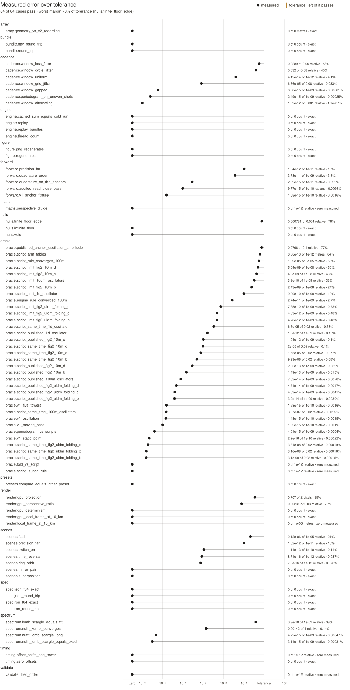
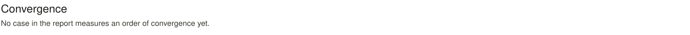

# Validation report

Written by `cargo xtask validate --report`; do not edit by hand. Every case is declared with
`cav_validate::case!` beside the code it checks, and all of them are listed here: one that did not run
is shown as **missing**, never left out.

**10 of 10 cases pass; worst margin: render.gpu_projection at 35% of its tolerance.**

<picture><source media="(prefers-color-scheme: dark)" srcset="error-vs-tolerance-dark.svg"></picture>

## array

| Case | Checked against | Measured | Tolerance | Unit | Of tolerance | Order | Result |
|---|---|---|---|---|---|---|---|
| `array.geometry_vs_v2_recording` (S0) | reference recording: tower positions and room of docs/viewer-mockup/replay.json (the v2 recording); largest difference | 0 | 0 | metres | 0% |  | pass |

## engine

| Case | Checked against | Measured | Tolerance | Unit | Of tolerance | Order | Result |
|---|---|---|---|---|---|---|---|
| `engine.replay` (S0) | exact self-consistency: a session replayed from its journal, and from its journal saved as JSON; replays whose state digest differs | 0 | 0 | count | 0% |  | pass |

## maths

| Case | Checked against | Measured | Tolerance | Unit | Of tolerance | Order | Result |
|---|---|---|---|---|---|---|---|
| `maths.perspective_divide` (S0) | closed form: a point ten times further away projects ten times nearer the axis | 0 | 1.000e-12 | relative | 0% |  | pass |

## render

| Case | Checked against | Measured | Tolerance | Unit | Of tolerance | Order | Result |
|---|---|---|---|---|---|---|---|
| `render.gpu_projection` (S0) | closed form: the f64 camera's projection of a point on each tower; distance to the nearest pixel of that tower's colour, worst over five towers and four views | 0.7071 | 2 | pixels | 35% |  | pass |
| `render.gpu_perspective_ratio` (S0) | closed form: the ratio of the on-screen heights of a near and a far tower, as the f64 camera predicts it | 0.0027 | 0.03 | relative | 9% |  | pass |
| `render.gpu_determinism` (S0) | exact self-consistency: the same frame drawn twice, and by a second renderer on the same device; bytes that differ | 0 | 0 | count | 0% |  | pass |
| `render.local_frame_at_10_km` (S0) | closed form: the same scene at the world origin: vertices relative to the view's target must not move | 0 | 1.000e-5 | metres | 0% |  | pass |

## spec

| Case | Checked against | Measured | Tolerance | Unit | Of tolerance | Order | Result |
|---|---|---|---|---|---|---|---|
| `spec.json_round_trip` (S0) | exact self-consistency: a spec of awkward numbers written to JSON and read back; numbers whose bits differ | 0 | 0 | count | 0% |  | pass |
| `spec.ron_round_trip` (S0) | exact self-consistency: a spec of awkward numbers written to RON and read back; numbers whose bits differ | 0 | 0 | count | 0% |  | pass |

## validate

| Case | Checked against | Measured | Tolerance | Unit | Of tolerance | Order | Result |
|---|---|---|---|---|---|---|---|
| `validate.fitted_order` (S0) | closed form: the slope of log(3h²) against log h is 2 | 0 | 1.000e-12 | relative | 0% |  | pass |

## Convergence

<picture><source media="(prefers-color-scheme: dark)" srcset="convergence-dark.svg"></picture>

## Over time

<picture><source media="(prefers-color-scheme: dark)" srcset="history-dark.svg"></picture>

The history is read from the earlier versions of `report.json` in git.
