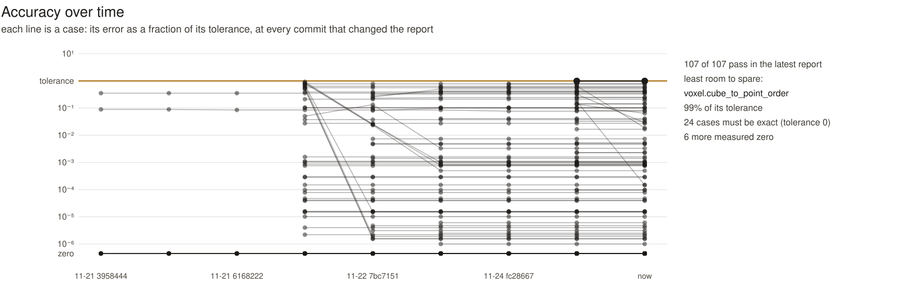

# Validation report

Written by `cargo xtask validate --report`; do not edit by hand. Every case is declared with
`cav_validate::case!` beside the code it checks, and all of them are listed here: one that did not run
is shown as **missing**, never left out.

**64 of 64 cases pass; worst margin: nulls.finite_floor_edge at 78% of its tolerance.**

<picture><source media="(prefers-color-scheme: dark)" srcset="error-vs-tolerance-dark.svg"></picture>

## array

| Case | Checked against | Measured | Tolerance | Unit | Of tolerance | Order | Result |
|---|---|---|---|---|---|---|---|
| `array.geometry_vs_v2_recording` (S0) | reference recording: tower x, y and base z, the room and 2T of docs/viewer-mockup/replay.json (the v2 recording); largest difference | 0 | 0 | metres | 0% |  | pass |

## engine

| Case | Checked against | Measured | Tolerance | Unit | Of tolerance | Order | Result |
|---|---|---|---|---|---|---|---|
| `engine.cached_sum_equals_cold_run` (S1) | exact self-consistency: superposition after a drag of one body and back, summed from kept contributions, against a cold run of the same scene; values of any channel that differ, to the bit | 0 | 0 | count | 0% |  | pass |
| `engine.replay` (S0) | exact self-consistency: a session replayed from its journal, and from its journal saved as JSON; replays whose state digest differs | 0 | 0 | count | 0% |  | pass |

## forward

| Case | Checked against | Measured | Tolerance | Unit | Of tolerance | Order | Result |
|---|---|---|---|---|---|---|---|
| `forward.precision_far` (S1) | exact self-consistency: the oscillation anchor and a tower 1.36 m from it, both moved by (10000.3, -7000.7, 300.1) m, read the same series as at the origin; largest difference as a fraction of the peak | 1.038e-12 | 1.000e-11 | relative | 10% |  | pass |
| `forward.quadrature_order` (S1) | closed form: Gauss-Legendre with 3 nodes a panel converges as h^6: the oscillation anchor's lower-interferometer phase at panels of T/2, T/4, T/8, T/16 against 12 nodes on T/64 (floor off, so the pieces are the two halves). The case is about the order; the 1e-9 on the finest step is a ceiling with no prediction behind it | 3.781e-11 | 1.000e-9 | relative | 4% | 6.15 (expected 6 ± 0.5) | pass |
| `forward.quadrature_on_the_anchors` (S1) | exact self-consistency: the engine's rule (Gauss, 6 nodes, 0.1 s panels) against 12 nodes on 0.025 s panels, on a static mass and the two published anchors; largest difference as a fraction of each series' peak | 2.893e-15 | 1.000e-11 | relative | 0% |  | pass |
| `forward.audited_read_close_pass` (S1) | exact self-consistency: 10 kg passing 0.5 m from a tower at 2.5 m/s, read until two successive rules agree to 1e-10 rad, against 12 nodes on 1.6 ms panels; largest error over 25 shots and both interferometers | 9.770e-15 | 1.000e-10 | radians | 0% |  | pass |
| `forward.v1_anchor_fixture` (S1) | v1 oracle: v1's outputs on the three anchors and on the oscillation read by the five towers, frozen in oracle/fixtures/v1 (the oracle tier checks them against v1 itself); engine set to v1's conventions; largest difference as a fraction of each series' peak | 1.575e-15 | 1.000e-10 | relative | 0% |  | pass |

## maths

| Case | Checked against | Measured | Tolerance | Unit | Of tolerance | Order | Result |
|---|---|---|---|---|---|---|---|
| `maths.perspective_divide` (S0) | closed form: the CPU matrix Mat4::perspective only, not the renderer: a point ten times further away projects ten times nearer the axis | 0 | 1.000e-12 | relative | 0% |  | pass |

## nulls

| Case | Checked against | Measured | Tolerance | Unit | Of tolerance | Order | Result |
|---|---|---|---|---|---|---|---|
| `nulls.finite_floor_edge` (S1) | closed form: a concrete disc 1 m thick under a tower on its axis, radius 400 m to 6.4 km: the gradiometer's reading as a fraction of what one interferometer reads from the infinite slab; it falls as 1/R, the edge's uniform gradient, towards the slab's zero | 7.812e-4 | 0.001 | relative | 78% | 1.00 (expected 1 ± 0.05) | pass |
| `nulls.infinite_floor` (S1) | closed form: an infinite uniform slab (and the half-space) gives uniform g: the forward model's reading of the slab at each of five towers at different heights, lower minus upper; values over five towers and six shots that are not exactly zero | 0 | 0 | count | 0% |  | pass |
| `nulls.void` (S1) | exact self-consistency: the void: the array and nothing else; values of any channel of any tower's any shot that are not exactly zero | 0 | 0 | count | 0% |  | pass |

## oracle

| Case | Checked against | Measured | Tolerance | Unit | Of tolerance | Order | Result |
|---|---|---|---|---|---|---|---|
| `oracle.script_arm_tables` (S1) | George's script: the four arm tables of 1D_oscillator, fig2_10m, 100m_oscillators and fig2_uldm_folding against the closed-form arms with the floor, at (j + 1)·dt; largest difference | 6.357e-13 | 1.000e-12 | metres | 64% |  | pass |
| `oracle.script_rule_converges_100m` (S1) | George's script: the scripts' trapezoid on the 100m_oscillators scene, offset gone, on the scripts' own window (which ends one step short of 2T), at steps of 0.01, 0.005, 0.0025, 0.00125 s (the first is the fixture's rule, held to it to 1e-9) against the engine's own model: both the missing step and the trapezoid shrink as the step does; largest difference as a fraction of the peak | 1.688e-5 | 3.000e-5 | relative | 56% | 1.99 (expected 2 ± 0.2) | pass |
| `oracle.script_limit_100m_oscillators` (S1) | George's script: 100m_oscillators: the scripts' trapezoid with the offset gone, on the whole flight, taken to its limit by two Richardson steps (dt, dt/2, dt/4), against the engine's own model; largest difference as a fraction of the peak | 3.298e-10 | 1.000e-9 | relative | 33% |  | pass |
| `oracle.script_limit_fig2_10m_c` (S1) | George's script: fig2_10m panel c (0.3275 Hz): the scripts' trapezoid with the offset gone, on the whole flight, taken to its limit by a step of dt/32, against the engine's own model; largest difference as a fraction of the peak | 1.407e-7 | 5.000e-7 | relative | 28% |  | pass |
| `oracle.script_limit_fig2_10m_d` (S1) | George's script: fig2_10m panel d (a circle at 0.35625 Hz): the scripts' trapezoid with the offset gone, on the whole flight, taken to its limit by a step of dt/32, against the engine's own model; largest difference as a fraction of the peak | 1.269e-7 | 5.000e-7 | relative | 25% |  | pass |
| `oracle.script_limit_fig2_10m_b` (S1) | George's script: fig2_10m panel b: the scripts' trapezoid with the offset gone, on the whole flight, taken to its limit by a step of dt/32, against the engine's own model; largest difference as a fraction of the peak | 1.150e-7 | 5.000e-7 | relative | 23% |  | pass |
| `oracle.script_same_time_1d_oscillator` (S1) | George's script: 1D_oscillator with only the one-step offset corrected: the engine minus the fixture against what the scripts' rule predicts (its limit minus the rule at the scripts' step and window), shot by shot; largest difference as a fraction of the largest predicted gap. Two-sided: it replaced a bound on the difference itself (acknowledged.txt) | 0.0027 | 0.02 | relative | 13% |  | pass |
| `oracle.script_limit_1d_oscillator` (S1) | George's script: 1D_oscillator: the scripts' trapezoid with the offset gone, on the whole flight, taken to its limit by a step of dt/32, against the engine's own model; largest difference as a fraction of the peak | 4.065e-8 | 5.000e-7 | relative | 8% |  | pass |
| `oracle.engine_rule_converged_100m` (S1) | exact self-consistency: the engine's audited read on the 100m_oscillators scene (a source 1 m from the atoms) against 12 nodes on 3 ms panels, 4000 shots; largest difference as a fraction of the peak | 2.742e-11 | 1.000e-9 | relative | 3% |  | pass |
| `oracle.script_same_time_fig2_10m_c` (S1) | George's script: fig2_10m panel c (0.3275 Hz) with only the one-step offset corrected: the engine minus the fixture against what the scripts' rule predicts (its limit minus the rule at the scripts' step and window), shot by shot; largest difference as a fraction of the largest predicted gap. Two-sided: it replaced a bound on the difference itself (acknowledged.txt) | 5.075e-4 | 0.02 | relative | 3% |  | pass |
| `oracle.script_same_time_fig2_10m_d` (S1) | George's script: fig2_10m panel d (a circle at 0.35625 Hz) with only the one-step offset corrected: the engine minus the fixture against what the scripts' rule predicts (its limit minus the rule at the scripts' step and window), shot by shot; largest difference as a fraction of the largest predicted gap. Two-sided: it replaced a bound on the difference itself (acknowledged.txt) | 5.029e-4 | 0.02 | relative | 3% |  | pass |
| `oracle.script_same_time_fig2_10m_b` (S1) | George's script: fig2_10m panel b with only the one-step offset corrected: the engine minus the fixture against what the scripts' rule predicts (its limit minus the rule at the scripts' step and window), shot by shot; largest difference as a fraction of the largest predicted gap. Two-sided: it replaced a bound on the difference itself (acknowledged.txt) | 4.694e-4 | 0.02 | relative | 2% |  | pass |
| `oracle.script_limit_fig2_uldm_folding_d` (S1) | George's script: fig2_uldm_folding panel d (a circle at 0.1425 Hz): the scripts' trapezoid with the offset gone, on the whole flight, taken to its limit by two Richardson steps (dt, dt/2, dt/4), against the engine's own model; largest difference as a fraction of the peak | 7.346e-12 | 1.000e-9 | relative | 1% |  | pass |
| `oracle.script_limit_fig2_uldm_folding_c` (S1) | George's script: fig2_uldm_folding panel c (0.131 Hz): the scripts' trapezoid with the offset gone, on the whole flight, taken to its limit by two Richardson steps (dt, dt/2, dt/4), against the engine's own model; largest difference as a fraction of the peak | 4.827e-12 | 1.000e-9 | relative | 0% |  | pass |
| `oracle.script_limit_fig2_uldm_folding_b` (S1) | George's script: fig2_uldm_folding panel b: the scripts' trapezoid with the offset gone, on the whole flight, taken to its limit by two Richardson steps (dt, dt/2, dt/4), against the engine's own model; largest difference as a fraction of the peak | 4.781e-12 | 1.000e-9 | relative | 0% |  | pass |
| `oracle.script_published_1d_oscillator` (S1) | George's script: 1D_oscillator as published (AION-10, 1 kg, D = 5 m, 0.1 Hz, 1000 shots), by the rule that copies its sampling; largest difference as a fraction of the peak | 1.599e-12 | 1.000e-9 | relative | 0% |  | pass |
| `oracle.script_published_fig2_10m_c` (S1) | George's script: fig2_10m panel c as published (AION-10, 0.3275 Hz, above Nyquist), by the rule that copies its sampling; largest difference as a fraction of the peak | 1.037e-12 | 1.000e-9 | relative | 0% |  | pass |
| `oracle.script_published_fig2_10m_d` (S1) | George's script: fig2_10m panel d as published (AION-10, a circle in the D-h plane at 0.35625 Hz), by the rule that copies its sampling; largest difference as a fraction of the peak | 2.918e-13 | 1.000e-9 | relative | 0% |  | pass |
| `oracle.script_published_fig2_10m_b` (S1) | George's script: fig2_10m panel b as published (AION-10, 0.05 Hz, 10000 shots), by the rule that copies its sampling; largest difference as a fraction of the peak | 1.494e-13 | 1.000e-9 | relative | 0% |  | pass |
| `oracle.script_published_100m_oscillators` (S1) | George's script: 100m_oscillators as published (AICE, 0.05 kg, D = 1 m, 0.08 Hz, 4000 shots), by the rule that copies its sampling; largest difference as a fraction of the peak | 7.818e-14 | 1.000e-9 | relative | 0% |  | pass |
| `oracle.script_published_fig2_uldm_folding_d` (S1) | George's script: fig2_uldm_folding panel d as published (AICE, a circle in the D-h plane at 0.1425 Hz), by the rule that copies its sampling; largest difference as a fraction of the peak | 4.713e-14 | 1.000e-9 | relative | 0% |  | pass |
| `oracle.script_published_fig2_uldm_folding_c` (S1) | George's script: fig2_uldm_folding panel c as published (AICE, 0.131 Hz, above Nyquist), by the rule that copies its sampling; largest difference as a fraction of the peak | 4.088e-14 | 1.000e-9 | relative | 0% |  | pass |
| `oracle.script_published_fig2_uldm_folding_b` (S1) | George's script: fig2_uldm_folding panel b as published (AICE, 0.02 Hz, 4000 shots), by the rule that copies its sampling; largest difference as a fraction of the peak | 3.896e-14 | 1.000e-9 | relative | 0% |  | pass |
| `oracle.v1_five_towers` (S1) | v1 oracle: v1's PropagationIntegral on the oscillation anchor read by each of the default array's five towers, engine set to v1's conventions; largest difference as a fraction of that tower's peak | 1.575e-15 | 1.000e-10 | relative | 0% |  | pass |
| `oracle.script_same_time_100m_oscillators` (S1) | George's script: 100m_oscillators with only the one-step offset corrected: the engine minus the fixture against what the scripts' rule predicts (its limit minus the rule at the scripts' step and window), shot by shot; largest difference as a fraction of the largest predicted gap. Two-sided: it replaced a bound on the difference itself (acknowledged.txt) | 3.075e-7 | 0.02 | relative | 0% |  | pass |
| `oracle.v1_oscillation` (S1) | v1 oracle: v1's PropagationIntegral on the published oscillation anchor (1 kg, D = 5 m, 0.1 Hz), 41 shots, engine set to v1's conventions; largest difference as a fraction of the peak | 1.476e-15 | 1.000e-10 | relative | 0% |  | pass |
| `oracle.v1_moving_pass` (S1) | v1 oracle: v1's PropagationIntegral on the published moving anchor (10 kg, D = 10 m, 2.5 m/s), 21 shots, engine set to v1's conventions; largest difference as a fraction of the peak | 1.016e-15 | 1.000e-10 | relative | 0% |  | pass |
| `oracle.periodogram_vs_scripts` (S1) | George's script: the engine's classical periodogram of each script's own series against the script's own spectrum: 1D_oscillator (no mean taken off, zero bin kept), and panels a to d of fig2_10m and fig2_uldm_folding, clean and with the script's noise; largest difference as a fraction of each spectrum's peak | 4.011e-15 | 1.000e-9 | relative | 0% |  | pass |
| `oracle.v1_static_point` (S1) | v1 oracle: v1's PropagationIntegral at v1-final on 100 kg at rest 2 m from the tower, engine set to v1's conventions; largest difference as a fraction of the peak | 2.200e-16 | 1.000e-10 | relative | 0% |  | pass |
| `oracle.script_same_time_fig2_uldm_folding_d` (S1) | George's script: fig2_uldm_folding panel d (a circle at 0.1425 Hz) with only the one-step offset corrected: the engine minus the fixture against what the scripts' rule predicts (its limit minus the rule at the scripts' step and window), shot by shot; largest difference as a fraction of the largest predicted gap. Two-sided: it replaced a bound on the difference itself (acknowledged.txt) | 3.815e-8 | 0.02 | relative | 0% |  | pass |
| `oracle.script_same_time_fig2_uldm_folding_c` (S1) | George's script: fig2_uldm_folding panel c (0.131 Hz) with only the one-step offset corrected: the engine minus the fixture against what the scripts' rule predicts (its limit minus the rule at the scripts' step and window), shot by shot; largest difference as a fraction of the largest predicted gap. Two-sided: it replaced a bound on the difference itself (acknowledged.txt) | 3.158e-8 | 0.02 | relative | 0% |  | pass |
| `oracle.script_same_time_fig2_uldm_folding_b` (S1) | George's script: fig2_uldm_folding panel b with only the one-step offset corrected: the engine minus the fixture against what the scripts' rule predicts (its limit minus the rule at the scripts' step and window), shot by shot; largest difference as a fraction of the largest predicted gap. Two-sided: it replaced a bound on the difference itself (acknowledged.txt) | 3.096e-8 | 0.02 | relative | 0% |  | pass |
| `oracle.fold_vs_script` (S1) | George's script: fold_frequency against fig2_folding_map.py's own, at 2001 frequencies from 0 to five times its Nyquist frequency of 0.1 Hz; largest difference | 0 | 1.000e-12 | relative | 0% |  | pass |

## render

| Case | Checked against | Measured | Tolerance | Unit | Of tolerance | Order | Result |
|---|---|---|---|---|---|---|---|
| `render.gpu_projection` (S0) | closed form: the f64 camera's projection of a point on each tower; distance to the centre of the nearest pixel of that tower's colour, worst over five towers and four views. The measure resolves no finer than half a pixel's diagonal, 0.71 px | 0.7071 | 2 | pixels | 35% |  | pass |
| `render.gpu_perspective_ratio` (S0) | closed form: the ratio of the on-screen heights of a near and a far tower, as the f64 camera predicts it | 0.0026 | 0.03 | relative | 9% |  | pass |
| `render.gpu_determinism` (S0) | exact self-consistency: the same frame drawn twice, and by a second renderer on the same device; bytes that differ | 0 | 0 | count | 0% |  | pass |
| `render.gpu_local_frame_at_10_km` (S0) | exact self-consistency: end to end on the GPU: the infinite-floor scene moved by (10000, -7000, 300) m, camera and all, against the same scene at the origin; bytes of the picture that differ | 0 | 0 | count | 0% |  | pass |
| `render.local_frame_at_10_km` (S0) | exact self-consistency: CPU geometry only: the vertices of the same scene built at the world origin, each relative to its own target | 0 | 1.000e-5 | metres | 0% |  | pass |

## scenes

| Case | Checked against | Measured | Tolerance | Unit | Of tolerance | Order | Result |
|---|---|---|---|---|---|---|---|
| `scenes.flash` (S1) | closed form: flash: a mass that exists for 1 ms reads, in the one shot in flight, the integrand at the middle of that millisecond times its length; largest difference over five towers as a fraction of that | 2.121e-6 | 1.000e-5 | relative | 21% |  | pass |
| `scenes.precision_far` (S1) | exact self-consistency: precision-far: the scene 10 km from the origin against the same scene at the origin, all five towers; largest difference as a fraction of each tower's peak | 1.024e-12 | 1.000e-11 | relative | 10% |  | pass |
| `scenes.switch_on` (S1) | exact self-consistency: switch-on: the shot in flight when the mass appears reads the always-there mass's integral from the switch to the readout (12 nodes on 2 ms panels); shots before read nothing, shots after read all of it; largest difference as a fraction of the full reading | 1.107e-13 | 1.000e-10 | relative | 0% |  | pass |
| `scenes.time_reversal` (S1) | closed form: time-reversal: with the launch that closes the arms at 2T (u0 = gT - v_kick/2), a pass played backwards reads the forward pass's series in reverse; largest difference over five towers as a fraction of the peak | 8.712e-16 | 1.000e-12 | relative | 0% |  | pass |
| `scenes.ring_orbit` (S1) | closed form: ring-orbit: a mass circling the centre tower at fixed radius and height reads the same every shot; largest departure from the mean as a fraction of it | 7.603e-16 | 1.000e-12 | relative | 0% |  | pass |
| `scenes.mirror_pair` (S1) | exact self-consistency: mirror-pair: towers 2 and 3 swap their readings of the two bodies, and towers 1, 4 and 5 read the same from each; values that differ, to the bit | 0 | 0 | count | 0% |  | pass |
| `scenes.superposition` (S1) | exact self-consistency: superposition: A alone, B alone, A + B; values of any channel, tower and shot where the reading of both is not the sum of the two, to the bit | 0 | 0 | count | 0% |  | pass |

## spec

| Case | Checked against | Measured | Tolerance | Unit | Of tolerance | Order | Result |
|---|---|---|---|---|---|---|---|
| `spec.json_round_trip` (S0) | exact self-consistency: a spec of awkward numbers written to JSON and read back; numbers whose bits differ | 0 | 0 | count | 0% |  | pass |
| `spec.ron_round_trip` (S0) | exact self-consistency: a spec of awkward numbers written to RON and read back; numbers whose bits differ | 0 | 0 | count | 0% |  | pass |

## spectrum

| Case | Checked against | Measured | Tolerance | Unit | Of tolerance | Order | Result |
|---|---|---|---|---|---|---|---|
| `spectrum.lomb_scargle_equals_fft` (S1) | closed form: on a uniform, gap-free grid Lomb-Scargle (Scargle's tau, mean taken off, times dt_eff) is the classical periodogram: 2000 shots of a comb, a tone and noise, every bin below Nyquist; largest relative difference | 3.900e-10 | 1.000e-9 | relative | 39% |  | pass |
| `spectrum.nufft_kernel_converges` (S1) | exact self-consistency: the NUFFT Lomb-Scargle's error against the exact sum at kernel widths 4, 6, 8, 10, 12, each as a fraction of its predicted ceiling 10^(2-w) of the peak (a decade a grid point, one decade in hand); the largest of the five | 0.0014 | 1 | relative | 0% |  | pass |
| `spectrum.nufft_lomb_scargle_long` (S1) | exact self-consistency: the NUFFT Lomb-Scargle on 100 000 jittered shots, 50 000 frequencies to 0.25 Hz, against the exact sum at 48 of them (the peak's bin, its neighbours, the rest spread evenly); largest difference as a fraction of the peak; the rounding floor is predicted near N*eps = 2e-11 | 4.717e-15 | 1.000e-9 | relative | 0% |  | pass |
| `spectrum.nufft_lomb_scargle_equals_exact` (S1) | exact self-consistency: the NUFFT Lomb-Scargle (two type-1 transforms, exponential-of-semicircle kernel 14 points wide, upsampling 2) against the exact N*M sum: 2000 shots at 2 s with up to 0.3 s of jitter, 1001 frequencies from 0 to 0.25 Hz; largest difference as a fraction of the peak | 3.111e-15 | 1.000e-9 | relative | 0% |  | pass |

## validate

| Case | Checked against | Measured | Tolerance | Unit | Of tolerance | Order | Result |
|---|---|---|---|---|---|---|---|
| `validate.fitted_order` (S0) | closed form: the report's own order fit, not the engine: the slope of log(3h²) against log h is 2 | 0 | 1.000e-12 | relative | 0% |  | pass |

## Convergence

<picture><source media="(prefers-color-scheme: dark)" srcset="convergence-dark.svg"></picture>

## Over time

<picture><source media="(prefers-color-scheme: dark)" srcset="history-dark.svg"></picture>

The history is read from the earlier versions of `report.json` in git.
